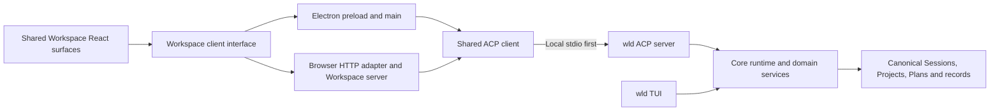

# Electron Workspace as an ACP Client

## Context and Constraints

The owner selected Electron for a desktop Workspace on Windows, macOS, and Linux. Hosted Workspace must remain a web
application, making reuse of the existing React components and design system a primary constraint. `wld` remains the
TUI and runtime. Desktop owns its application and UI; starting `wld workspace serve` and displaying its URL is only a
prototype, not the intended product architecture.

The first delivery is free local desktop work without a Workspace account. Later, the same application should connect
to a `wld` process on another network machine and optionally sign in to hosted Workspace for identity and cloud
features. Mobile applications are deferred. These are owner decisions; the process, packaging, and client details below
are proposed for review. This ADR does not claim implementation.

Workspace currently combines browser presentation, HTTP handlers, Session orchestration, and direct Core/store calls.
Changing only the window shell would preserve that coupling. The requested ACP boundary must cover the workbench's
reads and actions as well as chat, while preserving existing Core authority and external-client compatibility.

Product outcomes belong to [Workspace desktop requirements](../prd/runwield-workspace-prd.md#desktop-workspace) and
[first-party ACP access](../prd/runwield-acp-protocol-prd.md#workspace-client-access). Delivery belongs to the
[local desktop Epic](../plans/local-workspace-desktop.md).

## Decision and Rationale

### Shared application, separate runtime

Reuse Workspace's React surfaces, browser model, and semantic design tokens. Give them a typed client interface for
workbench queries, actions, subscriptions, and interactions. Electron supplies that interface through a narrow preload
bridge; the browser supplies it through its authenticated server adapter. Both hosts use the same ACP client mapping.
The interface represents a real process/network boundary, not a fake implementation introduced for tests.

Electron packages the local renderer and owns windows, native menus/dialogs, notifications, process supervision, and
desktop preferences. Its main process uses Electron's Node runtime. It does not import Bun-dependent Core execution
modules, construct `SessionRuntime`, acquire Session writer locks, or mutate Plan lifecycle files.

The bundled `wld` executable owns runtime execution and canonical storage through existing Core services. Project
registration and access grants are runtime-side facts; window state, drafts, and connection preferences can remain
client-side. Client caches are projections. Storage format and Session authority remain as defined by
[ADR-014](014-file-authoritative-session-bundles.md) and
[ADR-016](016-project-runtime-state-under-wld-internal.md). This client change must use the current Plan-store boundary
rather than freeze its storage location while separate Plan-store work proceeds.

Astro may remain the browser host. Move reusable interactive composition and data access out of server-only pages as
needed, so a locally packaged React renderer can display the same workbench. Do not fork a second desktop component
library or force a hosted-site framework migration to ship the desktop application.

### ACP and workbench access

Use supported standard ACP messages for initialization, Sessions, prompts, cancellation, configuration, and streamed
updates. Implement standard Session discovery where the negotiated baseline supports it instead of inventing a
RunWield-only list method. Preserve existing generic interactions and the negotiated `_session/steering` extension.

Expose remaining workbench capabilities through explicitly advertised, versioned ACP extensions: Project admission and
discovery, richer history/observation, Plan and artifact reads, revision-checked saves and workflow decisions, search,
usage, and relevant configuration. Group them by capability. Proposed names use `_dev.runwield/workspace/...` methods
and `dev.runwield/workspace` capability metadata; exact schemas belong to implementation planning. Do not publish
unimplemented methods or reinterpret a standard method to carry incompatible semantics.

Map extensions to existing Core owners. Move reusable domain orchestration out of `src/ui/workspace/server/` when the
ACP server needs it; never introduce a dependency from Core or ACP back into the Workspace UI. Preserve request
receipts, expected generations/revisions, access checks, and cancellation settlement at the authoritative owner.
Transport request IDs alone do not provide durable mutation deduplication.

RunWield ACP's pinned implementation, current ACP v1, and v2 draft semantics must be compared explicitly before pinning
the desktop contract. Where an extension fills an upcoming standard capability, use compatible concepts and retain a
small translation boundary. A draft does not justify advertising v2 conformance. Older external clients retain their
working behavior. Required desktop capability mismatches produce an actionable compatibility result before mutation.

Review content and decisions are structured data rendered with the shared review components. Large files and images
use bounded transfers/resource references tied to the selected runtime, not renderer-side arbitrary filesystem access.
Existing external ACP review links remain valid; desktop must not depend on a remote machine's loopback URL being
reachable from the user's browser. No general-purpose shell or filesystem RPC is added to solve UI gaps.

### Local process and distribution

Ship a compatible platform-specific `wld` executable with each desktop release and launch it over stdio. The initial
product does not depend on a globally installed CLI, Bun, Node, or a development server. Existing `wld` user settings,
provider setup, Projects, and saved Sessions remain usable. Bundling does not overwrite a user's shell installation.
An external executable override is not required for the first product; development can use an explicit source build.

One desktop instance per user supervises its local runtime connection, which can serve multiple Projects and Sessions.
All operations carry explicit Project and Session identity; neither process cwd nor the currently selected UI tab
authorizes an operation. The runtime remains the writer authority when a separate TUI or browser is also open.

Closing a window keeps running local work and the desktop supervisor alive. Reopening reattaches the renderer. Explicit
Quit with active work offers staying open or stopping and quitting; stopping waits for Core cancellation and durable
settlement before process disposal. An unexpected process exit leaves interrupted work recoverable from Core evidence.
Restarting the connection may reload observations, but never automatically resubmits an uncertain prompt, decision, or
publication action. An always-on service that survives application exit is a separate future capability.

Use Vite to build the desktop renderer/main/preload and retain Bun as repository orchestration. Packaging tooling must
bundle the matching executable and existing assets, follow the frozen-lock/no-lifecycle-script policy, and qualify the
three target operating systems. Choose and pin the packager during the packaging slice after checking native assets and
update behavior; the choice is not part of the runtime contract. Updates install application and bundled runtime as a
compatible set, after active work settles. Distribution must distinguish unsigned development artifacts from releases.

### Local work, network runtimes, and cloud identity

These are separate dimensions:

| Dimension             | Initial local application                 | Future capability                                        |
| --------------------- | ----------------------------------------- | -------------------------------------------------------- |
| Runtime connection    | Managed local `wld` over stdio            | Authenticated connection to another machine's `wld`      |
| Model-provider access | Existing Core credentials and model setup | Provider choices supported by that runtime               |
| Workspace identity    | No account required                       | Optional hosted Workspace account and cloud entitlements |

The existing `wld login` provider setup is not Workspace account sign-in. Local browsing and setup remain usable when a
provider is unavailable; model-dependent work explains its actual prerequisite. Free application use does not promise
free model inference.

A future remote connection supplies the same workbench contract. Runtime-scoped Project locators and stable Session
IDs prevent equal paths on different machines from aliasing. Remote paths remain remote; execution and file callbacks
must not silently target the desktop filesystem. Establish authenticated host trust and reconnect semantics before
shipping network access. ACP is a protocol, not authentication or a guaranteed standard network listener.

Attaching to an independently running remote runtime is distinct from `wld remote`'s connected-only SSH TUI with
laptop-owned personal data in [ADR-017](017-remote-ssh-local-personal-authority.md). Do not inherit its mounts, storage
placement, or disconnect policy implicitly. Future remote planning must choose and document its authority/lifetime
model. The local implementation provides a connection boundary, not speculative SSH, WebSocket, or relay backends.

Workspace sign-in will add identity and available cloud services to the installed application. It does not itself
authorize access to a runtime or upload local conversations, credentials, or repository contents. Logging out or losing
cloud connectivity preserves free local work. Login, cloud feature scope, cloud hosting, and entitlement policy require
their own subsequent Plan. The first local app has no nonfunctional cloud controls.

### Alternatives considered

- **Flutter clients:** evaluated for shared desktop/mobile code and avoiding Chromium overhead. Electron was selected
  because the required hosted Workspace can reuse the existing web UI. Flutter would require a UI rewrite, including
  Flutter web to achieve equivalent client sharing; mobile is now deferred.
- **Embedded `wld workspace serve`:** useful as a prototype but excluded by the owner's application-ownership
  constraint. It retains the server/runtime coupling and makes a remote runtime harder to substitute.
- **Core execution inside Electron:** excluded by the owner's ACP boundary and independent `wld` runtime. It also
  couples Electron's Node environment to Bun/runtime internals.
- **Forking HumanLayer/Cline infrastructure:** discussed as a possible reference, not selected. Reusing RunWield's UI
  avoids importing another product's domain model; inspect isolated infrastructure patterns only when needed.

## Implications

The main investment is separating Workspace's client and runtime responsibilities while preserving full workbench
behavior. Electron supplies distribution and integration, not new lifecycle authority. Browser and desktop share UI
improvements and ACP client semantics; protocol compatibility and process recovery become explicit obligations.

Chromium adds baseline memory and release-maintenance costs. Keep observation retention bounded, avoid a browser engine
per Session, and measure representative release builds with long conversations and diffs. Window, keyboard, clipboard,
accessibility, packaging, and process behavior still need verification on Windows, macOS, and Linux.

The renderer is sandboxed with context isolation and no Node integration. A narrow validated preload API exposes only
product operations; main validates callers and arguments. Packaged application content has a restricted origin/CSP;
untrusted links and generated content cannot navigate a privileged window or inherit its bridge. Remote-host and cloud
credentials belong outside renderer storage. These boundaries allow the shared web UI to remain browser-safe.

### References checked 2026-11-01

- [ACP v1 transports](https://agentclientprotocol.com/protocol/v1/transports): stdio is defined; custom transports must
  preserve protocol behavior. Remote transport remains separate work.
- [ACP extensions](https://agentclientprotocol.com/protocol/v1/extensibility) and
  [Session discovery](https://agentclientprotocol.com/protocol/v1/session-list).
- [ACP v2 migration draft](https://agentclientprotocol.com/protocol/v2/migration): a compatibility reference, not an
  implemented RunWield version claim.
- [Electron isolation](https://www.electronjs.org/docs/latest/tutorial/context-isolation) and
  [security guidance](https://www.electronjs.org/docs/latest/tutorial/security).
- [Electron Forge Vite plugin](https://www.electronforge.io/config/plugins/vite): currently marked experimental;
  independent Vite builds avoid making that plugin a requirement of this architecture.
