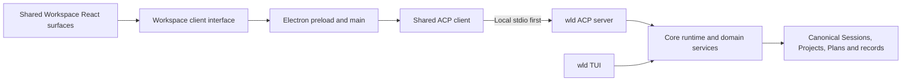

# Electron Workspace as an ACP Client

## Context and Constraints

The owner selected Electron for a desktop Workspace on Windows, macOS, and Linux. Hosted Workspace must remain a web
application, making reuse of the existing React components and design system a primary constraint. `wld` remains the
TUI and runtime. Desktop owns its application and UI; starting `wld workspace serve` and displaying its URL is only a
prototype, not the intended product architecture.

The first delivery is free local desktop work without a Workspace account. Later, the same application should connect
to a `wld` process on another network machine and optionally sign in to hosted Workspace for identity and cloud
features. Mobile applications are deferred. Approval of the
[first Session Plan](../plans/local-workspace-desktop/run-a-real-session-in-electron.md) accepts the separate-process
and semantic-client architecture below. The
[Project-entry Plan](../plans/local-workspace-desktop/open-projects-and-configure-providers.md) adds the explicit
Project-context boundary on the same connection. Acceptance records the decision, not delivery. Packaging tooling, remote
transport and trust, an always-on service, and hosted identity remain unresolved or separately planned.

The browser workbench combines presentation and HTTP adapters with Core/store access. Shared Session history and
continuation orchestration now live in Core; HTTP retains browser-specific behavior.
Changing only the window shell would preserve that coupling. The requested ACP boundary must cover the workbench's
reads and actions as well as chat, while preserving existing Core authority and external-client compatibility.

Product outcomes belong to [Workspace desktop requirements](../prd/runwield-workspace-prd.md#desktop-workspace) and
[first-party ACP access](../prd/runwield-acp-protocol-prd.md#workspace-client-access). Delivery belongs to the
[local desktop Epic](../plans/local-workspace-desktop.md).

## Decision and Rationale

### Shared application, separate runtime

Reuse Workspace's React surfaces and semantic design tokens through a typed semantic client interface. Shared UI serves
desktop now and future hosted SaaS. Electron supplies the interface through a narrow preload bridge and a persistent
ACP client. The interface represents a real process boundary, not a fake introduced for tests. Hosted SaaS transport,
authentication, and deployment are not selected here.

Do not migrate the old local browser workbench to ACP. It remains operational during this child; its retirement belongs
to the later cutover. Standalone question, review, and document hosts and the Plan share server survive that cutover.
This decision does not change Workspace's current public browser glossary.

Electron packages the local renderer and owns windows, native menus/dialogs, notifications, process supervision, and
desktop preferences. Its main process uses Electron's Node runtime. It does not import Bun-dependent Core execution
modules, construct `SessionRuntime`, acquire Session writer locks, or mutate Plan lifecycle files.

The `wld` runtime owns execution and canonical storage through existing Core services. Project
registration and access grants are runtime-side facts; window state, drafts, and connection preferences can remain
client-side. Client caches are projections. Storage format and Session authority remain as defined by
[ADR-014](014-file-authoritative-session-bundles.md) and
[ADR-016](016-project-runtime-state-under-wld-internal.md). This client change must use the current Plan-store boundary
rather than freeze its storage location while separate Plan-store work proceeds.

Keep reusable interactive composition separate from server-only pages. Do not fork a second desktop component library
or force a hosted-site framework migration. Future hosted SaaS reuses this UI; that does not require an ACP adapter
for the old browser workbench.

### ACP and workbench access

Use supported standard ACP messages for initialization, Sessions, prompts, cancellation, configuration, and streamed
updates. Implement standard Session discovery where the negotiated baseline supports it instead of inventing a
RunWield-only list method. Preserve existing generic interactions and the negotiated `_session/steering` extension.

Expose remaining workbench capabilities through explicitly advertised, versioned ACP extensions: Project admission and
discovery, richer history/observation, Plan and artifact reads, revision-checked saves and workflow decisions, search,
usage, and relevant configuration. Group them by capability. Proposed names use `_dev.runwield/workspace/...` methods
and `dev.runwield/workspace` capability metadata. Implemented
[Project schemas](../desktop-workbench-contract.md#workspace-project-protocol-version-1) and
[Session schemas](../desktop-workbench-contract.md#workspace-session-protocol-version-1) are in the engineering contract; future schemas belong
to their implementation planning. Do not publish
unimplemented methods or reinterpret a standard method to carry incompatible semantics.

Map extensions to existing Core owners. Move reusable domain orchestration out of `src/ui/workspace/server/` when the
ACP server needs it; never introduce a dependency from Core or ACP back into the Workspace UI. Preserve request
receipts, expected generations/revisions, access checks, and cancellation settlement at the authoritative owner.
Transport request IDs alone do not provide durable mutation deduplication.

The development Session client uses the persistent SDK 1.4.0 root client and ACP v1 over stdio. It implements
standard list/new/load/prompt/cancel/close/delete/configuration, steering, form elicitation, and negotiated version 1
Project and Session groups. Saved reads are provider-independent; negotiated load binds history without model
activation. Full-workbench parity remains separately planned. The
[engineering contract](../desktop-workbench-contract.md#protocol-baseline) compares that baseline with current v1 and
v2 drafts and assigns later capabilities to their owners. Where an extension fills an upcoming standard capability,
use compatible concepts and retain a small translation boundary. A draft does not justify advertising v2 conformance. Older external clients retain their
working behavior. Required desktop capability mismatches produce an actionable compatibility result before mutation.

Workspace negotiation fixes Project admission for the connection. Core issues a connection identity and validates
registration/root agreement and saved-Session membership before effects. Session bindings survive UI navigation;
missing metadata cannot bypass Workspace admission. Stop/close can settle owned work after access withdrawal.
Ordinary ACP clients keep their cwd-based behavior. Management by registration ID keeps missing-root settings usable.
Shared Project policy belongs to Core; retained standalone browser hosting belongs to `src/shared/browser-host/`, not
an executable path from ACP back through Workspace server modules.

Shared history naming, paging, and committed projection belong to `src/shared/session/session-history.ts`.
`session-continuation-service.ts` owns reusable Runtime construction, admission/receipt rules, configuration staging,
retained Sessions, operation listeners, background work, and cross-process routing. ACP and HTTP adapt those same
owners through the public Runtime interface in [ADR-010](010-session-runtime-sibling-adapters-and-acp.md).
HTTP keeps authorization, CSRF, URLs, notifications, and review presentation/launch behavior; it does not migrate to ACP.
Independent Project read contexts let navigation inspect other Projects without changing a bound execution context.
Unsent client queues remain client intent, not a second durable work authority. Bounded snapshots reconcile current
Core evidence without replaying effects. Oversized live deltas retain a bounded tail; canonical settled history owns
the full text. Semantic commands use Core's Workspace registry and existing configuration authority rather than model
prompts or renderer-owned command execution. Question defaults and choice descriptions cross the semantic interface
without authorizing an answer. Local recovery uses the supervisor boundary below; it does not select a remote
reconnect transport.

Review content and decisions are structured data rendered with the shared review components. Large files and images
use bounded transfers/resource references tied to the selected runtime, not renderer-side arbitrary filesystem access.
Existing external ACP review links remain valid; desktop must not depend on a remote machine's loopback URL being
reachable from the user's browser. No general-purpose shell or filesystem RPC is added to solve UI gaps.

### Local process and distribution

The current source-development launcher passes its explicit Bun executable and checkout `src/cli.ts acp` to main.
Main launches one subprocess without requiring a Project argument; no global CLI is selected. Native selection and
the optional development Project argument supply candidates, never admission authority. Builds use Vite for the renderer
and separate Node-target bundles for main and sandbox-compatible preload. This is not an installer or release.
The [engineering contract](../desktop-workbench-contract.md) holds setup commands and scoped evidence.

The source-development host uses the single-instance supervisor and local recovery decision below. Distribution is
separate: source execution does not establish installation or three-platform qualification.

Ship a compatible platform-specific `wld` executable with each desktop release and launch it over stdio. The initial
product does not depend on a globally installed CLI, Bun, Node, or a development server. Existing `wld` user settings,
provider setup, Projects, and saved Sessions remain usable. Bundling does not overwrite a user's shell installation.
An external executable override is not required for the first product; development can use an explicit source build.

One desktop instance per user supervises one local runtime connection and one window. Any number of Sessions can run
in parallel within or across Projects. Window selection is not Session ownership. Each binding retains its Project,
question, configuration, observation cursor, and queue; switching never requires Close or retargets another binding.
A second launch focuses or recreates the existing window instead of starting another runtime.
All operations carry explicit Project and Session identity; neither process cwd nor the currently selected UI tab
authorizes an operation. The runtime remains the writer authority when a separate TUI or browser is also open.

Closing a window keeps running local work and the desktop supervisor alive. Reopening reattaches the renderer. Explicit
Quit with active work offers staying open or stopping and quitting; stopping waits for Core cancellation and durable
settlement before process disposal. An unexpected process exit leaves interrupted work recoverable from Core evidence.
Renderer failure replaces only the view. Runtime Restart or main relaunch re-admits Projects and reloads Sessions from
Core history and receipt evidence. Reattachment refreshes snapshots and history before live updates. Generation checks,
event-eviction sequences, and a Core-owned commit boundary keep stale or already committed live output from duplicating
history. Recovery never automatically resubmits a prompt, answer, decision, or publication action.

Main owns a private, atomic, owner-only draft store for unsent text, image bytes, queues, and original request identities.
It is client intent, not a second transcript or execution authority. Persisted intent survives view and process changes;
forced termination can lose edits not yet written. Restored queues require deliberate Send. A read-only Core receipt
lookup distinguishes recorded acceptance, no receipt, and uncertainty without taking a prompt payload or starting work.
Unknown outcomes stay visible and cannot trigger a resend. Accepted or explicitly discarded intent is retired; corrupt
bytes are preserved with a notice. Main also owns private navigation and window preferences, which grant no access.

Negotiated close and connection drain await canonical Core settlement of this continuation owner's work, including
retained Background Tasks. They do not cancel another process's work that desktop only observes. Quit uses one shared
in-flight stop operation: flush private intent, block dispatch, await acknowledged drain, then dispose. Failed or
unsettled evidence keeps the app open for retry. The later updater must use this same boundary, not its own kill path.
An always-on service that survives application exit is a separate future capability.

Use Vite for the desktop renderer and separate esbuild bundles for Node main and sandbox preload. Retain Bun as
repository orchestration. Packaging tooling must
bundle the matching executable and existing assets, follow the frozen-lock/no-lifecycle-script policy, and qualify the
three target operating systems. Choose and pin the packager during the packaging slice after checking native assets and
update behavior; the choice is not part of the runtime contract. Updates install application and bundled runtime as a
compatible set, after active work settles. Distribution must distinguish unsigned development artifacts from releases.

### Local work, network runtimes, and cloud identity

These are separate dimensions:

| Dimension             | Initial local application                 | Future capability                                        |
| --------------------- | ----------------------------------------- | -------------------------------------------------------- |
| Runtime connection    | Managed local `wld` over stdio            | Authenticated connection to another machine's `wld`      |
| Model-provider access | Existing Core credentials and model setup | Provider choices supported by that runtime               |
| Workspace identity    | No account required                       | Optional hosted Workspace account and cloud entitlements |

The clean-install target includes in-app provider configuration without a separately installed CLI. The
[provider Settings child](../plans/local-workspace-desktop/configure-model-providers-in-desktop-settings.md) owns
that journey. The Project-entry source slice temporarily reuses external `wld login` setup and permits a restart;
it introduces no second credential store or authentication authority. This does not replace the distribution target.

The existing `wld login` provider setup is not Workspace account sign-in. Local browsing and setup remain usable when a
provider is unavailable; model-dependent work explains its actual prerequisite. Free application use does not promise
free model inference.

A future remote connection supplies the same workbench contract. Runtime-scoped Project locators and stable Session
IDs prevent equal paths on different machines from aliasing. Remote paths remain remote; execution and file callbacks
must not silently target the desktop filesystem. Establish authenticated host trust and reconnect semantics before
shipping network access. ACP is a protocol, not authentication or a guaranteed standard network listener.

Attaching to an independently running remote runtime is distinct from `wld remote`'s connected-only SSH TUI with
laptop-owned personal data in [ADR-017](017-remote-ssh-local-personal-authority.md). Do not inherit its mounts, storage
placement, or disconnect policy implicitly. Future remote planning must choose and document its authority/lifetime
model. The local implementation provides a connection boundary, not speculative SSH, WebSocket, or relay backends.

Workspace sign-in will add identity and available cloud services to the installed application. It does not itself
authorize access to a runtime or upload local conversations, credentials, or repository contents. Logging out or losing
cloud connectivity preserves free local work. Login, cloud feature scope, cloud hosting, and entitlement policy require
their own subsequent Plan. The first local app has no nonfunctional cloud controls.

### Alternatives considered

- **Flutter clients:** evaluated for shared desktop/mobile code and avoiding Chromium overhead. Electron was selected
  because the required hosted Workspace can reuse the existing web UI. Flutter would require a UI rewrite, including
  Flutter web to achieve equivalent client sharing; mobile is now deferred.
- **Embedded `wld workspace serve`:** useful as a prototype but excluded by the owner's application-ownership
  constraint. It retains the server/runtime coupling and makes a remote runtime harder to substitute.
- **Core execution inside Electron:** excluded by the owner's ACP boundary and independent `wld` runtime. It also
  couples Electron's Node environment to Bun/runtime internals.
- **Forking HumanLayer/Cline infrastructure:** discussed as a possible reference, not selected. Reusing RunWield's UI
  avoids importing another product's domain model; inspect isolated infrastructure patterns only when needed.

## Implications

The main investment is separating Workspace's client and runtime responsibilities while preserving full workbench
behavior. Electron supplies distribution and integration, not new lifecycle authority. Desktop and future hosted SaaS
share UI improvements; protocol compatibility and process recovery become explicit obligations.

Chromium adds baseline memory and release-maintenance costs. Keep observation retention bounded, avoid a browser engine
per Session, and measure representative release builds with long conversations and diffs. Window, keyboard, clipboard,
accessibility, packaging, and process behavior still need verification on Windows, macOS, and Linux.

The renderer is sandboxed with context isolation and no Node integration. A narrow validated preload API exposes only
product operations; main validates callers and arguments. Packaged application content has a restricted origin/CSP;
untrusted links and generated content cannot navigate a privileged window or inherit its bridge. Remote-host and cloud
credentials belong outside renderer storage. These boundaries allow the shared web UI to remain browser-safe.

### References checked 2026-11-01

- [ACP v1 transports](https://agentclientprotocol.com/protocol/v1/transports): stdio is defined; custom transports must
  preserve protocol behavior. Remote transport remains separate work.
- [ACP extensions](https://agentclientprotocol.com/protocol/v1/extensibility) and
  [Session discovery](https://agentclientprotocol.com/protocol/v1/session-list).
- [ACP v2 migration draft](https://agentclientprotocol.com/protocol/v2/migration): a compatibility reference, not an
  implemented RunWield version claim.
- [Electron isolation](https://www.electronjs.org/docs/latest/tutorial/context-isolation) and
  [security guidance](https://www.electronjs.org/docs/latest/tutorial/security).
- [Electron Forge Vite plugin](https://www.electronforge.io/config/plugins/vite): currently marked experimental;
  independent Vite builds avoid making that plugin a requirement of this architecture.
