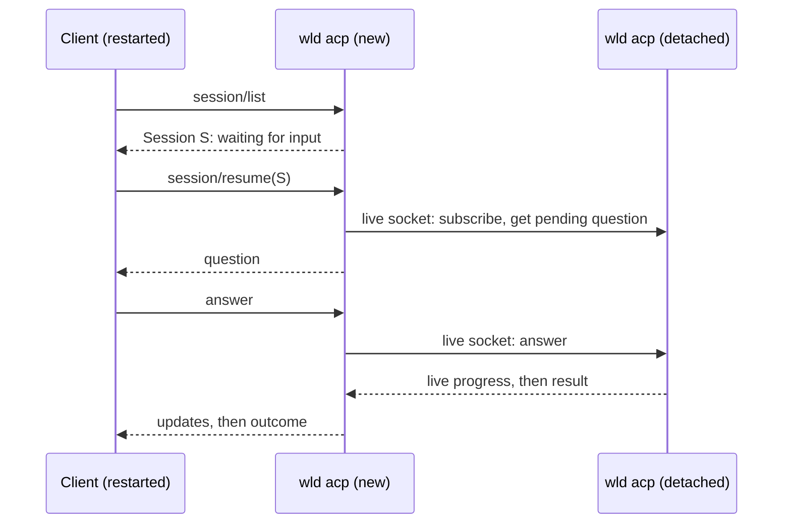

# Detachable ACP Sessions and a published ACP protocol package

## Context

RunWield Remote is a first-party Discord and Slack bridge in the separate `RunWield/remote` repository (Epic:
`docs/plans/remote-bootstrap.md` there). It needs two things RunWield does not offer yet. Desktop and Factory need the
same things.

1. **Work that survives a client restart.** Today, when an ACP client disconnects, `wld acp` cancels the active turn
   and exits. Restarting Remote during a Plan execution interrupts it.
2. **One shared, published contract.** Remote must not copy RunWield's types or build RunWield behavior that `wld` does
   not offer.

```text
today:   client exits → stdin closes → wld acp cancels the turn → exits
target:  client exits → stdin closes → wld acp finishes the operation → exits
         new client → new wld acp → session/resume → relays question, live progress, outcome
```

**PRD links.**
[ACP Session access](../prd/runwield-acp-protocol-prd.md#acp-session-access),
[Interrupted-work recovery](../prd/runwield-acp-protocol-prd.md#interrupted-work-recovery),
[Chat workflow access](../prd/runwield-acp-protocol-prd.md#chat-workflow-access), and
[Core execution, validation, and recovery](../prd/runwield-core-prd.md#execution-validation-and-recovery).

**Product decision changed.** The ACP PRD says "A RunWield-owned multi-channel gateway is deferred until a demonstrated
product need justifies it." On 2026-11-25 the owner decided to build it in `RunWield/remote`. OpenAB remains a supported
external ACP client.

## Objective

1. **Disconnect detaches.** Closing an ACP connection no longer cancels work. The running managed operation settles
   normally, and then the process exits. `session/cancel` and `session/close` still cancel. See
   [ADR-021](../adr/021-detachable-acp-operations.md).
2. **Clients can find work.** Standard `session/list` reports each Session's activity: idle, running in another process,
   or waiting for input.
3. **Clients can rejoin work.** Standard `session/resume` attaches a new connection. If another `wld acp` process is
   running the operation, the new process relays three things over that operation's live socket:
    - the pending question, and the client's answer back;
    - live progress from the moment of attachment;
    - the final result.
4. **One published contract.** `@runwield/acp-protocol` on public npmjs.com exports RunWield's ACP extension schemas,
   capability names, codecs, and a typed client wrapper. It imports nothing from Core.

**Out of scope, deliberately:**

- **Replaying progress produced while no client was attached.** Clients show that earlier progress was missed. The
  outcome is still delivered, and committed history stays available through `session/load`. Exactly-once replay needs
  Core event positions and an ordered event log across processes; add it when users need it.
- **Surviving death of the process running the work.** That needs durable checkpoints such as Pi Durable, which Factory
  plans to adopt first. Existing crash recovery from durable evidence still applies.
- **A daemon or long-lived runtime service.** The owner rejected it.

### Decisions

| Decision           | Choice                                                 | Option not taken                                                          |
| ------------------ | ------------------------------------------------------ | ------------------------------------------------------------------------- |
| Restart continuity | Detach, then resume through the live socket (ADR-021)  | Daemon or stdio proxy (rejected); custom socket transport; Pi Durable now |
| Missed progress    | Notice, not replay                                     | Exactly-once replay with event positions                                  |
| Registry           | Public npmjs.com                                       | GitHub Packages, which needs a token even for public installs             |
| Package versioning | By extension schema version                            | By `wld` version                                                          |
| Package boundary   | Client-safe part of code-reorg `packages/acp` (step 8) | A separate new package                                                    |

### The feature rule

Add to `AGENTS.md`: client-visible RunWield ACP behavior is defined here first, exported from `@runwield/acp-protocol`,
and advertised at `initialize`. Clients such as Remote, Desktop, and Factory use only what the package exports and the
server advertises. A change to an exported schema bumps the package version in the same change.

## Vertical Slice Findings

### Disconnect cancels work today

```text
runAcpCommand (src/cmd/acp/index.ts)
  startRunWieldAcpServer (src/acp/server.ts)
    createSessionRuntime({ ownerProcessKind: "acp" })
    connection.closed → closeMachinery
      operations.*.cancel() / stop()
      closeAllMappedSessions → closeMappedSession
        runtime.closeSessionWhenIdle        # cancels the turn, waits to settle
  process exits
```

- Plan execution and Workflow Validation run inside the same managed operation and process.
- `session/list` and `session/resume` are registered through `registerUnimplementedRequest`.

### What already exists

- **Operation-scoped writer lock.** `acquireSessionActivation` (`file-session-control.ts`) holds the lock only during a
  managed operation. A second process can `session/load` while the first works. Its prompt waits as
  `managed_operation_in_progress` and is delivered when the lock frees (`deliverWhenAvailable`).
- **Cross-process control.** `openLiveSessionConnection` (`src/shared/session/live-session-connection.ts`) opens a
  private local socket for each managed operation. It offers buffered events, the pending interaction, steer, answer,
  and cancel. Workspace already controls TUI-run Sessions through it. ACP uses it only to cancel in `session/delete`.

### Gaps this Epic closes

- `closeMachinery` cancels instead of detaching, and the command exits as soon as the connection closes.
- The socket's stream reports attention only. Relaying live progress needs a stream of Session updates from the moment
  of attachment, without history.
- The socket carries no version. Detached work makes it a contract between two `wld` binaries.
- ACP has no way to present a question that is pending in another process.

### Resume against a detached operation



When no operation is running, `session/resume` restores the Session without replaying history, as ACP defines.

## Expected Change Surface

- `src/acp/server.ts` — detach in `closeMachinery`; implement `session/list` and `session/resume`; advertise
  `sessionCapabilities.resume` and list support.
- `src/cmd/acp/index.ts` — stay alive after stdin closes until owned operations settle, then exit.
- `src/shared/session/runtime/lifecycle.ts` — a detach path beside `closeSessionWhenIdle`.
- `src/shared/session/runtime/lifecycle-loading.ts` — resume a Session that another process is running.
- `src/shared/session/live-session-connection.ts` — a live update subscription; a version field; refusal of unknown
  versions.
- `src/acp/interaction-mapper.ts` — present a question pending in another process and route the answer back.
- `src/acp/session-map.ts` — map a resumed Session to its remote operation.
- `packages/` — the client-safe protocol package and its publish step in the release workflow.
- `AGENTS.md` — the feature rule.
- `docs/prd/runwield-acp-protocol-prd.md`, `docs/prd/runwield-core-prd.md` — changed gateway decision; detach, list,
  and resume requirements with acceptance scenarios.
- `docs/adr/021-detachable-acp-operations.md` — accept when delivered; references from ADR-014 and ADR-020.
- `docs/domain-language.md` — _Detached operation_, _RunWield Remote_.

## Reuse Opportunities

- `src/shared/session/live-session-connection.ts` — answer, steer, cancel across processes.
- `deliverWhenAvailable` in `src/acp/server.ts` — prompts sent while another process holds the lock.
- `src/acp/interaction-mapper.ts` — form elicitation, chat fallback, and the `reviewUrl` metadata.
- `docs/plans/runwield-package-architecture.md` step 8 — the `packages/acp` boundary.

## Verification Plan

- Automated: `./scripts/with-bun.sh run ci`.
- Manual: run a Plan through Remote, OpenAB, or acp-connector. Restart the bridge during execution. Confirm the run
  finishes and the restarted bridge shows the outcome.

### Outcome Evidence

- **Disconnect does not cancel.** Start a long Plan execution over ACP and close stdin. The execution reaches its normal
  conclusion with its Workflow Validation result. The same test today ends cancelled.
- **The orphaned process ends.** After detach and settlement, the `wld acp` process exits and holds no writer lock.
- **Explicit cancel still cancels.** `session/cancel` and `session/close` on an attached Session settle as cancelled.
- **List shows live state.** From a second process, `session/list` reports the detached Session as running, or as
  waiting for input when a question is pending.
- **Resume relays the question.** The second process presents the pending question. Its answer reaches the detached
  operation, and that operation continues with it.
- **Resume relays live progress and the outcome.** After resume, updates produced from that point arrive, followed by
  the final result.
- **No replay.** After resume, the transcript holds each prompt once, and no publication runs twice.
- **Version refusal.** A resumer with an unknown socket version gets a clear refusal, and the detached operation is
  unaffected.
- **Package boundary.** `@runwield/acp-protocol` imports nothing from `src/` or private packages, and installs from
  npmjs.com without a token. The server's advertised capabilities and `_meta.runwield` fields use its exported schemas.
- **Older clients unaffected.** Clients that never call `session/list` or `session/resume` see the same `initialize`,
  `session/load`, and update shapes as before, apart from added capability fields.

**Protected behavior:** JetBrains, Air, and OpenAB keep working. `session/load` history replay is unchanged. ADR-014
writer rules, TUI and Workspace cross-surface behavior, and crash recovery from durable evidence are unchanged.

**Behavior that stops existing:** cancel on disconnect. Tests asserting it change to assert detach. They are not
deleted.

## Edge Cases & Considerations

- **Clients that launch `wld acp`** must not kill it when they exit: separate process group, `KillMode=process` under
  systemd. Document this for client authors.
- **A detached question with no client** waits, as it does in the TUI. `session/list` makes it findable.
- **A `wld` upgrade during detached work.** The old binary finishes. A newer resumer either speaks the old socket version
  or refuses clearly.
- **Two clients resume the same Session.** Both receive updates. The first answer to a question wins; the second gets the
  existing stale-answer rejection.
- **Order with code-reorg.** If code-reorg step 8 has not landed, extract only the client-safe protocol part and leave
  the server binding in place.
- **Later work:** exactly-once replay of missed progress, and Pi Durable checkpoints for surviving process death.
