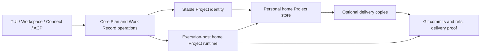
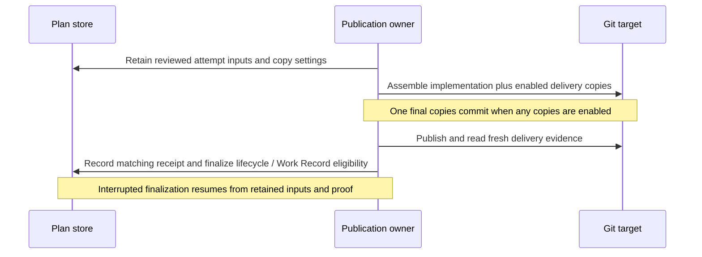
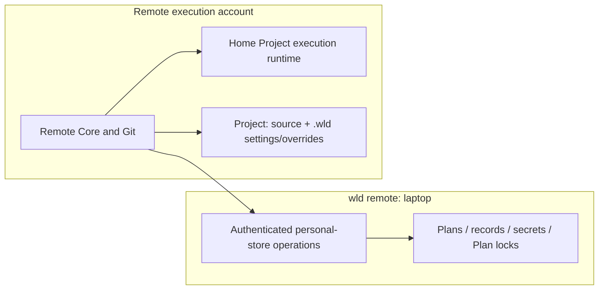

# External Project State and Plan Store

## Context

Every checkout currently carries its own Plan documents. Core resolves authority across primary, planning, execution,
and target-branch copies, then joins that content with controller and worktree records. Moving only `docs/plans/` would
leave those competing ownership rules intact. This Epic replaces them with one live Plan per Project and relocates
everything currently under every checkout's `.wld/internal/` into `~/.wld/projects/<projectId>/`.

The [Plan Store proposal](../prd/plan-store-prd.md) supplies the target requirements. Current behavior remains governed
by the central PRDs and accepted ADRs. This is a working architecture draft, not an approved design or implemented
capability. The owner confirmed the full proposal and expanded runtime relocation on 2026-11-01. The launch-mode
ownership rule below is also confirmed; detailed storage and recovery mechanisms remain reviewable design choices.
The Slicer child decomposition below records the implementation boundaries.

Scope includes Plans, separated metadata, stable Project identity, Session continuity, Work Records, explicit imports,
delivery copies, milestone history, retention, and all project-internal runtime state. Staging delivery does not remove
any of those outcomes from this Epic. Work Records must never move without their default repository delivery copies
working in the same release. Project `.wld/` retains local settings and user overrides only; no runtime directory or
Plan-store symlink remains there.



Repository copies cannot supply live Plan truth after import.

## Objective

Make `~/.wld/projects/<projectId>/` the home for Plans, Work Records, and all state currently in `.wld/internal/`.
Every checkout and client uses the same Core operations and identifiers. Code still executes in isolated worktrees;
Plan documents no longer need planning worktrees, Git seeding, branch overlays, or merge reconciliation. Logical
repository and checkout ownership survives relocation; physical placement inside a checkout does not.

Keep the existing file-based technology strategy. A database containing Plan bodies would conflict with ordinary
editor access; a Git branch dedicated to live Plans would retain branch synchronization and require Git for history.
A synchronized per-checkout cache would preserve the failure class this change removes. These alternatives are
excluded by the proposal's one-copy and plain-Markdown requirements.

The durable commitment is separating Project identity from checkout location and Git history. Reversing it would
require exporting documents and metadata, rebuilding repository ownership rules, and migrating Session references.
The [proposed Project-state ADR](../adr/0020-home-project-state-and-launch-mode-ownership.md) records the trade-offs.
Accepted ADRs still describe the existing implementation; the implementing work must reconcile their ownership clauses.

### Ownership and interfaces

The following boundaries are proposed responsibilities, not a new dependency-injection framework or a prescribed file
decomposition. Plan persistence, lifecycle transitions, locks, and recovery remain Core-owned machinery.

| Owner                        | Canonical facts                                                                     | Contract with callers                                                                                            |
| ---------------------------- | ----------------------------------------------------------------------------------- | ---------------------------------------------------------------------------------------------------------------- |
| Project identity             | Stable ID, known repository/directory bindings, existing Session storage locators   | Resolve an existing Project without side effects; deliberately enter or link a Project through a separate action |
| Plan store                   | Live document paths, metadata revision, hierarchy, archive state, retained versions | Read by Project and Plan ID; edit documents against content hashes; mutate metadata against its revision         |
| Plan lifecycle               | Allowed transitions, approval invalidation, completion semantics                    | Commit transitions through the Plan store; callers cannot assign protected state through document edits          |
| Execution/publication        | Repository instance, execution worktree, attempt phases, Git proof                  | Bind an attempt to one Plan; publish the sealed candidate; return proof for the matching attempt                 |
| Work Record store            | Record content, identity, provenance, retrieval eligibility, supersession           | Retrieve and update canonical records; search indexes remain disposable projections                              |
| Session store                | Transcript segments, manifest generations, Session writer ownership                 | Resolve through stable Project identity while preserving existing Session IDs and native locks                   |
| UI, search, sharing adapters | Views, routes, notifications, transport payloads                                    | Consume authoritative operations; never reconstruct ownership from a checkout path or display cache              |

`plan.wld.json` owns Plan identity, name, lifecycle, relationships, controller state, Session associations, and references
to execution and delivery evidence. Folding controller persistence into it does not let ordinary document saves reset
controller state. The lifecycle module continues to own transition rules.

The worktree registry continues to own physical execution and publication attempts for its repository, with its files
relocated to the execution account's home Project runtime. Plan metadata
references an attempt by identity; it does not duplicate the mutable publication phase. A permanent completion receipt
is retained in Plan metadata only after proof. A Project may have several linked clones, but one Plan has at most one
active execution attempt across them. Attaching another clone does not transfer an existing attempt or reinterpret its
local refs. Admission and recovery enforce that binding centrally.

### Entire project runtime relocation

`project-runtime-layout.ts` currently divides paths into primary-checkout and selected-checkout owners. Replace those
physical roots with explicit personal-store and execution-host roots, retaining repository/checkout IDs where the
resources genuinely differ. Flattening every clone's registry into one `worktrees.json` would mix unrelated Git refs.
Likewise, a registry or transition journal must not resolve against whichever cwd happened to start the process.

| Existing internal resource                               | Proposed destination and ownership                                                                                                      |
| -------------------------------------------------------- | --------------------------------------------------------------------------------------------------------------------------------------- |
| `controller/plans`                                       | Plan-owned controller fields join `plans/<name>/plan.wld.json` on the personal store owner                                              |
| Plan/catalog locks and Plan backups                      | Personal Project store locks and retained versions; no selected-checkout document authority                                             |
| `worktrees.json`, registry locks, migration reports      | Execution-host Project runtime, scoped to repository binding and personal-store owner                                                   |
| Publication staging, delivery evidence, repair checkouts | Execution-host Project runtime, retaining the exact repository/attempt identity and Git proof                                           |
| Transition journals                                      | Owner of the coordinated operation; Plan-only operations stay with the personal store, Git-effect operations with the execution binding |
| Collaboration secrets                                    | Private personal Project store; never a delivery copy or a user override                                                                |
| Work Record index and supersession/recovery locks        | Personal Project store with canonical Work Records; derived indexes can be rebuilt                                                      |
| Debug output and layout/adoption records                 | Home Project runtime on the responsible host, with one recorded owner per operation                                                     |
| Existing no-home fallback worktrees                      | Git-aware relocation into execution-host home Project runtime; no new fallback inside the repository                                    |

The inventory is not a whitelist for leaving files behind. Preserve unrecognized legacy internal files in a recorded
home recovery area, inspect all primary and linked-worktree roots, and retire the old directory only after verified
relocation. Do not copy live lock ownership to a new pathname. Quiesce existing writers, then acquire locks at the new
authority. Ordinary execution worktrees already outside `.wld/internal/` retain their recorded locations; this is not
an unrelated forced move of all `~/.wld/worktrees/` history.

New runtime writes, locks, logs, indexes, backups, and recovery artifacts must never recreate project `.wld/internal/`.
Do not replace it with a symlink or a new local runtime directory. Existing managed ignore rules may remain inert;
settings, Agents, Skills, prompts, and other user overrides remain untouched. Missing home access is an actual
prerequisite failure, not permission to recreate the repository fallback.

### Project identity and Session continuity

Use an opaque generated ID, not a path hash, basename, or remote URL. In Git repositories, store it in shared local
repository configuration, so linked worktrees agree. Read the specific shared local value, excluding inherited global
or per-worktree overrides. Outside Git, retain it in a small local identity file outside `.wld/`; its exact name is an
implementation choice. Deliberate entry after `git init`
moves that identity into Git configuration without changing it or leaving a new tracked identity file.

A remote URL is evidence for offering to link a fresh clone, never identity or automatic permission. Persist the
accept/decline outcome so entry does not repeatedly ask. Different clones retain distinct execution bindings even when
they share the Project. Remote changes never mint a new ID. Project settings remain project configuration; linking
clones does not silently copy their settings. Publication freezes the executing binding's effective copy settings.

Core owns identity without requiring Workspace SQLite. Existing Workspace registration IDs and Session project IDs
must be mapped explicitly; changing a directory key function globally would also relocate Attached Workflow records,
worktrees, and metrics unintentionally.

**Proposed migration approach:** bind existing Session bundles to the new Project through recorded storage locators
instead of moving all transcripts. Keep Session IDs, segment IDs, lock locations, historical cwd evidence, and native
writer semantics. New storage can use the stable ID. Resolve the current execution cwd separately from historical
transcript cwd. An active old writer must settle before a binding changes; two aliases must never yield two locks for
one Session. Connect's existing workflow records also need stable lookup bindings, without converting them into
Sessions. Metrics and general Memory namespace redesign are outside this Epic.

### Storage and mutation

Proposed layout; internal directory names other than the PRD's public document names are reviewable. For ordinary
`wld`, the personal owner and execution host are the same machine/account. For `wld remote`, the two trees are on
different hosts, as defined below:

```text
<personal owner's home>/.wld/projects/<projectId>/
  project.wld.json                 identity and known storage/repository bindings
  plans/<plan-name>/
    plan.wld.json                 versioned Core metadata; stable Plan ID
    context.md                    editable body, no front matter
    validation.md                 validation instructions
    manual-qa.md                  optional manual QA
  history/<plan-id>/<version>/     frozen milestone packages, never live authority
  work-records/<record>.md         canonical Work Records; existing schema retained
  internal/                       Plan/record locks, secrets, import state, immutable attempt inputs

<execution account's home>/.wld/projects/<projectId>/
  execution/<repository-binding>/<personal-owner>/
    worktrees.json                execution registry; no live Plan documents
    publication/                  staging, repair checkouts, and Git delivery evidence
    checkouts/<checkout-id>/       remaining checkout-scoped journals and diagnostics
  execution-locks/                cross-owner coordination for the same physical repository

<each participating checkout>/
  .wld/settings.json              local project settings
  .wld/agents/, skills/, prompts/ user overrides; other supported overrides remain
  docs/plans/<plan>/              optional delivery copy
  docs/work-records/              delivery copies enabled by default
```

Names locate packages; IDs identify them. Parent/child relationships and dependencies resolve by ID, with names exposed
for users and legacy import. Renaming a Plan cannot orphan children, history, Session associations, or receipts. Epic
artifacts move with their Epic package and remain distinguishable from executable Plans. Archive state is metadata;
archive/restore does not create another live copy or change the Plan ID.

Separate body hashes from metadata revisions. Metadata-only writes never rewrite Markdown. RunWield document edits
retain optimistic conflict detection; external editor saves are accepted as live content without manufacturing
lifecycle changes. Review and execution bind to a coherent snapshot of all required documents and their hashes.
Approval cannot authorize content edited afterwards. Content changing during snapshot capture requires a fresh read;
Core locks do not pretend to lock out an ordinary editor.

Core metadata is replaced atomically under a native store-owner lock. Multi-resource operations use recoverable intent
and revision checks, reusing existing transition machinery where applicable. A stored reference never points at an
uncommitted snapshot. Preserve one lock ordering across Project/catalog, Plan, and repository execution resources;
remote calls must not invert it. A missing home store is unavailable, not a reason to create a second authority in the
repository. Passive list/search/read operations do not initialize identity, create links, migrate, or repair.

Give editors and Agents the canonical document path or a supported Core document operation. There is no `.wld/plans`
alias. Connect hosts restricted to the repository need their normal explicit store-root grant or Core document tools;
do not bypass host permissions or create a copied live Plan. Remote read/edit paths use the selected owner's verified
mount or service and never substitute a remote-account Plan because the laptop is disconnected.

### Publication and Work Records

Publication seals the exact reviewed Plan documents, metadata needed for provenance, Work Record input, copy settings,
and intended repository paths into immutable attempt inputs inside the store. These are historical inputs, not a
second live Plan. The attempt references them by identity and digest. Their retention is independent of optional
user-facing milestone history and cannot expire while publication, recording, or recovery still depends on them.



Enabled copies arrive in one final artifacts-only commit before merge or change-request opening. Plan metadata is
excluded; Work Records retain their existing content/schema contract. With both settings off, code publication still
works and emits no copies commit. A frozen attempt cannot pick up later live Plan edits or new settings on retry.
If target movement requires rebuilding an unpublished candidate, the final candidate still contains one copies commit;
there must not be duplicate artifact commits from repeated attempts.

Git remains authoritative for whether code reached its target. Local Plan `verified` and Work Record approval follow
confirmed publication, never the existence of a snapshot or copies commit. A Work Record prepared before publication
must retain truthful provisional evidence until confirmation. Its repository representation cannot become a new
authority or force a second finalization commit solely for Plan status. The existing proof-bearing publication design
must be adapted explicitly, not bypassed. Existing non-Git completion remains in-place verification.

Recorder retry reads retained attempt inputs, including the Epic's relevant child snapshots and Tickets, after the
execution worktree is gone. It never reconstructs that input with `git show docs/plans/...` after cutover. Search
indexes address canonical record IDs and are rebuilt from the store; folder renames must not make records invisible
because the old Mnemoteca collection used a basename. Preserve provenance, supersession, closure confidence, and
retrieval eligibility. Index failure does not revoke established code delivery.

Retain the current supported publication modes. This Epic does not implement the separate Forge delivery proposal;
any later Forge integration must consume the same sealed-input and copy-generation contract.

### Runtime adoption, document import, history, and retention

Runtime relocation and document import have different entry rules. Deliberate Core entry automatically relocates
machine-owned `.wld/internal/` state; users do not operate its migration machinery. Plans and Work Records still enter
the new canonical document stores through the proposal's explicit import commands. Relocated controllers for
not-yet-imported Plans remain keyed by their existing identity until import joins them; relocation must neither
auto-import documents nor discard their unfinished runtime. A legacy attempt can settle against its retained evidence
without creating a second new-format Plan authority.

Home may be on another filesystem, and `wld remote` can move personal authority across machines. Do not assume an
atomic directory rename. Stage bytes at the destination, verify identity and content, durably publish the ownership
record, then retire only the recorded source. Recovery after each boundary resumes that operation rather than choosing
the newest-looking directory. Git worktrees and publication clones require Git-aware relocation and repaired absolute
references, preserving uncommitted repairs and exact commits. Source cleanup follows proof; a crash may leave inert
source bytes temporarily, but never two admitted writers. Adoption covers linked worktrees as well as the primary root.

Keep migration progress at the home destination, with repository-local Git configuration for identity/version where
needed; no permanent `.wld/internal` marker remains. Inspect older unfinished runtime migrations before relocation so
their source/target records cannot be replayed into the checkout. A no-home startup cannot begin the cutover.

`wld plans import <path>` and `wld wr import <path>` are explicit, repeatable operations. Normal discovery never imports
repository Markdown. Import preserves existing IDs, statuses, hierarchy, and record provenance, separating Plan front
matter from body. Plain Markdown becomes a draft; a metadata-free delivery copy also becomes a new draft. Maintain
import provenance for repeat detection of ID-less files; a changed source must not silently overwrite an already live
Plan. Batch imports validate relationship mappings and resume interrupted work without duplicate IDs or partial visible
packages. Import leaves source files untouched and records repository paths for later best-effort pruning.

Importing an unfinished local Plan is more than parsing its front matter: resolve the current pre-cutover document,
controller record, execution binding, and publication evidence as one unit. A stale primary copy cannot overwrite the
execution-worktree authority. Import must account for canonical siblings and archived Plans, and report missing or
conflicting source evidence without resetting lifecycle or discarding work. Runtime metadata repair is Core work;
user decisions concern genuinely conflicting content, not instructions to hand-edit bookkeeping.

The cutover is one-way and requires older writers to stop. Use a versioned, recoverable import/adoption record;
retries finish the same operation. Imported document source files remain available but cease to be live runtime inputs
after adoption. Migrated internal runtime files are retired after verified relocation; they are not left as permanent
repository backups.
Existing publication attempts retain their recorded candidate and repository paths until settled; conversion must
not reinterpret their sealed evidence as a new-format attempt. No downgrade or simultaneous legacy/new writers is
promised. Release notes explain explicit import; an empty list can explain the command without auto-importing or
offering an unsolicited migration.

Keep milestone versions at approval, delivery, and closure/archive. Restoring content creates a new current revision
and applies normal approval invalidation; historical status, active attempt pointers, and delivery proof cannot be
replayed as current facts. This interpretation of restoration is a reviewable assumption needing explicit wording in
the owning requirement when delivered.

Preserve count-first archived-Plan retention. Work Records use the proposal's separate defaults: newest 100 retained,
plus every record no older than 90 days; zero days means count-only. Records covering retained archived Plans remain.
Pruning is explicit, supports dry-run, asks before deletion, and never runs automatically. Only recorded repository
paths within a known binding are eligible for cleanup; no traversal or symlink escape is allowed. Missing or renamed
copies are skipped. Repository deletions remain uncommitted. Pruning never deletes evidence still required by an
unfinished attempt or pending Recorder operation.

### Launch mode determines the personal owner

The owner confirmed this rule; an SSH environment variable is not an authority selector:

| Invocation                    | Plans, Work Records, and personal Session authority                        | Git execution and its runtime files             |
| ----------------------------- | -------------------------------------------------------------------------- | ----------------------------------------------- |
| Ordinary local `wld`          | Current account's home Project store                                       | Same machine/account's home Project runtime     |
| Manual `ssh host`, then `wld` | Remote account's home Project store; ordinary local execution on that host | That remote account's home Project runtime      |
| Laptop `wld remote host`      | Laptop home Project store and laptop-owned Sessions                        | Remote execution account's home Project runtime |

The execution-runtime placement is the proposed implementation of the confirmed Plan ownership rule. Git worktree
registries, staging/repair checkouts, and Git-effect journals stay with the machine that can inspect those files and
refs. None live inside the source checkout. Plan controller state, Plan locks, collaboration secrets, Work Records, and
their indexes stay with the personal store owner. Session persistence keeps its existing laptop save contract.

For `wld remote`, extend the authenticated, connection-scoped personal service with coarse store operations. The
laptop owns metadata locks, snapshot commits, and operation receipts; remote Core owns lifecycle computation and Git
effects. Merely redirecting native locks or SQLite through SSHFS is not sufficient. Operations carry expected
revisions and stable IDs. A lost response is reconciled by operation identity before retry, never by replaying Git
effects. Direct Markdown editing can use the verified mount with the same content-hash checks as an external editor;
persisted references contain IDs, not temporary mount paths. Reconnect resolves fresh access paths.



A manual SSH invocation and a `wld remote` connection to the same repository select different personal stores. The
shared repository Project ID does not authorize automatic copying, merging, or takeover of their Plans. Execution
bindings record the personal-store owner, and repository-level Git coordination on the execution host prevents unsafe
overlap between owners. Reusing a Plan ID alone cannot adopt another owner's attempt. Reconnecting to the same owner
resumes its evidence; switching invocation mode does not silently switch an unfinished attempt's owner.

Preserve connected-only `wld remote` execution, host trust, continuation after disconnect, and no laptop checkout
requirement. Ordinary `wld` started manually over SSH does not acquire a dependency on a laptop. A remote slice must
prove concurrent access and lost acknowledgements; existing Session-save evidence alone does not establish store
correctness.

## Vertical Slice Findings

Inspected source establishes the following current dependencies:

| Flow                      | Existing path and finding                                                                                                            | Architectural consequence                                                                                      |
| ------------------------- | ------------------------------------------------------------------------------------------------------------------------------------ | -------------------------------------------------------------------------------------------------------------- |
| Load a Plan               | `workflow/plan-location.ts` chooses execution, registered planning, primary, or target-branch documents                              | Replace document selection with Project/Plan lookup; preserve execution-location selection separately          |
| Save a Plan               | `plan-store.js:savePlan` acquires catalog/Plan locks and calls `prepareControllerView`; ordinary saves preserve controller authority | Move persistence without merging document edits and lifecycle/controller writes into one unrestricted save     |
| Controller state          | `workflow/controller-registry.ts:controllerRecordPath` stores Plan-keyed records below primary `.wld/internal/`                      | Consolidate Plan-owned controller state in metadata; retire overlays after explicit adoption                   |
| Publication and recording | `workflow/publication-machine.ts` and `work-records/published-source.ts` recover artifacts through Plan paths and Git commits        | Retain immutable store inputs and receipts before removing repository Plan commits                             |
| Session lookup            | `session/file-session-storage.ts` hashes roots for identity and encodes roots for local storage; remote projects use another path    | Introduce stable lookup bindings without changing transcript identity, historical cwd, or lock ownership       |
| Connect continuation      | `attached/record-store.ts:locateAttachedWorkflows` uses the encoded primary root                                                     | Include existing Attached Workflow lookup in identity adoption; do not migrate unrelated home trees implicitly |
| Work Record retrieval     | `work-records/store.ts` uses checkout-relative files; `index-adapter.ts` derives collection names from project basename              | Move canonical storage and stable index binding together; indexes remain derived                               |

`project-runtime-layout.ts:resolveProjectRuntimeLayout` enumerates both primary and selected-checkout internal paths;
`remote/personal-resources.ts` already distinguishes the local account's home from an activated laptop personal mount.
Those are separate inputs to the new layout contract, not interchangeable strings. `publication-machine.ts` constructs
Git staging paths from the runtime layout, and `work-records/index-adapter.ts` passes its index path to Mnemoteca.
Both need owner-aware relocation, not only a new Plan directory constant.

The [backlog cleanup Work Record](../work-records/2026-10-27-plan-backlog-cleanup.md) confirms the old Plan Packages Epic
was removed. It is not a prerequisite; package layout requirements derive from the current proposal.

## Child Plan Decomposition

The Slicer decomposition contains 15 draft Planned Changes. Each returns to Planner before execution; the files do
not imply lifecycle finalization or approval. Child landing branches inherit `epic/external-plan-store`. Stable names
carry dependency references; `order` records the sequence.

| Order | Child Plan                                                                                                      | Prerequisites |
| ----- | --------------------------------------------------------------------------------------------------------------- | ------------- |
| 1     | [Establish Stable Project Identity](external-plan-store/establish-stable-project-identity.md)                   | None          |
| 2     | [Preserve Session and Connect Continuity](external-plan-store/preserve-session-and-connect-continuity.md)       | 1             |
| 3     | [Relocate Project Runtime into Home Storage](external-plan-store/relocate-project-runtime-into-home-storage.md) | 1             |
| 4     | [Add Canonical Plan Packages](external-plan-store/add-canonical-plan-packages.md)                               | 1, 3          |
| 5     | [Import Plans with Workflow Evidence](external-plan-store/import-plans-with-workflow-evidence.md)               | 3, 4          |
| 6     | [Run Lifecycle from Canonical Plans](external-plan-store/run-lifecycle-from-canonical-plans.md)                 | 4, 5          |
| 7     | [Publish from Retained Plan Inputs](external-plan-store/publish-from-retained-plan-inputs.md)                   | 6             |
| 8     | [Move Work Records with Delivery Copies](external-plan-store/move-work-records-with-delivery-copies.md)         | 7             |
| 9     | [Expose Home Plans across User Surfaces](external-plan-store/expose-home-plans-across-user-surfaces.md)         | 6, 8          |
| 10    | [Activate the Local Home Store](external-plan-store/activate-the-local-home-store.md)                           | 2, 5, 6, 8, 9 |
| 11    | [Serve Laptop Owned Project State](external-plan-store/serve-laptop-owned-project-state.md)                     | 4, 8          |
| 12    | [Activate Managed Remote Store Ownership](external-plan-store/activate-managed-remote-store-ownership.md)       | 3, 10, 9, 11  |
| 13    | [Prove the Composed Store Migration](external-plan-store/prove-the-composed-store-migration.md)                 | 2, 9, 12      |
| 14    | [Keep and Restore Plan Milestone History](external-plan-store/keep-and-restore-plan-milestone-history.md)       | 10, 12        |
| 15    | [Prune Retained Plans and Work Records](external-plan-store/prune-retained-plans-and-work-records.md)           | 8, 12, 14     |

**Delivery milestones:** child 10 makes the ordinary local/manual-SSH workflow usable, including normal browser
review and supported user surfaces. Child 13 proves the core workflow across supported launch modes. Children 14 and
15 add milestone history and full retention; both remain required by the agreed full Epic scope.

Preparatory package, import, publication, record and surface slices remain behind internal format admission until
local activation. Work Records cannot move without working default delivery copies. Surface support precedes local
activation so the normal browser review path is ready when the store changes.

### Outcome ownership

| Epic outcome                                               | Owning children                    |
| ---------------------------------------------------------- | ---------------------------------- |
| Stable Project/personal-owner identity                     | 1                                  |
| Session and Connect continuity                             | 2                                  |
| Complete runtime relocation                                | 3; managed-remote completion in 12 |
| One package; separate document and metadata ownership      | 4                                  |
| Explicit import with existing workflow evidence            | 5; public activation in 10         |
| Lifecycle, sibling visibility and one execution owner      | 6                                  |
| Immutable publication input and optional Plan copies       | 7                                  |
| Canonical Work Records, default copies and stable indexing | 8; public activation in 10         |
| Authorized access, review and sharing across surfaces      | 9; public activation in 10         |
| Ordinary local and manual-SSH workflow                     | 10                                 |
| Laptop-native mutation, locking and acknowledgement        | 11                                 |
| Managed-remote ownership and recovery                      | 12                                 |
| Cross-child migration and recovery proof                   | 13                                 |
| Milestone history and content restoration                  | 14                                 |
| Count-first retention and safe copy cleanup                | 15                                 |

The composed-proof child verifies the joined journey; it does not absorb missing capabilities from other children.
Each behavior owner carries its same-change PRD/glossary work, while child 15 reconciles the completed transient
proposal and remaining references.

**Current execution limit:** the owner authorized implementing only child 1 on 2026-11-01, with CI/repair, fresh-context
code review/repair, and delivery into the Epic branch. Stop after that child; each later child requires the owner's
review and a new instruction to proceed.

## Expected Change Surface

This map guides later decomposition; it is not an allowlist or a task sequence.

```text
src/
  plan-store.js, plan-front-matter.ts   storage contract; legacy parsing confined to explicit import
  shared/
    project-*                         identity, automatic internal relocation, action-owned entry
    runwield-owned-paths.ts            retire internal runtime writers; preserve settings and overrides
    collaboration/                    private secrets follow the personal Project store
    workflow/                         lifecycle, snapshots, controller state, publication, recovery
    worktree-registry.js               repository execution binding; no live Plan document authority
    work-records/                      canonical storage, provenance, indexing, retention
    session/                          stable lookup with existing writer and transcript contracts
    attached/, remote/                host continuation and explicit launch-mode ownership
    owner-coordination/                Workspace registration mapping; never Core storage authority
    epic-artifacts.ts                  package-owned Epic context and validation artifacts
  cmd/, tools/, agent-definitions/      import and document paths; eliminate front-matter write assumptions
  ui/workspace/, ui/review/             readable documents, revision-safe actions, search and artifact access
docs/
  prd/                               owning capabilities updated with their delivered behavior
  adr/                               replace obsolete ownership clauses when the new decision is accepted
  domain-language.md, entity-model.md  update terms when implementation makes them true
  user-documentation/                store location, explicit import, delivery-copy settings and backup
```

Preserve remote-canonical Shared Plan rules. Moving a local package must not create a writable local authority for a
shared Plan whose existing collaboration contract forbids it. Existing sharing transport can adapt at its boundary;
do not implement new real-time collaboration or hosted storage here.

## Reuse Opportunities

- `shared/private-json-file.ts`, `native-file-lock.ts`, and Windows replacement handling: portable file durability and
  native ownership. Validate them on the selected storage owner; mounting a path does not establish equivalence.
- `plan-store.js` body hashing, strict read results, identity checks, and stale-write errors: preserve their protection
  while separating document and metadata revisions.
- `workflow/state-transition.ts` and publication attempt/receipt machinery: retain explicit evidence and restart
  reconciliation, removing obsolete Plan-copy operations rather than adding a parallel workflow.
- Session manifests and owner-coordination root mappings: reuse existing identity/locator concepts and registration
  reconciliation, without making SQLite necessary for Core.
- Work Record schema, eligibility, supersession, and index adapters: retain meaning while changing canonical location.
- `defineGitFixture`, `makeValidationProjectRoot`, and existing multiprocess publication tests: exercise real stores
  and repositories. Do not add injection seams for Core-owned storage or lifecycle operations.

## Verification Plan

An Epic is not directly executable. Later child Plans select exact focused test commands using
`bun scripts/run-tests.js <paths>` after `bun run install:locked` on Bun 1.4.3; the integrated gate is `bun run ci`.
Use disposable homes, real Git fixtures, and process-global locks where required. Validate new file behavior on Linux,
macOS, and Windows; remote testing follows the existing supported Linux host scope.

### Outcome Evidence

| Outcome                              | Observable evidence and owning requirement                                                                                                                                                                                                                                                                                                      |
| ------------------------------------ | ----------------------------------------------------------------------------------------------------------------------------------------------------------------------------------------------------------------------------------------------------------------------------------------------------------------------------------------------- |
| One live Plan                        | Primary checkout, two worktrees, and a deliberately linked clone resolve the same Plan ID and document bytes; changing branches cannot change them. No new-format live read uses `docs/plans/` or `git show` for Plan content. [Plan store](../prd/plan-store-prd.md#plan-store)                                                                |
| Independent ownership                | A lifecycle/controller update leaves every Markdown byte unchanged; a hand edit leaves metadata intact and invalidates stale approval at the action boundary. Concurrent stale writes cannot erase newer work. [Plan store](../prd/plan-store-prd.md#plan-store)                                                                                |
| Stable continuity                    | Rename/move a Project and alter its remote; find the same Plans, Work Records, Sessions, and existing Attached Workflow. Sessions retain one writer lock and unchanged committed history. A declined clone link stays separate. [Project identity](../prd/plan-store-prd.md#project-identity)                                                   |
| Safe import                          | Import an Epic with children, archived Plans, IDs, controller state, and an unfinished execution; restart midway and retry. Exactly one live package per ID remains, originals are unchanged, and current execution evidence wins over stale copies. Unimported files never enter listings. [Plan import](../prd/plan-store-prd.md#plan-import) |
| Publication without repository Plans | Complete standalone and Epic delivery with Plan copies off, then both copies off. Git proves delivery; canonical status and recording recover after a killed process; no Plan commit is required. [Repository footprint](../prd/plan-store-prd.md#repository-footprint-and-delivery-copies)                                                     |
| Immutable delivery copies            | Enable each setting combination, retry after target advancement and lost acknowledgement, and edit the live Plan meanwhile. The final branch has the intended single copies commit, excludes `plan.wld.json`, and uses the sealed input. Edited delivery copies cannot affect live state. Same requirement as above.                            |
| Recording after cleanup              | Remove the delivered execution checkout, retry Recorder and rebuild indexes. Retrieve the exact delivered source with correct provenance, confidence, supersession, and Epic Ticket aggregation from retained store input. [Work Record store](../prd/plan-store-prd.md#work-record-store)                                                      |
| History without Git                  | Approve, edit, deliver or close a Plan in a non-Git folder; inspect retained versions and restore content without restoring stale execution ownership or completion proof. [Plan history](../prd/plan-store-prd.md#plan-history)                                                                                                                |
| Controlled pruning                   | Dry-run and confirmed pruning honor count/age floors, retained-Plan coverage, and unfinished evidence pins; copy cleanup stays within recorded repository paths and leaves deletions uncommitted. Missing copies do not block it. [Work Record store](../prd/plan-store-prd.md#work-record-store)                                               |
| Surface parity                       | TUI, Workspace review/search, Connect, and ACP show and act on the same revision. Passive reads make no files or Git changes. Strict host path permissions remain enforced while the approved Plan-access route works. [Core Plan review](../prd/runwield-core-prd.md#plan-review)                                                              |
| Remote continuity                    | On the chosen owner, disconnect before and after a store acknowledgement, reconnect, and reconcile the same operation; never duplicate publication or admit two writers through different filesystem paths. [Remote connection](../prd/runwield-core-prd.md#remote-connection)                                                                  |

Additional outcomes introduced by the confirmed runtime scope:

- **No checkout runtime:** after adoption and after exercising planning, execution, publication, repair, sharing,
  indexing, archive, and failure recovery, neither primary nor linked checkouts contain `.wld/internal/` or
  `.wld/plans`. Snapshot comparisons show settings and overrides unchanged. All former runtime writers resolve into
  the responsible host's home Project tree. [Project runtime](../prd/plan-store-prd.md#project-runtime-outside-checkouts).
- **Complete recoverable relocation:** seed every named layout resource, an unknown internal file, an unfinished
  transition, and a repair checkout with uncommitted work. Interrupt before and after destination ownership commits
  across filesystem/host boundaries. Fresh-process recovery preserves bytes, IDs, permissions, Git registrations, and
  exact candidate proof; retires old sources; and never admits both writers. Same owning capability as above.
- **Explicit launch ownership:** ordinary local `wld` and manual SSH followed by `wld` use their own account home;
  `wld remote host` uses the laptop Plan store and remote home execution runtime. Test both modes against the same
  repository without copying Plans or crossing attempt owners. Disconnect cannot select another store. Native Plan
  locks and record indexes execute on their owner rather than through SSHFS.
  [Launch mode](../prd/plan-store-prd.md#storage-ownership-by-launch-mode).

Cross-boundary acceptance must include: relocate an existing Project runtime; import an existing Epic; edit a sibling while another child executes; resume
from a second surface; publish with Plan copies disabled; remove the execution worktree; rename the Project; then
retrieve its Work Record and resume its Session. One child's unit tests cannot establish that journey.

Preserve approval/readiness semantics, dependency ordering, code isolation, confirmed-publication completion,
automatic internal recovery, private transcript ownership, Shared Plan restrictions, and Work Record provenance.
Retire checkout-based Plan authority, planning worktrees used only for documents, branch seeding/carry-over of Plans,
front-matter lifecycle writes in live documents, checkout-local internal runtime and its no-home fallback, and
automatic external-document adoption. Legacy import and settlement
of pre-cutover attempts are bounded compatibility paths, not permanent fallback readers.

The child work delivering each outcome must update its owning central PRD capability in the same change: Core owns
authoring, lifecycle, execution/recovery, Session continuity, Project initialization, and Work Records; Workspace owns
local Plan management and shared-review journeys; Connect and ACP link shared Core outcomes and document their host
constraints. Update ADR-015/016/017/018 where ownership changes, reconciling them with the proposed Project-state ADR
when it is accepted rather than leaving conflicting accepted storage rules. After all proposal
requirements are delivered or explicitly deferred into their lasting owners, remove the transient Plan Store PRD and
repair references. Do not mark these outcomes delivered during planning.

## Edge Cases & Considerations

- **Uncoordinated editors:** external writes do not honor Core locks. Snapshot hashes and action-time rechecks must
  detect changes; no design claim promises a transaction across an arbitrary editor and Core.
- **Several linked clones:** shared planning is not permission to run the same Plan twice. A second binding observes
  the current attempt and requires a real recovery/continuation operation to change execution location.
- **Lost store:** history on the same disk is not a backup. Document the store location and delivery-copy trade-off;
  backup service, cross-machine synchronization, and automatic replication are outside this proposal.
- **Interrupted cutover:** retained original files do not make old software safe after new writes. Version admission,
  idempotent import, and recorded legacy attempt ownership are part of the change, not optional cleanup.
- **Path and permission differences:** home roots or connection mounts may be unavailable or denied. Core repairs owned
  machinery during deliberate actions, preserves foreign content, and reports real access prerequisites. It does not
  ask the user to operate internal locks or fabricate another live copy.
- **History restoration:** the proposal's restore wording does not distinguish document restoration from replaying
  metadata. The recommended interpretation above preserves identity and evidence; confirm it during review.

### Confirmed direction and reviewable assumptions

The owner confirmed full proposal scope, relocation of all `.wld/internal/`, only settings and overrides left in
project `.wld/`, and launch-mode-dependent Plan ownership. These are no longer open questions.

The concrete owner partition for execution runtime, native-lock service operations, Session locator adoption, and
content-only history restoration are architectural proposals explained above. They need verification in the eventual
child work; none claims a completed cross-host or crash-recovery proof. Slicer must preserve the outcomes and isolate
the evidence needed for those uncertainties rather than decomposing this Epic as a directory rename.

### Research

- [Git worktree configuration](https://git-scm.com/docs/git-worktree#_configuration_file) documents shared repository
  configuration and optional per-worktree overrides. It supports a shared local Project ID, not remote-URL identity.
  The same documentation describes `worktree move`/`repair`; relocating execution files requires preserving Git's
  registrations as well as copying bytes.
- [Git configuration scope](https://git-scm.com/docs/git-config) distinguishes local, global, and worktree settings.
  Identity resolution must not accidentally inherit a global value across repositories.
- [Node filesystem API](https://nodejs.org/api/fs.html) documents file replacement, copying, and synchronization.
  It does not establish Bun/platform or SSHFS durability; those require the explicit verification above.
