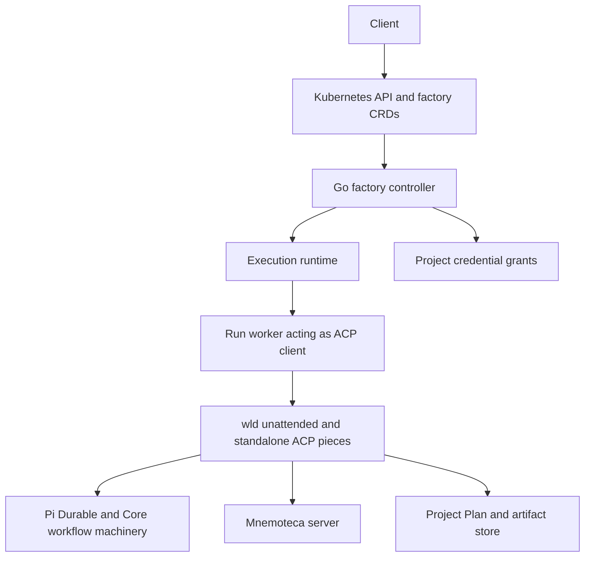

# Declarative Factory Runtime

The owner authorized the first Router implementation on 2026-11-16. The broader architecture below remains a target;
the delivered slice is limited to the status recorded here. Kubernetes is the selected factory API direction;
Mnemoteca server with a shared CLI engine is selected but not implemented by this slice.

The [RunWield package architecture plan](runwield-package-architecture.md) covers the behavior-preserving domain extractions
and the storage interfaces used by local and hosted deployments.

## Initial Router Slice

The [Factory module](../../factory/README.md) provides a Go controller, namespaced `FactoryRun` and `StepExecution`
CRDs, a deterministic ACP worker, per-run persistent storage, separated controller/worker/client RBAC, a Mac
deployment script, and a live recovery check. A provisioned `wld` worker advertises `_dev.runwield/factory/execute` version 1 and returns
the existing typed Triage outcome. The Router does not launch another Agent.

This first loop classifies supplied input only. It exposes only `triage_report`; repository checkout and confined
discovery are deferred. An operator provisions an active RunWield Project registration in the tenant namespace.
The controller verifies that binding before intake or dispatch. The worker verifies the same ID before reading or writing a receipt.
The scratch directory supplies execution space. Production tenant authorization remains a separate prerequisite.

Recovery uses admitted inputs, an OS lock, and an atomic result receipt on the run PVC. A replacement process or
pod replays a completed receipt, or repeats interrupted read-only reasoning. Pi Durable integration, model
checkpoints, cross-run memory, and side-effect recovery for subsequent loops are not implemented.

Qualification on the Mac Studio used Lima 2.3.0, ARM64 Ubuntu, k3s v1.37.2+k3s1, and the real configured
`openai/gpt-6.1-sol` provider. Final-build runs `router-none-dl8kf`, `router-process-v2dbr`, and `router-pod-tsfh6` all completed with
typed `INQUIRY` results. The process test killed `wld` after admission and restarted the controller; the pod test
force-deleted the worker. Replacement workers retained the original operation IDs. Worker RBAC denied Secret reads
and another execution's status. Local Router/ACP tests also cover receipt replay, concurrent duplicate calls,
input mismatch, and rejection of prose-only results. These are implementation checks, not a prerequisite spike.

## GitHub Router recipes

The 2026-11-17 increment adds namespaced `GitHubTriage` admissions and two opinionated recipes: freeze the oldest ten
eligible open `test` issues as a finite batch, and wake hourly to admit one eligible issue only when the project is
idle. Both exclude PRs, `status:in-progress`, and retained claims. Selection IDs are saved before child FactoryRuns;
run names derive from GitHub repository/issue IDs and are shared across recipes. The shared owner registry supplies
the opaque Project ID. Inputs snapshot title plus body; no checkout or issue-comment context is loaded.

`wld` saves `triage_report` before its Core-owned GitHub publication transition, then saves an intent and comment
receipt. Network-boundary tests exercise uncertain acknowledgement, author/target verification, and no duplicate
write on replay. An uncertain POST without visible evidence remains pending and reconciles; automatic resolution of
that ambiguity is not implemented. This is comment publication, not implementation or PR delivery.

The deployable recipes and operational commands live in the [Factory README](../../factory/README.md#github-triage-recipes).
[Factory product requirements](../prd/runwield.md#factory-recipes) own admission behavior, while Core and ACP retain
execution and protocol ownership. GitHub credentials are explicitly provisioned into the personal namespace; only the
controller and publication workers mount them. Wake jobs have admission-only RBAC and no GitHub/model credentials.

Live GitHub qualification on 2026-11-17 created issues #631
and #632 for a batch, then
#633 and #634
for separate next-item wakes. All completed with one triage comment each. Workers were force-deleted after durable
admission and before a routing result on #631 and #634. Both retained their operation IDs; #634 recovered automatically
without credential or Job intervention. An extra wake admitted nothing despite all four issues retaining `test`.
The hourly schedule was restored. The owner requested deletion of all four test issues on 2026-11-18;
GitHub confirmed deletion. Local execution evidence retains the observed comments and run identities.

This run exposed two setup constraints: a newly created issue may not yet appear in GitHub's list endpoint, and the
factory's copied OAuth credential can lag behind the desktop. The first empty admission was preserved and a new batch
started after visibility was confirmed. The stale model Secret was refreshed before the independent #634 recovery
check. Shared credential refresh remains deferred. The repeatable live harness is `factory/github-smoke.ts`; full
local evidence is `.ci-cache/factory-github-live.json`. No exactly-once guarantee for an ambiguous GitHub POST is implied.

## Context

Consumers declare a factory workflow from connected reusable pieces. Agents use Pi Durable with RunWield tools,
system prompts, persistent artifacts, and explicit memory operations across runs.

Build the first real single-user path and iterate quickly on failures. The owner explicitly does not require a
preliminary prototype or technology-qualification gate. Recovery and integration validation belong to implementation
and delivery; confidence in Kubernetes and Pi Durable permits starting before those tests have been run.

The earlier Factory proposal is in the sibling Workspace repository at `docs/prd/runwield-factory-prd.md`. It proposes SaaS coordination and a default quick-fix composition. This exploration addresses the reusable
runtime and custom compositions. The owner's 2026-11-16 requirements below define the target factory loop catalog
and delivery defaults; pricing and existing interactive defaults are not changed by this design document.

Owning shared requirements remain [Core recovery](../prd/runwield-core-prd.md#execution-validation-and-recovery)
and [Project identity](../adr/019-home-project-state-and-launch-mode-ownership.md). [Factory recipes](../prd/runwield.md#factory-recipes) owns current intake requirements;
implementation must distinguish delivered behavior from remaining targets.

## Confirmed Constraints

- Factory extends RunWield's opinionated workflows; it is not a generic workflow engine. As clarified by the owner
  on 2026-11-17, accepted completion tools such as `triage_report`, `task_completed`, and `review_complete` drive
  Core-owned transitions, as in the TUI. Kubernetes schedules and recovers execution; it does not independently
  interpret agent output to choose the next business stage. Extend the shared Core machinery for unattended use.
- Recipes configure supported RunWield workflows, intake, delivery, and existing customization such as agent prompt
  overrides. A custom Router still runs through `wld` and obeys its result contract. General-purpose classifiers and
  arbitrary agent graphs are outside the product direction. CSV was a generalization example, not requested work.
- Preserve two intake modes: a finite admitted batch, and a standing recipe that wakes and admits one eligible item
  for processing before selecting another on a later wake. Batch membership and execution concurrency are separate.
- Recover from process crashes and pod death. Power failure, host failure, and disk loss are outside initial scope.
- Portability means deploying the factory on Mac Studio k3s in a Linux VM, Linux Kubernetes, GKE, or EKS. It does not
  mean live migration, process-memory snapshot compatibility, or automatic transfer between installations.
- Start with Carlos as the sole consumer. Multiple tenants and parallel execution can follow.
- Complete and test the single-user factory loop before production SaaS tenancy. A separate prerequisite will add an
  optional identity mode to `wld` and enforce tenant ownership across Plan storage, Sessions, settings, credentials,
  and other user/project state. That work is required before multi-tenant production use, not before this factory build.
- The final major consumer-facing stage is a factory-management UI in the desktop application or SaaS Workspace.
  Initial operation uses Kubernetes resources; its contracts must support that later UI.
- Use one Kubernetes namespace per tenant, including the initial single-tenant installation. Permissions start with
  no application grants and are enabled explicitly through separated roles. Kubernetes RBAC is part of the reason
  for retaining the Kubernetes API; full tenant onboarding remains later scope.
- Reuse the stable opaque Project ID from the external Plan Store work. Paths, directory names, and Git URLs are not
  identity. Preserve separate repository-instance and checkout bindings.
- Memory is explicit small-document storage and retrieval through agent tools. No retrospective transcript mining,
  automatic memory supervisor, or implicit session ingestion.
- Build a Mnemoteca server and share its storage/retrieval engine with the CLI where practical. Preserve explicit
  memory tool calls and document semantics. Mem0 was considered; it is not the selected implementation direction.
- `wld` needs independent unattended loops callable through ACP: routing with structured output; planning/architecture/
  product planning; Epic slicing; planned implementation; and Quick Fix implementation. These reusable Core capabilities
  are prerequisites for their corresponding factory paths, separate from the later SaaS identity prerequisite.
- Planned implementation performs implementation, mechanical validation/repair, two review stages, and PR publication
  or merge according to configuration. Quick Fix performs implementation, CI, and review, defaults to automatic merge,
  and stops only for a genuine need. A future merge recommendation engine is deferred, not required to auto-merge now.
- Configurable planning accepts a prompt, input, or draft; it drafts or advances Plans/Epics by processing answered
  questions. Slicing accepts an Epic and may require user intervention. Each loop must also work outside a factory.
- Intake is outside the factory core. A CronJob selecting labelled issues, a desktop execution choice, or another
  client supplies an input to a configured FactoryRun. Building those connectors is not required for the first loop.
- Account for future tenant ownership of Plans, memory, GitHub access, and other project credentials now.
- Use Kubernetes as the declarative factory API: clients connect directly to its API server to manage factory objects.
  CRDs reuse API serving, resource persistence, watches, validation, and authorization rather than requiring a new
  RunWield factory CRUD server. A Go controller supplies domain behavior. Agent Substrate and gVisor remain candidates
  for execution underneath that API.

## Proposed Responsibility Map

Factory orchestration owns immutable run definitions, stable step identity, dependency progression, review waits,
and reconciliation with execution. Core retains lifecycle, validation, review, and publication authority. Recommended
integration: Pi Durable owns agent-task checkpoints inside the `wld` unattended execution path. The outer ACP client
is deterministic; it does not run a second reasoning agent to drive `wld`. Substrate, if selected, owns sandbox
lifecycle, placement, routing, and isolation.
Memory stores reusable knowledge, never authoritative workflow status. Credentials are referenced, not embedded in
workflow definitions, prompts, memory, or artifacts.

These are logical responsibilities; they do not require a separate deployed service for every box.

## Vertical Slice Findings

Existing Core Sessions persist Pi JSONL, manifests, and recovery descriptors with native single-writer locks. Some
unfinished background work remains process-local. Persisting a transcript alone does not recover an interrupted
workflow. [ADR-014](../adr/014-file-authoritative-session-bundles.md) describes current guarantees.

Current workflow files and execution registries also have durable authority. The
[external Plan Store Epic](external-plan-store.md#project-identity-and-session-continuity) separates opaque Project
identity, personal owner, and execution bindings. It explicitly excludes the general memory-namespace redesign;
this Factory work extends that identity contract without adding competing identifiers. The
[proposed ownership ADR](../adr/019-home-project-state-and-launch-mode-ownership.md) identifies unattended workers
as a reason to revisit its personal-store/execution-owner partition. Its proposal is not proof of completed migration.

Mnemoteca's sibling source implements explicit documents, tags, local embeddings, vector-first retrieval with a BM25
boost, optional cross-encoder reranking, and an explicit legacy RRF mode. SQLite WAL currently owns stored documents.
These details were inspected in `../mnemoteca/internal/search/hybrid.go` and `../mnemoteca/internal/db/sqlite.go`.

Current `wld --mode acp` can select individual agents, but this is not yet a durable unattended delivery operation.
`src/shared/workflow/validation-host-contract.ts` and `validation-host-turn.ts` expose reusable typed validation/repair
requests. `validation-interactions.ts` currently stops when noninteractive decisions are unanswered. ACP live questions
and connection-bound work need durable operation/decision records for factory use. Reuse those Core services while
adding the unattended contract; a permissive ACP client alone would not implement it. PR delivery is also new Core
work tracked in the [Forge delivery Epic](forge-change-request-delivery.md), whose merge/verification semantics remain
distinct from a configured PR-published factory output. [Desktop ACP direction](../adr/020-electron-workspace-acp-client.md)
already proposes typed workbench extensions and durable mutation receipts that the factory should reuse where applicable.

## API Direction and Remaining Decisions

### Independent wld loop catalog

These are reusable ACP capabilities, not mandatory stages of one fixed factory. A client can invoke any loop directly;
the factory binds their typed outputs to later inputs. Their names below describe contracts, not finalized CLI syntax.

| Loop                                  | Input                                                        | Owned behavior and output                                                                                                                                                                                     |
| ------------------------------------- | ------------------------------------------------------------ | ------------------------------------------------------------------------------------------------------------------------------------------------------------------------------------------------------------- |
| Router                                | Captured request and relevant project context                | Return structured routing intent, complexity, summary/rationale, and applicable classification/work kind. Do not switch agents or launch a downstream operation. Factory configuration interprets the result. |
| Planner / Architect / Product Planner | Prompt, source input, draft revision, or answered questions  | Draft a Plan/Epic or advance its revision; publish artifact references, structured embedded questions, and planning state. Product Planner is being built; do not claim it is available.                      |
| Slicer                                | Epic revision and any decisions needed to continue           | Produce/update child Plans and dependencies, with durable intervention requests when needed. Report child identities and the source Epic revision; restart/answer replay must not duplicate children.         |
| Planned implementation                | Plan reference, execution configuration, and delivery target | Implement, mechanically validate/repair, perform two configured review stages, repair/revalidate findings, and publish to PR or merge. Return exact validation, review, and delivery evidence.                |
| Quick Fix implementation              | Bounded issue/request and execution configuration            | Implement, run CI, review and repair as required, then auto-merge by default. Escalate only for a real blocker or unresolved product decision; no routine approval or Plan creation is added.                 |

Preserve the two requested planned-implementation review stages as distinct stage contracts. Their exact reviewer
roles remain a reviewable detail; unattended execution should not silently become a mandatory human checkpoint.
Configuration may select review policy and PR versus merge delivery. Mandatory repository policy and actual validation
results remain applicable; auto-merge is the requested default, not permission to report a failed gate as passed.

When repair changes source, invalidate checks/reviews tied to the old source and rerun the affected stages. Mere API,
process, or pod failure is recovered mechanically. Missing access, an unresolved product question, or repeated inability
to produce a validated result can become a durable wait with specific evidence. Do not insert a generic approval gate
because the client is unattended. State-changing finalization and repairs remain deterministic Core-owned operations.

Recommended common contract: stable operation/request identity, Project identity, versioned loop name, input snapshot,
optional artifact revision, and execution policy; result includes a loop-specific structured output, durable artifact
references, evidence, and any outstanding interaction. `Completed` means that loop's declared output was produced.
`WaitingForInput` means it has durably yielded for a decision. Transport errors and retries are not business outcomes.
An interaction-free draft operation can complete with embedded questions as an output for a later answer-processing
operation; a composition can also explicitly wait and continue the same loop. Preserve both composition choices.

Core owns the loops, completion-tool acceptance, business transitions, local repairs, and effects. A recipe selects
a supported workflow and its configuration; the factory hosts and recovers that execution. The client supplies intake
and decisions. Input selection, questions, and outcomes must not be inferred from the active UI or current process.

Reuse the existing `TriageOutcome` contract in `src/shared/workflow/triage-outcome.ts` for Router results, extending it
only for a demonstrated consumer need. Current `wld router` starts an interactive Session; expose a separate operation
that returns the decision without applying the subsequent agent transition. Slicer already has child-Plan persistence
and decomposition machinery in `src/shared/workflow/workflow-slicer.ts`; make that independently invocable and resumable
instead of writing a second decomposition implementation in the factory.

### Factory API and runtime

The owner clarified the reason for CRDs: Kubernetes already supplies the API clients need. GitOps is an available
client behavior, not the justification or a requirement for every consumer. Keep the Kubernetes API and Go controller.
Do not add a parallel REST/gRPC CRUD service or duplicate factory-definition database merely to wrap these objects.

Proposed resource boundaries, subject to schema review:

- `FactoryPiece`: a supported RunWield operation/customization with its existing tool and result contracts; whether
  this needs its own resource remains open.
- `Factory`: a configured RunWield recipe, intake/delivery bindings, and supported execution policy.
- `FactoryRun`: one admitted execution with stable Project identity and pinned definition inputs.

Clients write desired state in `spec`; the controller writes observed progress and references through `status`.
Use schema/CEL validation for structural invariants. Reference authorization, workflow semantics, effect reconciliation,
and resume behavior remain RunWield responsibilities. Snapshot admitted definition inputs so editing a reusable piece
cannot silently change a running execution. API generation/resourceVersion handle object changes; neither replaces
the stable Project ID or durable operation identity.

Use Kubernetes persistence for factory definitions and bounded orchestration state. Keep Pi transcripts/checkpoints,
workspace bytes, canonical Plan documents, memory documents, and large artifacts in their owning stores. Kubernetes
does not supply semantic memory search or Plan editing semantics simply because these stores are referenced by CRDs.
Keep recovery-critical state durable and explicit; process-local controller caches are not authority.

| Execution option beneath the same factory API | Benefit                                                    | Cost and reconsideration condition                                                                    |
| --------------------------------------------- | ---------------------------------------------------------- | ----------------------------------------------------------------------------------------------------- |
| Go controller managing ordinary worker pods   | Smallest runtime for a single active consumer              | Own worker lifecycle and credential integration; gVisor can still supply isolation                    |
| Go controller calling Substrate               | Reuse sandbox lifecycle, routing, and credential mediation | Additional infrastructure and cross-system reconciliation; qualify storage and each deployment target |

Substrate does not replace Core workflow rules or Pi Durable. Its Actor API is distinct from the
Kubernetes API. Direct Substrate access with a separate Factory service was considered and set aside because it would
require building the factory API the owner intends Kubernetes to provide. Google's AX illustrates that alternative,
not a proposal to adopt AX. Scale arguments about millions of tasks do not establish a present RunWield need.

Clients can manage factory resources without permissions to create arbitrary pods or read credential Secrets.
The controller must enforce allowed execution profiles and credential references; its broader permissions must not
turn a user-editable reference into access to another project's secrets. Tenant namespace/RBAC boundaries and store
authorization must agree. Labels and Project IDs are addressing, not access controls. Client authentication, including
the eventual browser connection path, remains deployment work rather than an assumed new domain API.

Substrate storage must be examined before selection: a snapshot of an actor is not proof that its latest Pi checkpoint
survives the death of the worker pod. Accepted application writes and uncommitted workspace edits must survive the
chosen process/pod failure boundary independently of periodic sandbox snapshots.

### Shared memory

Selected direction: Mnemoteca server with a shared Go application/storage/retrieval engine used by both server and
local CLI in the Mnemoteca repository. Keep transport and command parsing outside the engine. A factory client calls
the server; the existing local CLI need not become server-dependent. Do not fork a second copy of the algorithm.
A single service owning a SQLite PVC is the proposed initial deployment; PostgreSQL remains later optional work.

Mem0's direct insertion was a viable alternative, but the owner selected Mnemoteca reuse. No comparison benchmark is
required before building the selected path.

Proposed memory contract: explicit store, recall, list, update, and delete; stable document IDs and revisions;
idempotent mutation request IDs; source references and embedding-model metadata. Preserve caller-selected text.
Indexing and embedding may follow explicit writes; they do not authorize generating or rewriting memories.

### Identity and later tenancy

The chosen tenant boundary is one Kubernetes namespace per tenant. Factory resources are namespaced; Projects within
that namespace retain their existing opaque Project IDs. Bind namespace identity to a stable tenant record rather
than treating a reusable namespace name as ownership of retained data. Platform administration owns namespace
provisioning, CRD installation, and baseline policies. Tenant users do not receive namespace-admin privileges by default.

Proposed role separation:

| Role                     | Allowed responsibility                                                                      |
| ------------------------ | ------------------------------------------------------------------------------------------- |
| Observer                 | Read factory definitions and run status in the tenant namespace                             |
| Factory author           | Manage reusable pieces and compositions without credential or infrastructure administration |
| Run operator             | Submit and control runs using allowed pieces and credential grants                          |
| Controller identity      | Reconcile executions and update status with explicitly scoped infrastructure permissions    |
| Worker identity          | Access only the project stores and capabilities granted to its execution                    |
| Credential administrator | Manage provider credentials and project grants independently of workflow authors            |

Roles may be combined explicitly for Carlos initially, while worker and controller identities remain separate.
Use dedicated service accounts; do not grant the default account application permissions. Workers receive no general
Kubernetes API access by default. Where service authentication needs a token, use an explicitly scoped audience and
lifetime rather than mounting an unrestricted controller credential. Keep spec and status permissions separate;
separate approval authority, when introduced, must not rely on RBAC restricting individual fields within one resource.

Namespace isolation is implemented through complementary controls: narrow RBAC, default-deny ingress and egress with
explicit required routes, enforced Pod Security policy, and resource quotas/limits. NetworkPolicy enforcement requires
a supporting network implementation on every supported deployment. Platform policy changes are not tenant-author
permissions. Sandbox runtime components that require greater privileges remain platform-managed, outside tenant worker
policy; a selected Substrate deployment must enforce equivalent tenant separation in its own execution layer.

Shared controllers and data services remain trusted infrastructure. Whether to deploy per-tenant controller instances
is unresolved; namespace RBAC alone does not contain a compromised controller granted access across all namespaces.
For production tenancy, shared memory, Plan, Session, settings, and credential services must authenticate the caller
and enforce matching tenant/project grants for reads, writes, searches, and direct-ID access. A user-supplied namespace
or Project ID is not proof of authority. The separate `wld` optional-identity prerequisite owns enforcement within Core;
the initial factory binds the single configured owner and carries those scopes through its contracts.
Cross-namespace resource and credential references are rejected unless an explicit sharing contract later permits them.

Proposed addressing uses tenant/owner context plus the existing Project ID and resource ID. Repository and checkout
IDs stay execution bindings. One configured owner is enough initially. Project identity is not an access grant.
Service contracts carry authorized scope from the beginning; multi-tenant rollout remains later work.

Project memory is shared across that project's runs. Personal cross-project preferences belong to a principal;
tenant-wide knowledge, if added, is a separate explicit scope. A global-memory option must never mean every tenant.
Migration maps existing named collections to confirmed Project IDs; identical folder names do not justify a merge.

Plans retain their canonical document and Core transition contracts. Shared access should use the Plan Store's
authorized operations rather than treating a network-mounted path as writer authority.

### Credentials

Proposed credential grants bind a tenant/principal, Project ID, provider, permitted resource, and allowed operations.
Workflow pieces reference grants. Runtime admission resolves them for the specific attempt; raw secrets stay out of
the declaration. Keep GitHub, model-provider, package-registry, and cloud credentials distinguishable.

GitHub App installation tokens are a candidate for repository-scoped, short-lived access. The App private key belongs
outside worker execution. Git/SSH and arbitrary build tools need an explicit delivery mechanism; HTTP header injection
alone does not prove those paths work. Workers must reacquire expired credentials when resuming.

For the initial installation, scoped Kubernetes Secrets may supply credentials. Later managed secret stores can
replace their backing storage without changing workflow references. Substrate credential injection is useful where
supported, but RunWield still decides which project and attempt may use a credential.

## Expected Change Surface and Reuse

- Factory CRDs and Go controller: new surface; resource schemas and repository placement remain under discussion.
- Core identity and external Plan Store: reuse existing identity and owner contracts; do not fork lifecycle rules.
- Pi Durable worker: new integration around existing RunWield tools and effective role instructions.
- Shared memory: Mnemoteca server and shared CLI engine; preserve the explicit tool interaction model.
- Deployment: parameterized images, storage, runtime, and credential references for supported Kubernetes environments.

## Readiness to Start

The Kubernetes API, Go controller, namespace boundary, Project identity reuse, Mnemoteca direction, and initial failure
scope are settled enough to start implementation planning. Use the recommendations below as reviewable initial design
defaults. Resolve reversible details while building the complete path; do not require a separate proof before starting.

### Execution unit and workflow semantics

Prefer one worker pod per active FactoryRun initially, with sequential ACP pieces and distinct durable agent conversations
where context isolation is needed. Reuse one retained workspace and owner home across those steps. Define logical step
IDs independently of pods so later parallel branches can receive isolated workers and workspaces. Compare this with
one pod per step: stronger immediate step isolation costs workspace transfer, more storage coordination, and more
frequent startup. Neither model permits multiple live writers to one execution workspace.

Initial storage/concurrency default: allow one active run per Project. Retain its single-owner project store across
runs, with separate run workspaces, Sessions, and execution records. Share project settings through the owning store
and freeze effective execution settings per run. A replacement attaches the existing state; a new run receives a new
run identity without creating a new Project. This avoids both simultaneous checkout mutation and a separate Plan-store
copy per run. Parallel branches and concurrent runs are later extensions, not accidental behavior of multiple pods.

Extend the existing Core completion-event machinery for unattended execution. An Agent's completion tool is validated
and accepted for the current operation/attempt; Core persists the accepted event, advances the owned workflow, and
settles the event with its resulting state/evidence. Preserve replay safety across interrupted transitions and
reconcile external effects before repeating them. The implementation operation owns implementation through validation,
review/repair, and PR or merge delivery. Standalone operations remain independently callable through ACP. The controller
must not build a second business state machine around their progress events. Infrastructure restarts resume the same
logical attempt; a deliberate new semantic attempt gets a new identity. Retry budgets yield recoverable waits, never
false publication or automatic abandonment.

Example compositions include route-and-branch; Quick Fix through automatic merge; Plan implementation to PR or merge;
draft Plan/Epic with questions; apply answers and republish; and slice an Epic with intervention where needed.
These are supported RunWield recipe profiles, with Core-owned transitions and no mandatory Router-first entry point.
A draft operation can finish with questions as its output. A supported workflow may explicitly wait for answers and
continue, or an independent later run can consume the draft
revision and answers. Neither planning completion nor answering questions implicitly authorizes implementation.

ACP supplies transport, Sessions, role selection, and updates. Add advertised/versioned RunWield extensions for typed
operation admission, inspection, results, and durable decisions where standard ACP has no matching contract. Reuse
the planned desktop/workbench ACP capability surfaces where their semantics agree. Do not infer completion from chat
prose or an ACP `end_turn`, and do not assume draft ACP v2 features are available in the pinned runtime.

### Controller and worker protocol

Recommended protocol: the controller creates an internal `StepExecution` with immutable run/step/attempt identity,
resolved piece version, typed inputs, and credential/artifact references. The per-run worker reads its assigned work,
calls `wld` over local stdio ACP, and writes bounded progress and durable result references to that execution's status.
The controller alone advances FactoryRun status. Give the worker access only to its assigned execution resources;
arbitrary pod, Secret, and other-run access is unnecessary.

Before side effects, `wld` admits a stable operation key and persists the session/operation association. Repeated
submission returns the existing operation or rejects mismatched inputs. After ACP disconnect or lost acknowledgement,
the worker queries that operation and resumes from committed state instead of blindly replaying a prompt. Its transport
request ID is not its durable operation key. Persist outputs before publishing the completion receipt. A typed result
contains outcome, loop-specific structured output, artifact references with revisions, outstanding questions, and PR
or merge evidence when applicable. Keep bulk
logs/transcripts outside CRDs. Controller and worker reconcile from durable records after restart.

Use existing workspace writer locks and an explicit execution-ownership check before replacement begins work. A pod
name or volume access mode alone does not prove that an old writer has stopped. The exact mechanism belongs to the
first implementation, which must exercise forced pod replacement rather than assume ownership safety.

The controller schedules admitted RunWield operations and manages worker lifecycle; the target Pi Durable integration
schedules model/tool tasks inside `wld`. Core owns business transitions, delivery lifecycle, and proof. A pod exit or
successful Kubernetes Job is not proof of publication. Repeated
reconciliation must rediscover an existing execution rather than create another. Record requests before starting
effects, and record durable artifact/result references before declaring a step complete.

### Runtime and retained state

Recommend ordinary worker pods on k3s in an ARM64 Linux VM for the first implementation. Substrate remains optional
execution infrastructure; it is not a prerequisite to start. Evaluate gVisor with the implemented worker toolchain.
Build one runtime path and test recovery as part of its delivery rather than first building disposable alternatives.

Pin compatible Pi Durable, RunWield tools, prompts, and worker image versions. Implement the required Pi Durable
integration and adapt `wld` as needed; existing Pi integration alone does not establish compatibility.
Retain Pi checkpoints, owner home, Core state, checkout/worktree files, and artifacts on persistent storage at stable
container paths. Volume ownership and attachment must prevent overlapping writers. A local single-node volume can
cover the initial failure scope without claiming node-loss recovery.

Use the selected Mnemoteca server to complete the learning loop. Start
with explicit project binding and mutation idempotency. The factory may use the existing local Plan/Session contracts
under one configured owner until the separate identity prerequisite is ready. It must not invent a competing Project
ID or silently claim that external Plan relocation has shipped.

### Admission, outcome, and deletion

FactoryRun creation is the intake boundary, with a stable request key and captured input. CronJobs, external events,
and desktop execution choices can create the same resource. Selection rules and source polling belong to those clients.
Admission deduplicates the request key within its declared tenant/project/factory scope; an intentional rerun uses a
new key. Declare what each composition promises: a routing result, Plan/Epic draft, sliced child Plans, review decision,
PR-ready change, or merged change.

For PR delivery, success means a remotely confirmed PR for the expected repository, branch, and validated head commit.
For merge delivery, success requires confirmed incorporation into the configured target with evidence tying the
delivered content to validation/review. Reconcile both operations after lost acknowledgements. A PR-published output
does not claim the PR merged, code shipped, or an existing Core Plan became Verified. Reuse and update the owning
Forge/Core delivery design, including its proposed restrictions where the owner now requires factory auto-merge.
The existing draft's exclusion of implicit merge is not a veto on this requested target behavior. The later merge
recommendation engine may advise delivery policy; its absence does not disable the configured automatic-merge path.
Non-delivery compositions complete when their declared output contract is met.

Recommended run phases are Accepted, Running, WaitingForInput, Paused, Completed, and Abandoned. Recovery/retry details
are conditions and attempt records, not terminal delivery failures. A missing external credential or exhausted budget
preserves work and exposes a clear waiting reason. Invalid input is rejected before execution. A pause requests safe
settlement and retains the run; resume continues the same execution. Abandonment is an explicit user decision. Normal
resource deletion stops execution through controller cleanup and preserves durable outputs by default. Keep retained
data outside accidental garbage-collection cascades; add no automatic artifact/memory expiry initially.

Represent questions with stable IDs, their source artifact revision, and their answer schema. Embed them in the
Plan/Epic and expose structured references for clients. Accept answers or approvals through a dedicated namespaced
decision/input resource whose immutable spec includes the target revision and request key. This separates answer
permissions from controller status permissions. Persist the Core acknowledgement before consuming a decision;
duplicate answers reuse the receipt, and stale answers require reconciliation against the newer draft. Timeout or
missing UI never supplies an answer, approval, or abandonment. While awaiting a person, no live process is required
to own an unanswered in-memory interaction; the pod can be released after durable settlement.

### Complete-loop evidence and later UI

First recommended implementation slice: a manually created FactoryRun, project memory recall, unattended implementation,
validation/review and repair, confirmed PR publication, retained execution evidence/artifacts, and an explicit memory
write. A second run must recall that stored memory. Work Records follow Core's actual lifecycle rules; an open PR must
not generate a falsely Verified record. The composition's publication and learning permissions must be declared.
The earlier product proposal's reviewed-learning policy remains separate from selecting the memory service.

Complete the catalog with independently callable Router, planning/answer advancement, Slicer, and Quick Fix loops
using the same ACP/execution contract. Quick Fix must demonstrate its default auto-merge behavior; a PR-only build
does not satisfy that requirement. Their delivery does not require a desktop UI: resources and artifact references
can drive the loop first. The first thin implementation may expose one loop while the remaining required loops follow
in small iterations; do not confuse a first slice with completion of the catalog.

Crash the agent process, worker pod, and controller at meaningful boundaries, including after an external effect
but before acknowledgement. Prove the same run recovers without duplicate publication, lost edits, or lost memory.
The single-user acceptance does not wait for SaaS tenancy or a graphical client.

Prepare the later UI through stable resource schemas, readable conditions/wait reasons, revision-bound decisions,
and artifact/log references. The desktop or Workspace client uses Kubernetes for factory management. Browser login,
API reachability and any transport proxy are later client architecture; they need not introduce another factory CRUD
authority. Place the Go controller and distribution in an explicitly chosen repository/package; keep the reusable
RunWield worker integration in its owning runtime and preserve the existing TypeScript source policy there.

## Verification Outcomes

- A client using the Kubernetes API can create/read/update factory declarations, create a run, and watch its progress
  without a separate factory CRUD service. API permissions distinguish client spec changes from controller status.
- The initial tenant namespace uses explicit role grants and dedicated execution identities. Before multi-tenant
  production support is claimed, the separate `wld` identity prerequisite and factory integration verification prove
  API, network, Plan, Session, settings, memory, artifact, and credential isolation across two tenants,
  including direct IDs and forged cross-namespace references. A factory author cannot grant itself broader execution,
  credential, or platform permissions through a declaration.
- Killing an agent process or replacing its pod preserves acknowledged checkpoints, workspace edits, Plans, and
  artifacts; recovery uses the same Project, run, and step identities.
- Killing orchestration during admission or completion does not create a duplicate step or lose a completed result.
- A crash after an external effect but before its acknowledgement reconciles that effect before any retry.
- A replacement cannot run concurrently with an old writer for the same execution ownership.
- A newly created run retrieves explicitly stored project memory; renaming directories does not change its scope.
- A standalone ACP draft piece publishes a Plan/Epic revision with stable embedded question IDs. An answer-processing
  piece consumes the matching revision, republishes once, and returns any remaining questions without requiring a live
  desktop client. Replaying the same answer submission does not create another revision.
- The implementation composition reports PR-published only after read-back confirms the expected remote PR and head.
  That receipt never implies merge completion or premature Core verification.
- Router returns typed routing output without changing agent or starting implementation. Two factory configurations
  can consume that same result differently.
- Slicer produces child Plans once, yields a durable intervention when necessary, and continues after a revision-bound
  answer without duplicating child identities or losing dependency relationships.
- Planned implementation exercises mechanical validation/repair and both configured review stages, then reaches the
  chosen PR or merge outcome. A repair invalidates stale evidence for the changed source.
- Quick Fix completes CI and review and merges automatically by default; a transient pod/API failure recovers without
  a routine user gate, while an unresolved prerequisite exposes a specific durable waiting reason.
- Replaying a memory write request creates one document; update/delete reject stale or unauthorized ownership.
- Resume uses compatible pinned prompts/tools and reacquires valid credential grants.
- Deployment on each claimed Kubernetes target uses the same factory declaration contract with environment-specific
  infrastructure configuration. Claim support only after qualification; no host-loss or hot-migration test is required.
- Parallel work, when added, has separate execution bindings and explicit result joins; it does not share writable
  checkouts by accident. Existing Core publication/abandonment semantics remain authoritative.

## Open Questions

- Reviewable defaults: one pod per active run, local ACP to `wld`, internal StepExecution resources, and revision-bound
  decision resources. Refine schemas and naming during the first implementation; no separate preflight prototype.
- Repository placement for the Go factory controller/distribution remains open. Recommended: a dedicated Factory
  repository, with unattended/ACP work in Core and the memory server in Mnemoteca. No new repository was created.
- Shared Plan/Epic publication destination and learning-review policy need concrete bindings for the first deployment;
  artifact contracts should carry destination references without assuming Git commits or PRs for planning output.

## Research

- [Kubernetes custom resources](https://kubernetes.io/docs/concepts/extend-kubernetes/api-extension/custom-resources/)
- [CRD schemas and status](https://kubernetes.io/docs/tasks/extend-kubernetes/custom-resources/custom-resource-definitions/)
- [Kubernetes RBAC](https://kubernetes.io/docs/reference/access-authn-authz/rbac/)
- [Kubernetes multi-tenancy](https://kubernetes.io/docs/concepts/security/multi-tenancy/)
- [NetworkPolicy enforcement](https://kubernetes.io/docs/concepts/services-networking/network-policies/)
- [Pod Security Admission](https://kubernetes.io/docs/concepts/security/pod-security-admission/)
- [Kubernetes Job execution semantics](https://kubernetes.io/docs/concepts/workloads/controllers/job/)
- [Kubernetes garbage collection](https://kubernetes.io/docs/concepts/architecture/garbage-collection/)
- [Pi Durable contracts](https://github.com/earendil-works/pi/blob/main/packages/durable/README.md)
- [ACP extensibility](https://agentclientprotocol.com/protocol/v1/extensibility)
- [Substrate architecture](https://github.com/agent-substrate/substrate/blob/main/docs/concepts/architecture.md)
- [Substrate security responsibilities](https://github.com/agent-substrate/substrate/blob/main/docs/security/security.md)
- [AX design](https://github.com/google/ax/blob/main/DESIGN.md)
- [Mem0 explicit insertion](https://github.com/mem0ai/mem0/blob/main/docs/core-concepts/memory-operations/add.mdx)
- [GitHub installation tokens](https://docs.github.com/en/apps/creating-github-apps/authenticating-with-a-github-app/generating-an-installation-access-token-for-a-github-app)
- [GKE Substrate installation constraints](https://docs.cloud.google.com/kubernetes-engine/ai-ml/install-overview-substrate)
