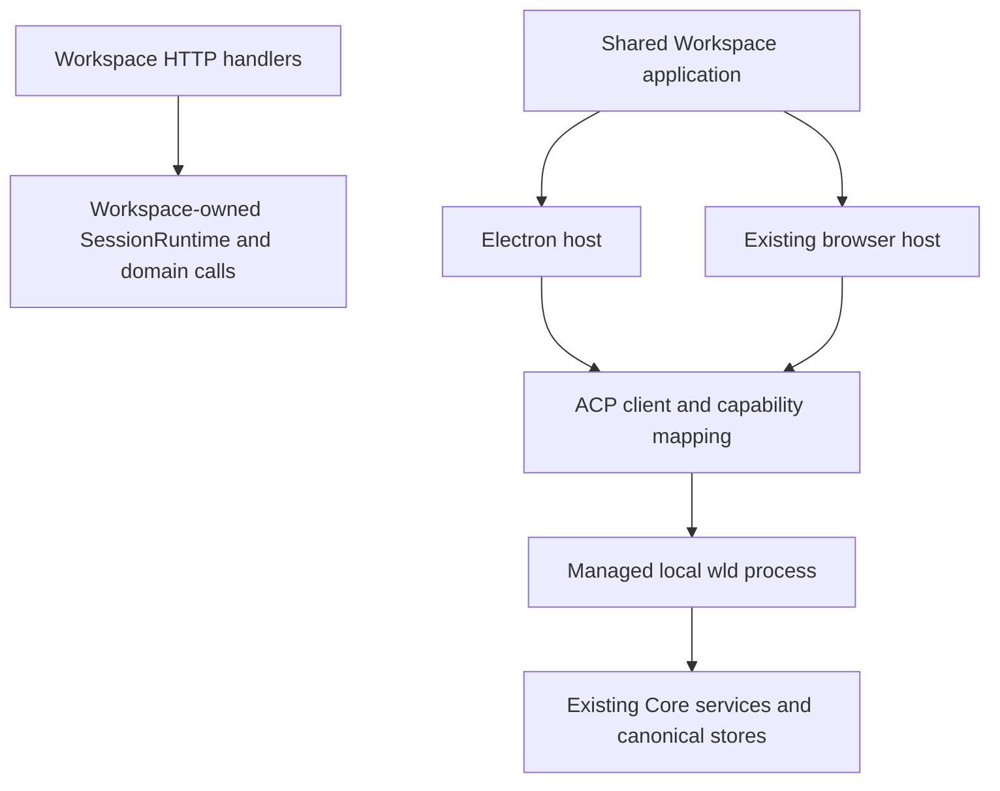

# Local Workspace Desktop

## Context

The owner wants an Electron application that owns Workspace and controls `wld` through ACP plus extensions. `wld`
remains the TUI and runtime. The application should eventually support another machine's runtime and optional hosted
Workspace sign-in for identity and cloud services. Start with the local application because those future services do
not yet exist. Mobile app development is deferred.

This is an architecture and implementation proposal, not implementation authorization or delivery evidence. The
desktop target is Windows, macOS, and Linux. The existing browser Workspace remains supported and shares the product
components. Current self-hosted Shared Plan collaboration is not evidence that hosted Workspace accounts/cloud
features are available.

Owning requirements:

- [Desktop Workspace](../prd/runwield-workspace-prd.md#desktop-workspace): proposed free local desktop journey.
- [Account identity and cloud services](../prd/runwield-workspace-prd.md#workspace-identity-and-cloud-services): later
  scope, kept independent of local access.
- [Network runtime access](../prd/runwield-workspace-prd.md#network-runtime-access): later scope, not a local release gate.
- [Workspace ACP access](../prd/runwield-acp-protocol-prd.md#workspace-client-access): proposed protocol parity.
- [Core Session continuity](../prd/runwield-core-prd.md#session-continuity) and
  [execution, validation, and recovery](../prd/runwield-core-prd.md#execution-validation-and-recovery): existing authority
  and completion meaning to preserve.

## Objective

Deliver an installable local Workspace application that works without a RunWield account or a separately installed CLI.
It reuses existing provider setup and canonical work, carries the existing local workbench through a managed `wld`
process, and preserves the same outcomes in the browser and TUI. Its local work must remain available when Workspace
cloud endpoints are unreachable; a model provider may still require its own connection and credentials.

The selected approach is [proposed ADR-020](../adr/020-electron-workspace-acp-client.md). Wrapping the existing server
would ship a window sooner but retain runtime ownership in the UI host. Flutter would require replacing the existing
frontend and adopting Flutter web to preserve hosted-client reuse. The meaningful commitment here is the ACP-backed
client contract and shared UI, not the choice of installer generator.

The first release includes Project registration, attention/dashboard navigation, Sessions and existing history,
configuration, questions/approvals, Plan boards and editing, Plan/Code Review, workflow progress/actions, document and
knowledge views, usage/settings, and native desktop essentials. Existing browser-only sharing links can remain browser
links where appropriate; this Epic does not create an account-based collaboration service. Any proposed reduction in
existing local Workspace capability must be identified during contract inventory rather than silently dropped.

## Vertical Slice Findings

Source inspected on 2026-11-01:

1. `src/ui/workspace/static/workspace-shell.ts`, React surfaces, and Astro pages use HTTP APIs and server-provided
   data. `components/OwnerDashboard.astro` streams dashboard updates directly. A shared React library alone will not
   remove host coupling; composition, data access, and subscriptions need a common client boundary.
2. `src/ui/workspace/routes/owner-session-api.js` reaches `WorkspaceSessionContinuationService` in
   `server/session-continuation.js`. Its constructor calls `createSessionRuntime` with the coordination store and owns
   live operations, retained Sessions, listeners, and background work. That runtime ownership moves into `wld`.
3. `server/owner-plan-actions.ts` calls Core Plan actions and manages operation receipts, generation checks, and writer
   admission. Those semantics must move behind ACP with the authoritative service; an Electron wrapper must not
   reproduce them or discard them while converting HTTP to RPC.
4. `src/acp/server.js` already owns a real runtime and advertises new/load/prompt/cancel/close/delete, configuration,
   image prompts, and steering. `session/list` is not advertised by the inspected implementation. Current upstream v1
   has a Session-list capability; check the pinned SDK before choosing its implementation path.
5. ACP authentication currently refers to provider/default-model setup and advertises terminal login when supported.
   That is distinct from the future Workspace account. A clean desktop install needs an actual provider-setup journey.
6. `package.json` pins Bun 1.4.3, ACP SDK 1.4.0, Astro, React, Vite, CodeMirror, and Pierre diffs. Existing compiled CLI
   and Workspace release scripts can supply assets, but no Electron package/runtime boundary exists yet.
7. [ADR-017](../adr/017-remote-ssh-local-personal-authority.md) governs a different remote SSH product with laptop-owned
   personal state. It does not establish an authenticated remote ACP endpoint or the lifetime of an attached worker.



## Implementation Sequence

These are delivery outcomes to turn into independently reviewable child Plans. This Epic remains draft and does not
create executable child work or claim any milestone complete.

### 1. Establish the workbench contract and a real protocol slice

An inventory maps every current local Workspace read, action, stream, and interaction to its authoritative Core owner
and either standard ACP or a negotiated extension. It includes Project trust, provider setup, Session discovery and
history, Agent/model configuration, queued input and steering, background results, Plans/artifacts, reviews, search,
usage, and settings. Each row has a parity scenario and a compatibility/fallback decision. Existing SDK omissions are
distinguished from protocol omissions; any SDK upgrade is deliberate and independently checked against external clients.

A shared typed ACP client can launch a real compiled/source `wld acp` process, initialize, discover supported
capabilities, open or resume a Session, stream a turn, answer an interaction, cancel, and close correctly. Unsupported
required methods fail before side effects. Desktop product code receives semantic results, not access to arbitrary RPC.
The source boundary is enforced without adding injection seams for Core-owned machinery.

A minimal Electron entrypoint renders the existing shared Session and question components and drives that real process
through an isolated preload bridge. This early vertical proof must show input, streaming output, and an answered
interaction inside the desktop window; a static shell or browser-only proof is insufficient. It establishes the
reusable package boundary before the full workbench migration and does not claim product or platform qualification.

### 2. Make Workspace domain services available through ACP

The runtime exposes the contract's workbench capabilities through standard methods where available and versioned
extensions otherwise. Workspace-owned reusable domain behavior moves to a suitable shared Core owner, preserving
canonical store APIs and layered settings. Existing Plan-store work is integrated through its owner, without hard-coded
checkout-only paths or changes to another in-progress Plan's scope.

Mutations retain Project admission, expected revision/generation, request identity, durable receipts, and single-writer
rules. History and observations are bounded and can rebuild from canonical state after a gap. Unknown capabilities,
oversized content, stale review decisions, wrong Project/session references, and duplicate requests have explicit
outcomes. Review payloads include resource identity and versioned decisions so desktop can render them directly; links
required by existing external clients continue to work. Live event data never becomes storage authority.

### 3. Route the browser Workspace through the same client

The existing browser host retains its authentication, device pairing, origin checks, routes, and shared UI behavior,
while its workbench execution uses the ACP client and a separate `wld` process. HTTP adapters only translate authorized
client requests and observations; they no longer construct a runtime or perform authoritative workflow mutations.
Core owns authoritative runtime operations even where browser transport receipts remain useful.

Shared React composition, interaction handling, and subscriptions consume the common Workspace client. Server-only
Astro data-loading boundaries stay in the browser host, not shared interactive components. Browser and future desktop
reuse the same components, model, and semantic tokens. The currently supported browser paths keep their user outcomes;
tests asserting in-process runtime ownership are replaced with real-process protocol coverage.

### 4. Deliver the local Electron application

A desktop package, proposed under `src/ui/desktop/`, owns main/preload/renderer entrypoints and a Vite build. The packaged
renderer opens the shared Workspace application through a local application origin, without starting `wld workspace
serve`, loading a cloud website, or requiring a development server. Main manages the bundled executable over stdio and
exposes narrow validated product operations through an isolated preload bridge.

The user opens the app without a Workspace account, selects/registers an existing Project with a native picker, sees
existing history, and completes a real Session and Plan review. Existing Core provider configuration is reused. With
no provider configured, the app exposes the actual Core setup flow, including its supported authentication mechanism
and default-model selection, using the bundled executable if a terminal flow is needed. Errors identify provider setup
without suggesting that a cloud Workspace account is required. The user can still browse local work.

Menus, shortcuts, external links, clipboard/image attachments, review navigation, notifications, and file dialogs obey
the existing design system and platform behavior. Window/project preferences survive restart. The renderer has no Node
or direct canonical storage access, and untrusted generated content cannot navigate into or invoke privileged APIs.
No placeholder login/cloud/remote controls appear in the first local product.

### 5. Preserve work across windows, clients, and failures

One desktop supervisor keeps its local runtime alive when the window closes; reopening reconstructs the current view.
Separate Projects progress independently. The same persisted Session remains usable from an idle TUI or browser under
Core's normal writer rules, with configuration and completed work hydrated from current evidence.

Explicit Quit distinguishes staying open from stopping owned work and quitting. Cancellation settles before process
disposal; updates wait for the same boundary. A renderer crash does not kill the Agent. A main/runtime crash produces
truthful interrupted state and a safe restart/resume path; recovery rehydrates state without replaying an uncertain
prompt, workflow action, review decision, or publication. Observations after a reconnect reconcile through snapshot/
generation information rather than append a second transcript or regress the view.

### 6. Package, qualify, and document the desktop product

Each target artifact includes a compatible `wld`, runtime dependencies, and the shared UI. It runs on a clean machine
without a global CLI or development toolchain. Shell-installed `wld` remains independently usable and is not overwritten.
The desktop negotiates capabilities instead of assuming any separately installed executable is compatible.

The packaging Plan selects and pins supported Electron and packaging tools, respects Bun's frozen locks and disabled
lifecycle scripts, and documents any explicit audited binary-fetch/build step. Application updates replace the desktop
and bundled runtime together after work settles. Runtime-version compatibility and rollback cannot bypass existing
Core on-disk migration rules. Platform release instructions distinguish development builds from signed/notarized
published artifacts and describe Linux dependencies and supported architectures honestly.

Acceptance is recorded for macOS, Windows, and Linux with actual installed application evidence. A local macOS proof
does not qualify the other two systems. Public release availability remains unclaimed until publication is confirmed.
The owning PRDs, current ADR references, glossary, and desktop user documentation match delivered behavior; account
sign-in and remote-runtime capabilities remain explicitly future scope.

### Follow-on work outside this Epic

After local acceptance, a separate network-runtime Plan chooses authenticated transport, host registration, attachment
to already-running `wld`, observation replay, authority placement, and disconnect behavior. Host paths and identities
must already be represented without assuming that every runtime is the desktop's local machine.

A separate hosted Workspace Plan defines account identity, service deployment, actual cloud features, access rules,
and entitlements. Signing in enriches the installed application; it neither replaces its local UI nor becomes a
prerequisite for local use. Cloud sign-out does not remove local Projects or history. These future choices do not
justify shipping speculative services, mock authentication, remote transport implementations, or account tables now.

## Expected Change Surface

- `src/acp/`, `src/cmd/acp/` — protocol handlers, negotiation, workbench extensions, process lifetime, compatibility.
- `src/shared/session/`, `src/shared/owner-coordination/`, and existing Plan/workflow owners — reusable authoritative
  workbench services extracted from the UI server, without replacing storage and lifecycle policy.
- `src/ui/workspace/server/`, `routes/`, `components/`, `browser/`, `static/`, and Astro pages — client boundary,
  shared composition, HTTP transport adaptation, and removal of direct runtime ownership.
- New shared ACP client and desktop boundaries — exact paths follow the first contract slice; `src/ui/desktop/` is
  the proposed desktop package, not an existing implementation.
- `src/ui/design-system/`, `docs/design-system.md` — reuse existing primitives; any necessary new desktop pattern
  enters the shared system with documentation.
- `package.json`, Bun locks, existing build/release scripts and CI — explicit Electron build and platform artifacts.
- Workspace/ACP/root PRDs, ADR-011, ADR-021, `docs/domain-language.md`, and user documentation — target/current
  reconciliation at the milestone that actually delivers each capability.

## Reuse Opportunities

- Existing Workspace components and `src/ui/design-system/` for workbench UX, themes, documents, editors, and diffs.
- `src/acp/server.js`, `event-mapper.ts`, `interaction-mapper.js`, and `session-map.ts` for standard protocol behavior.
- `src/shared/session/session-runtime.ts` and file Session stores for turns, writer ownership, persistence, and recovery.
- `src/shared/workflow/plan-actions.ts` and current Plan-store services for revision-checked workflow operations.
- Existing Workspace receipt/generation checks, moved behind their authoritative boundary rather than duplicated.
- `scripts/compile-command.ts`, existing compiled-runtime qualification, and packaging/release conventions.
- `defineGitFixture` and `makeValidationProjectRoot` for real repository/Plan fixtures; subprocess/provider boundaries
  may be controlled, but Core writes, locks, and lifecycle transitions must run for real.

## Verification Plan

Prerequisite: Bun 1.4.3 and `bun run install:locked`. Child Plans add focused cases to the isolated runner and update
`scripts/bun-test-files.json` when required. Existing relevant commands include:

```sh
bun scripts/run-tests.js src/acp/server.test.js src/acp/managed-session.integration.test.ts
bun scripts/run-tests.js src/ui/workspace/workspace-session-ux.test.tsx src/ui/workspace/workspace-plan-review.integration.test.ts src/ui/workspace/workspace-code-review.integration.test.ts
bun scripts/run-tests.js src/ui/workspace/workspace-renderer-lifecycle.test.ts src/ui/workspace/workspace-operation-memory.test.ts
bun run workspace:check
bun run seams:check
bun run doc-links:check
```

Each new process/desktop suite must execute the built host boundary and real runtime, not a mocked ACP transcript that
would also pass if IPC never reached `wld`. Add exact commands, desktop dev entrypoints, and artifacts when those child
Plans define them. A plain browser test cannot verify Electron preload isolation, native integration, or child lifetime.

Headed checks use both the existing browser Workspace and the packaged Electron app, with a real disposable Project.
Exercise registration, a streamed Session, question/answer, review, approval-for-later, run, Code Review, cancellation,
restart, and TUI continuation. Use a controlled provider for deterministic state checks and a separately configured
provider for end-to-end acceptance. Verify long histories/diffs, keyboard and screen-reader access, attachments, and
window close/reopen on all target operating systems. Record release-build process-tree memory at idle and with the
same representative workload; no framework marketing estimate substitutes for measurement.

### Outcome Evidence

| Outcome                           | Observable evidence                                                                                                                                                                      |
| --------------------------------- | ---------------------------------------------------------------------------------------------------------------------------------------------------------------------------------------- |
| Free local application            | Fresh install launches and registers a Project with Workspace cloud endpoints unavailable and no account; configured model work succeeds without Workspace authentication.               |
| Real runtime separation           | A process trace shows desktop main and a distinct bundled `wld acp`; desktop/browser host imports do not construct `SessionRuntime` or perform canonical workflow writes.                |
| Full workbench contract           | Every inventory row has a passing real-process parity scenario; standard methods remain standard and unknown required capabilities prevent dependent actions.                            |
| Shared web/desktop implementation | Both hosts import the same workbench components and client models; the desktop renderer imports no server-only modules or Core execution/storage implementation.                         |
| Canonical review and lifecycle    | Stale revision/generation and wrong-Project decisions are rejected by Core; retrying the same request does not execute it twice.                                                         |
| TUI/browser/desktop continuity    | The same persisted Session ID and committed history continue across all three with idle views left open and one writer per operation.                                                    |
| Window and process lifetime       | Window close/reopen preserves running work; renderer crash leaves it running; full Quit waits for cancellation settlement; unexpected process exit can resume without repeating effects. |
| Stable observation                | Long streams stay bounded; reconnect loads a current snapshot/generation and does not duplicate transcript entries or turn incomplete work into success.                                 |
| Native installation               | Installed artifacts on all three OSes run without Bun/Node/global `wld`, preserve saved data across a compatible update, and record signing/publication status accurately.               |
| Authority and privacy             | Generated content cannot invoke arbitrary preload methods; unregistered roots are refused; runtime paths are scoped to their connection; local work is not uploaded by app launch.       |
| Honest product documentation      | Workspace/ACP scenarios describe proven local behavior and retain future labels for remote attachment and hosted identity.                                                               |

The entire Epic protects ordinary TUI use, working external ACP clients, existing browser journeys, private transcripts,
Plan-store ownership, writer exclusion, passive reads, provider configuration, review conflict checks, and Core's
publication/recovery semantics. Expected removals are Workspace-hosted runtime execution, renderer/server bypasses of
the runtime contract for authoritative operations, and platform-specific copies of shared workbench UI. Existing HTTP
routes and Astro hosting need not disappear.

## Edge Cases & Considerations

- Provider setup and Workspace login are distinct. Existing ambiguous ACP errors must identify the real prerequisite.
- Core/Plan-store changes already in progress may change service locations. Verify current owners while slicing; do not
  restore outdated storage paths or overwrite unrelated working changes.
- Initial ACP/SDK gaps can make this a substantial protocol migration. Inventory and a real Session/review slice settle
  feasibility before broad UI movement; do not replace missing semantics with permissive placeholder responses.
- A runtime must support multiple explicit Project contexts without caching process cwd/home as authority.
- Resource transfer, large diffs, and replay need bounds/backpressure. Versioned snapshots preserve correctness when a
  consumer falls behind instead of retaining unlimited events.
- The local browser gateway may use its own managed runtime process. Core's existing single-writer protocol coordinates
  it with Electron and TUI; a new global lease or cross-process fake lock is not introduced.
- Target OS/architecture support, signing credentials, updater hosting, and the release channel must be resolved in the
  packaging Plan. Missing publication prerequisites are recorded, never replaced with claims that a release shipped.
- The first app's background lifetime ends on explicit Quit. Unattended service behavior and remote-worker disconnect
  behavior need separate requirements rather than inheriting window-close semantics.
