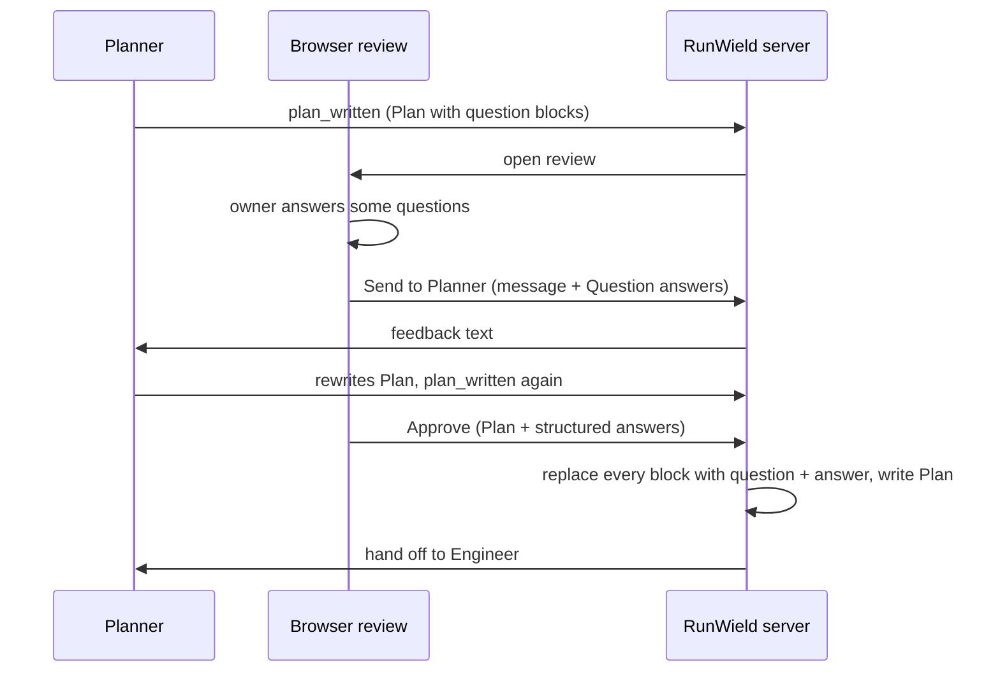

# Answer Planner questions inside the browser Plan review

## Context

The owner wants to try a new Planner workflow locally before it ships:

1. Planner drafts as much of the Plan as it can.
2. Planner puts open questions **in the Plan, next to the section they affect**, as question blocks.
3. The owner reviews the Plan in the browser, answers the questions in place, and talks to Planner in the review chat.
4. Planner rewrites the Plan with the answers and calls `plan_written` again. The loop repeats until approval.

Two parts have different release rules:

- **The block renderer and approval handling ship as a normal, dormant feature.** No shipped Agent writes question
  blocks, so other users never see them.
- **The Planner instructions stay local.** They live in `~/.wld/agents/planner.md`, which RunWield appends after the
  bundled Planner prompt. The bundled Planner prompt does not change. Promoting the experiment later is a prompt change.

What exists today:

- The review page already has a chat with Planner (`ArtifactConversationSidebar.tsx`). Send passes the message and any
  attached review notes to Planner, Planner revises, and the review stays open.
- Review notes for both Send and "Send feedback" come from one builder, `buildPlanReviewFeedback`
  (`plan-review-feedback.ts`).
- The review draft (`plan-review-draft.ts`) saves annotations in the browser so they survive a reload.
- Approve sends the browser's Plan text to the server. `applySharedPlanReviewDecision`
  (`src/shared/workflow/plan-review-actions.ts`) writes that text to the Plan file inside the locked, revision-checked
  review transition.
- Plans are drawn by Plannotator's `Viewer` (upstream submodule). It has no plug-in point for custom code blocks, but it
  tags each rendered block with `data-block-id`, and the review page already has the parsed blocks (`parsed.blocks`).

### Owning PRD capabilities

- [Workspace: Browser Plan review and workflow](../prd/runwield-workspace-prd.md#browser-plan-review-and-workflow) —
  **proposed addition:** answer Plan Questions in place, send answers to Planner automatically, approve with open
  questions after a warning.
- [Core: Plan review](../prd/runwield-core-prd.md#plan-review) — **proposed addition:** on approval, every question block
  in the Plan becomes a recorded question and answer.
- Behavior that must survive: annotation-only chat submissions, review draft recovery, stale-Plan rejection on approval,
  and single application of a repeated approval click.

## Objective

A `wld-question` fenced block in a Plan:

- renders as an answerable form at its place in the browser Plan review;
- carries the owner's answers to Planner with every chat message or feedback submission, with no extra click;
- never reaches Engineer or the saved Plan as a raw block. On approval, RunWield replaces each block with its question
  and the owner's answer, or the recommended answer when the owner did not answer.

## Approach

### The block format

A Plan Question is an embedded `user_interview`: the same question shape, placed in the Plan body instead of the
conversation. It is a fenced code block, so it stays readable in a terminal or on GitHub:

````md
```wld-question
{
  "id": "auth-scope",
  "type": "multiple_choice",
  "prompt": "Which accounts can use the new export?",
  "choices": [
    { "value": "admins", "label": "Admins only" },
    { "value": "all", "label": "All members" }
  ],
  "default": "admins"
}
```
````

- `type` is `yes_no`, `text`, or `multiple_choice`, as in `user_interview`.
- `default` is the recommended answer.
- Multiple choice always offers "Other" with free text, as `user_interview` does.

One module owns this format: `src/shared/plan-questions.ts`. The browser and the server both use it, so the format is
decided in one place.

```ts
parsePlanQuestions(markdown): PlanQuestionBlock[]          // id, question, raw block range, or parse error
resolvePlanQuestions(markdown, answers): string            // every valid block -> question + answer text
formatPlanQuestionAnswers(questions, answers): string      // "### Question answers" section for Planner
```

### Rendering without changing Plannotator

```tsx
<PlanReviewSurface> (src/ui/workspace/react/PlanReviewSurface.tsx)
  usePlanQuestionAnswers()           // answers, saved in the review draft
  <PlannotatorPlanBody> / Viewer     // draws the block as a code block with data-block-id
  <PlanQuestionBlocks>               // finds wld-question blocks in parsed.blocks,
                                     // portals a form into each data-block-id element,
                                     // hides the raw <pre>
```

> [!WARNING]
> **The form depends on Plannotator's rendered output**
>
> The portal relies on `data-block-id` and the code-block markup. A Plannotator upgrade can break it. A focused test must
> fail when the form no longer mounts.

### The loop



- **During planning**, answers travel as text in the feedback (`### Question answers`). Planner turns each answered
  question into a decision in the right section and removes its block. Only the local Planner prompt asks for this.
- **On approval**, the browser sends the answers as structured data (`questionAnswers: [{ id, value }]`). RunWield
  resolves the blocks on the server, in `applySharedPlanReviewDecision`, before the Plan is written. The Plan on disk,
  the Engineer handoff, and the later Work Record all show settled questions.

The resolved text replaces the block in place:

```md
> **Question (auth-scope):** Which accounts can use the new export?
>
> **Answer:** Admins only (recommended; not answered in review)
```

Answer labels:

- owner answer: `(answered in review)`;
- no owner answer, with a recommendation: `(recommended; not answered in review)`;
- no owner answer and no recommendation: `Not answered. Engineer decides.`

> [!TIP]
> **Why resolve on the server and not in the browser**
>
> The server already writes the approved Plan inside the locked review transition. Resolving there means every approval
> path (Workspace, standalone review, Approve for Later, Approve & Run) gets the same result, and a browser bug cannot
> leave raw blocks for Engineer.

Option set aside: keep the blocks in the Plan and explain the answers only in the handoff text. It was less code, but
the blocks confuse Engineer and later readers.

### Approve with open questions

When any question has no owner answer, Approve shows a confirmation: "N questions are not answered. The recommended
answers will be used." The owner can approve anyway.

## Expected Change Surface

This list is guidance, not an allowlist: verify the real footprint during implementation and change whatever the
Implementation Steps need, including files not named here. Stop and report only when discovery changes approved intent —
the change reaches another subsystem, public behavior or architecture shifts, migration or compatibility risk grows, or
the Verification Plan no longer proves the objective.

- `src/shared/plan-questions.ts` (new) — the only owner of the `wld-question` format: parse, resolve to text, format
  answers for Planner. Must be importable by the browser bundle, so it imports `user_interview` types as type-only.
- `src/ui/workspace/react/PlanQuestionBlocks.tsx` (new) — the in-place answer forms, mounted by portal.
- `src/ui/workspace/react/PlanReviewSurface.tsx` — owns the answer state, auto-attaches answers to chat, adds
  `questionAnswers` to the Approve payload, and shows the open-question confirmation.
- `src/ui/workspace/react/plan-review-feedback.ts` — appends `### Question answers` to the feedback text.
- `src/ui/workspace/react/plan-review-draft.ts` — saves answers with the review draft.
- `src/ui/workspace/routes/api/review-handlers.js` — reads and normalizes `questionAnswers` on the approve decision.
- `src/shared/workflow/plan-review-actions.ts` — resolves question blocks in the reviewed Plan before the approval
  write. Only the approved path does this.
- `docs/prd/runwield-workspace-prd.md`, `docs/prd/runwield-core-prd.md` — new requirements and scenarios.
- `docs/domain-language.md` — the new term **Plan Question**.
- `docs/design-system.md` — only if the form needs a visual pattern that the design system does not cover yet.
- `~/.wld/agents/planner.md` — the local Planner instructions. Outside the repository; not part of the commit.

Deliberately not changed: the Plannotator submodule, the bundled Planner prompt
(`src/agent-definitions/`), `plan_written`'s handoff text, and the TUI review.

## Reuse Opportunities

- `src/tools/user-interview.ts` — `YesNoInterviewQuestion`, `TextInterviewQuestion`, `MultipleChoiceInterviewQuestion`,
  `InterviewChoice` as the block's question types.
- `parsed.blocks` in `PlanReviewSurface.tsx` — the existing parse of the Plan, which already carries code block language
  and `id`.
- `attachedContextLabel` and `onDetachContext` in `ArtifactConversationSidebar.tsx` — the existing attached-context chip.
- `createPlanReviewDraft` / `parsePlanReviewDraft` — draft persistence and plan fingerprinting.
- `src/ui/design-system/components/react/RunWieldPrimitives.jsx` and `--rw-*` tokens — form controls and colors.

## Implementation Steps

- `src/shared/plan-questions.ts` exports `parsePlanQuestions`, `resolvePlanQuestions`, and `formatPlanQuestionAnswers`,
  and the types `PlanQuestionBlock` and `PlanQuestionAnswer` (`{ id: string; value: boolean | string }`).
  `parsePlanQuestions` returns one entry per ` ```wld-question ` fence with its `id`, question, and source range, or a
  parse error for invalid JSON, a missing `id`, an unknown `type`, a duplicate `id`, or a multiple-choice question with
  no choices.
- `resolvePlanQuestions` replaces every valid block with the quoted question-and-answer text defined in Approach, using
  the owner's answer when present, otherwise `default`, otherwise `Not answered. Engineer decides.` Multiple-choice
  answers show the choice label; an "Other" answer shows the owner's text. Invalid blocks stay unchanged. All text
  outside the blocks is byte-identical.
- In the browser Plan review, each valid `wld-question` block renders as a form in place of its code block: radio
  buttons for multiple choice plus "Other" with a text field, Yes/No for `yes_no`, a text area for `text`. The
  recommended option is marked "Recommended". An invalid block stays as a plain code block with a visible parse-error
  note. Plannotator source is not modified.
- Answers are saved in the review draft and restored after a page reload of the same Plan revision. Answers whose `id`
  no longer exists in a revised Plan are dropped.
- When at least one question has an answer, the chat shows the attached-context chip (for example "2 question answers
  attached") without a manual "add to chat" click. Send and "Send feedback" include a `### Question answers` section,
  built by `formatPlanQuestionAnswers`, with one line per answered question. Removing the chip excludes the answers from
  that message. The chip combines with the existing review-notes chip when annotations are also attached.
- Approve sends `questionAnswers` in the decision body. `reviewDecisionApi` keeps only entries with a string `id` and a
  boolean or string `value`.
- When any valid question has no answer, Approve (for Later and Run) first shows a confirmation that names the count and
  says the recommended answers will be used. Cancel keeps the review open; confirm approves.
- `applySharedPlanReviewDecision` applies `resolvePlanQuestions` to the reviewed Plan only when the decision is
  approved, before the Plan is written. The written Plan file has no `wld-question` fence, and the rest of the approval
  transition (stale checks, lifecycle events, single application) is unchanged. Feedback decisions write no change to
  the blocks.
- `~/.wld/agents/planner.md` tells Planner to: write consequential open questions as `wld-question` blocks in the
  section they affect, with a recommended `default` when it has one; keep using `user_interview` only for blocking
  questions it must settle before it can draft; and, when feedback contains `### Question answers`, record each answer
  as a decision in the right section, remove that block, and call `plan_written` again. If the Engineer cannot write
  outside the worktree, it reports the exact file content to the owner instead.
- `docs/prd/runwield-workspace-prd.md` (Browser Plan review and workflow) and `docs/prd/runwield-core-prd.md` (Plan
  review) describe the delivered behavior with acceptance scenarios, and say that no bundled Agent writes question
  blocks yet.
- `docs/domain-language.md` defines **Plan Question**: the Plan-surface form of the **User-Interview Tool**, an embedded
  interview question written as a `wld-question` block in a Plan, answered by the owner in browser review, and resolved
  into question-and-answer text on approval. The entry states how it differs from the User-Interview Tool (in the Plan
  body and answered asynchronously, not a blocking tool call in the conversation).

## Verification Plan

Automated:

- `bun scripts/run-tests.js src/shared/plan-questions.test.ts` — parse and resolve: owner answer, recommended fallback,
  no recommendation, "Other" text, yes/no, invalid and duplicate blocks left unchanged, surrounding text unchanged. A
  stub `resolvePlanQuestions` that returns its input fails these tests.
- `bun scripts/run-tests.js src/shared/workflow/plan-review-actions.test.ts` (or the existing approval test file) —
  against a real Plan project from `makeValidationProjectRoot`: approve a Plan with two blocks, one answered, and assert
  the Plan **file on disk** has no `wld-question` fence and contains both resolved answers with the right labels. A
  feedback decision on the same Plan leaves the blocks in the file. A stale-Plan approval is still rejected.
- `bun scripts/run-tests.js src/ui/workspace/react/plan-review-feedback.test.ts src/ui/workspace/react/plan-review-draft.test.ts`
  — feedback contains `### Question answers` only when answers exist; draft round-trips answers and drops stale ids.
- A React test for `PlanQuestionBlocks` through the real `Viewer` render: the form mounts at the block, the raw `<pre>`
  is hidden, and selecting an option updates the answer state. This test fails if the portal no longer finds the block.
- `bun run seams:check` — no new seam.

Manual (headed browser, Frontend Engineer):

1. Put `~/.wld/agents/planner.md` in place. Ask Planner for a small Plan. Confirm the review shows question forms in
   their sections.
2. Answer one question, reload the page, and confirm the answer is restored.
3. Type a message and Send. Confirm the chip showed the answer count and Planner's revised Plan records the decision and
   no longer has that block.
4. Leave one question open and click Approve for Later. Confirm the warning, approve, and open the Plan file: the open
   question shows the recommended answer, and no `wld-question` fence remains.
5. Check light and dark themes and a phone width; the form fits and uses `--rw-*` tokens.

Behavior that must stay protected: annotation-only Send, annotation chip removal, review draft recovery, stale-Plan
rejection on approval, and single application of a repeated approval click. No existing behavior is expected to stop.

## Edge Cases & Considerations

- **Plannotator upgrade breaks the portal.** The React test above fails first. The block still reads as JSON if the form
  does not mount.
- **The owner edits a block by hand in the review.** Direct edits are part of the reviewed Plan; resolution uses the
  edited block.
- **Planner leaves an answered block behind.** On approval, the owner's draft answer still resolves it.
- **Sequence reviews.** Question blocks in Sequence child Plans are not resolved by this change; Sequence approval uses a
  different path. Reviewable assumption: not needed for the experiment.
- **TUI review** shows the raw block. Acceptable while only the local Planner writes blocks.
