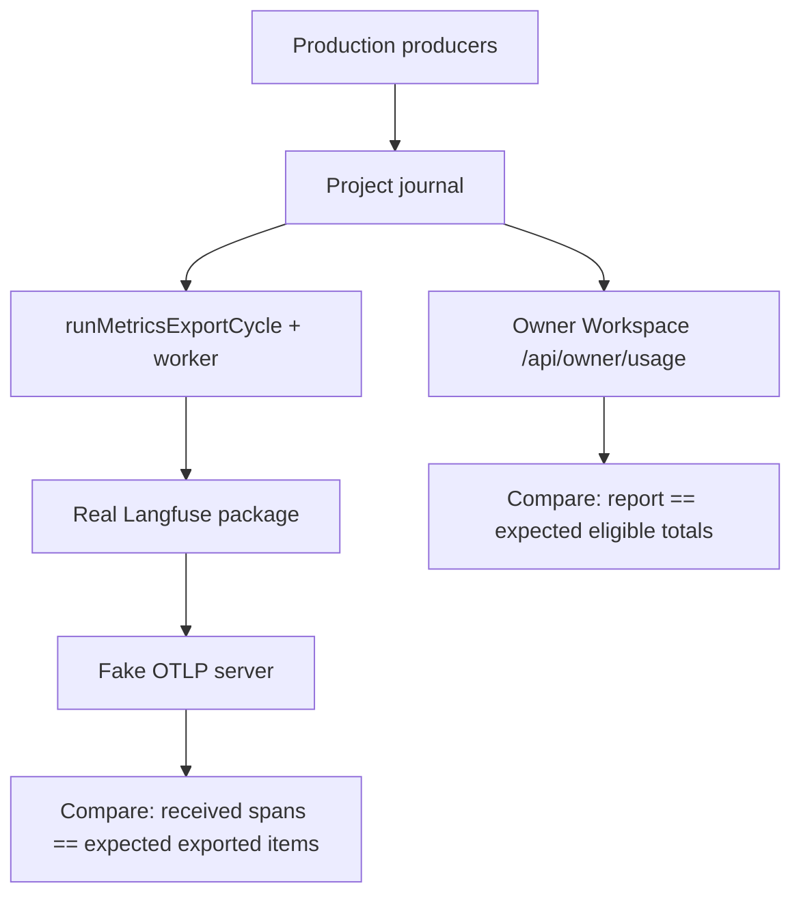

# End-to-End Usage and Export Acceptance

## Context

Children 01–09 are delivered. Each one proves its own boundary. The parent Epic names one journey that no child owns,
and it says that a synthetic-only demo is not a completed integration.

This child does three things:

1. Repairs the defects that the earlier reviewers left in the Epic's **Integration Notes** and that are still open.
2. Adds one hermetic journey test that runs the real chain, from recording to the Workspace report and the real
   Langfuse package, and compares local and remote totals.
3. Runs the same journey live, with the owner, on a real Project, all three backends, and a disposable Langfuse
   project. Then it reconciles the documents.

Owning PRD capabilities:

- Core [Usage measurement and export](../../prd/runwield-core-prd.md#usage-measurement-and-export) — gains one
  requirement change: partial cost is not exported as a native total.
- Workspace [Personal usage and outcomes](../../prd/runwield-workspace-prd.md#personal-usage-and-outcomes) — the
  existing requirement "The Report remains readable after a clear" becomes true while a clear is pending.
- Root [capability ownership map](../../prd/runwield.md) — links checked, no new ownership.
- Core [Execution, validation, and recovery](../../prd/runwield-core-prd.md#execution-validation-and-recovery) and
  [Models and providers](../../prd/runwield-core-prd.md#models-and-providers) stay authoritative for delivery
  conclusions and backend visibility. This child changes neither.

### What discovery found

Integration Notes status, checked against current source:

| Note                                                    | Status   | Evidence                                                                                                                                                                       |
| ------------------------------------------------------- | -------- | ------------------------------------------------------------------------------------------------------------------------------------------------------------------------------ |
| 03 — repair round counted once; interrupted ≠ abandoned | Resolved | `usage-reporting.ts` counts `repair_round` only and dedups on `roundId`. No test puts `repair_round` and `repair_round_finished` with the same `roundId` together.             |
| 05 — status strip and shared report response            | Resolved | `usage-rendering.test.ts` asserts the strip; `UsageReport.tsx` reads one `/api/owner/usage` response.                                                                          |
| 05 — `/usage` readable while a clear is pending         | **Open** | `owner-usage.ts` throws `HISTORY_CLEAR_MESSAGE` when `coverage.historyClearPending`, and `owner-api.js` returns 400. A clear intent stranded by a crash keeps `/usage` at 400. |
| 06 — worker imports only approved `entryPath`           | Resolved | `metrics-exporter-worker.ts` imports `data.entryPath` only.                                                                                                                    |
| 06 — settings show three exporter states                | Resolved | `owner-usage-settings.ts` maps `approved` / `installed_unapproved`; empty list shows "not installed".                                                                          |
| 07 — exporter contract; `not_found_yet` for absence     | Resolved | `exporter.ts` `confirm` returns only `present`, `not_found_yet`, `mismatch`.                                                                                                   |
| 07 — Workspace settings call Core grant functions       | Resolved | `mutateUsageSettings` calls the Core functions; counts come from `readMetricsExportStatus`.                                                                                    |
| 08 — partial cost exported as native total              | **Open** | `exporter.ts` `map` sets `cost_details` and `model.name` for any `reported`/`calculated` USD cost, and ignores coverage.                                                       |

> [!WARNING]
> **Partial cost inflates the vendor chart today**
>
> Guided Review records a known cost subtotal as `costSource: "reported"` with `measurementAvailability: "partial"`.
> An agy row with partial tokens and a complete catalog cost looks the same in the export record. The exporter sends
> both as a native Langfuse total. Langfuse then shows a subtotal as the full cost. This is the exact failure the Epic
> names: HTTP 200 while a vendor chart is wrong.

The local reporter has the same conflation in reverse: `usage-reporting.ts` marks cost partial whenever
`measurementAvailability === "partial"`, so complete agy cost is shown as partial.

Two corrections to the earlier draft of this child:

- **Recording stays opt-in.** The owner withdrew default-on recording on 2026-10-06 (child 01). The current PRDs,
  `settings.md`, and `SETTINGS.md` already say opt-in. The Epic document still says "on by default" in its scope
  bullet, persistence section, "Record by default" outcome row, durable commitments, and expected changes. Those edits
  were lost in a branch merge. This child restores them, so the integration review does not judge delivery against a
  withdrawn goal.
- **`bun run workspace:dev` serves fixture data.** In dev mode, `pages/api/owner/[...segments].ts` returns
  `dev-usage-fixture.ts` and starts no scheduler. It is fine for visual repair, but the journey must use the real owner
  Workspace: `bun src/cli.ts workspace serve --no-open`, which starts the owner Workspace and the export scheduler in
  one process. The TUI starts only the scheduler (`startInteractiveSession`). "TUI-hosted" in the Epic means: a
  browser on `wld workspace serve` while a TUI Session is also running.

### Epic Scope Changes

None. All siblings are delivered. This child edits the parent Epic document only to restore the owner's opt-in
decision.

## Objective

Demonstrated agreement, on real runs:

- Local totals match eligible collected evidence.
- Remote totals match received observations.
- Every gap is disclosed beside its number: disabled interval, partial CLI data, partial cost, a lost export response.

Documentation describes delivered behavior, with unmet intent still labeled target or deferred.

## Approach

Three parts, in order. Repairs go first, so the journey test and the live run check the repaired system.

```text
A  repair open notes        partial cost coverage (08), readable pending clear (05), repair-round test (03)
B  hermetic journey test    real producers -> journal -> report API + real Langfuse package -> fake OTLP server
C  live journey (owner)     real Project, Pi + Claude + agy, wld workspace serve, phone, disposable Langfuse
   then documentation reconciliation
```

### A1. Cost coverage becomes its own fact

Today one field, `measurementAvailability`, carries both token and cost coverage. Add an explicit cost coverage field
to the model-usage observation. Each writer states it from its own evidence.

```diff
 ModelUsageObservation (execution-metrics.ts)
   costAmount, costCurrency, costSource
   measurementAvailability          # token-category coverage
+  costAvailability?: "complete" | "partial" | "unavailable"
```

Consumers read it like this:

```text
exporter map(row)
  if costAvailability == "partial"
    send no cost_details, no model.name        # same as unavailable cost
    keep known subtotal in metadata with cost_complete=false
  else if costAvailability absent
    keep today's rule                          # old rows, agy behavior unchanged
  else today's rule

local reporter cost coverage(row)
  if costAvailability present  -> use it
  else                         -> today's rule (partial measurement => partial cost)
```

Writers:

- `recordGuideJobMetric` (`review-agent-handlers.js`) sets `partial` from `usageTotals.availability.costUsd`.
- The agy CLI writer sets `complete` when the catalog calculation applies, `unavailable` otherwise.
- Claude CLI and Pi writers set the value their source supports.

> [!TIP]
> **Why a field, not a rule in the exporter**
>
> The exporter cannot tell a Guided Review subtotal from a complete agy cost with today's fields. Guessing from
> `costSource` would suppress a correct agy cost or keep the wrong subtotal. One explicit fact, owned by the writer
> that has the evidence, fixes the export and the local report together.

The field goes through the metrics.js schema allow-list, `FIELDS.model_usage` in `metrics-export-record.ts`, and the
exporter's `FIELDS`/`ENUMS`. Absent means "use the old rule", so existing journals and the agy installation test keep
their meaning.

### A2. `/usage` stays readable while a clear is pending

The Workspace PRD already requires this: "The Report remains readable after a clear, including a concurrent clear from
another process", and Core "marks a pending clear explicitly in Project coverage ... so Workspace can offer a readable
retry". Today the route throws instead.

```diff
 loadOwnerUsageReport (owner-usage.ts)
   report = queryUsageReport(roots, period, timeZone)
-  if report.coverage.historyClearPending -> throw HISTORY_CLEAR_MESSAGE   # -> 400
+  return report                          # pending Projects show no old rows + a pending-clear notice
   on usage_history_changed -> retry, bounded; after the bound, same readable result, never a raw code
```

`UsageReport.tsx` shows the pending clear next to the affected Project, using an existing notice primitive.

> **Question (stranded-clear-recovery):** A crash can leave a clear intent that only a locked writer finishes. With recording off and no export running, nothing finishes it. How should RunWield recover?
>
> **Answer:** Report shows 'Clear did not finish' with a Retry clear button that re-runs the existing clear (recommended: report stays read-only, matches the PRD's 'readable retry') (answered in review)

### A3. Repair-round dedup gets its missing test

No code change. A `usage-reporting.test.ts` case puts `repair_round` and `repair_round_finished` with the same
`roundId` in one journal and expects one repair round.

### B. One hermetic journey test

A new integration test runs the Epic journey with production producers and real files. Only true external boundaries
are fake: the model, the CLI subprocess output (pinned stream fixtures), and the Langfuse HTTP server.



The expected totals are written in the test from the fixture inputs. They are not read back from
`queryUsageReport`. Otherwise a wrong reporter would agree with itself.

Set aside: an env-gated live Langfuse test in CI. It needs credentials in the test environment and creates remote data
on every run. The live check stays an owner-run step (part C).

### C. Live journey, run with the owner

The Engineer prepares the run and the evidence template. The owner provides credentials, CLI logins, and the phone.
This is the reason for Pair execution.

```text
1  non-Plan work                      -> usage recorded, no Plan attribution
2  each backend (Pi, Claude, agy)      -> per-backend rows with real provenance
3  an interruption                     -> ongoing, never "abandoned"
4  a repaired publication              -> failed validation + repair round + one delivered attempt
5  a deliberate abandonment            -> abandoned, distinct from interrupted
6  a disabled interval                 -> no rows, no export, a gap on the report
7  restart (close TUI and workspace)   -> only persisted evidence; gaps stay gaps
8  a lost export response              -> unconfirmed, not resent, later items still send
9  inspect /usage on desktop and phone -> same zone, days, totals
10 inspect the disposable Langfuse project -> counts and sums match received observations
```

> **Question (langfuse-destination):** Which disposable Langfuse v4 project will you use for the live journey?
>
> **Answer:** A new disposable project on Langfuse Cloud over HTTPS (recommended: the PRD names Cloud v4 as the supported protocol) (answered in review)

Step 8 needs a lost response from a real destination. A real Langfuse does not drop responses on request. Assumption,
reviewable: the live run gets step 8 by cutting the network after the request is sent (for example, a loopback
forwarding proxy that the owner stops mid-request). If that is not practical, step 8 is proven by the hermetic test
only, and the evidence file says so.

## Expected Change Surface

These are the boundaries we have evidence for. This list is guidance, not an allowlist: verify the real footprint
during implementation and change whatever the Implementation Steps need, including files not named here. Stop and report
only when discovery changes approved intent — the change reaches another subsystem, public behavior or architecture
shifts, migration or compatibility risk grows, or the Verification Plan no longer proves the objective.

- `src/shared/workflow/execution-metrics.ts`, `src/shared/workflow/metrics.js` — `costAvailability` on the
  model-usage observation and its schema allow-list.
- `src/ui/workspace/routes/api/review-agent-handlers.js`, agy/Claude CLI execution sessions, Pi usage writer — each
  writer states cost coverage.
- `src/shared/workflow/metrics-export-record.ts` — carry `costAvailability` in the export record.
- `packages/langfuse-exporter/exporter.ts`, `mapping.test.ts` — suppress native cost and model name for partial cost.
- `src/shared/workflow/usage-reporting.ts`, `usage-reporting.test.ts` — cost coverage from the new field; repair-round
  dedup test.
- `src/ui/workspace/server/owner-usage.ts`, `react/UsageReport.tsx`, `owner-usage-report.integration.test.ts` —
  readable report while a clear is pending.
- New `src/ui/workspace/usage-export-journey.integration.test.ts` (path proposed) — the hermetic journey. Shared
  install helpers may move out of `packages/langfuse-exporter/installation.test.ts` into a test fixture.
- New `docs/plans/reliable-usage-dashboard-and-langfuse-export/journey-evidence.md` — content-free record of the live
  run.
- `docs/plans/reliable-usage-dashboard-and-langfuse-export.md` — restore the owner's opt-in decision.
- `docs/prd/runwield-core-prd.md`, `docs/prd/runwield-workspace-prd.md`, `docs/prd/runwield.md` — partial-cost export
  rule, pending-clear behavior, link check.
- `docs/user-documentation/settings.md`, `src/skills/runwield/SETTINGS.md` — only if they disagree with delivered
  behavior after the repairs.
- `docs/domain-language.md` — verify only. **Usage observation**, **Metrics exporter**, and **Delivery unconfirmed**
  already exist; edit only if the repairs change a definition.
- Any module from children 01–09 where the live journey exposes a real defect.

Deliberately out: `docs/plans/archived/complete-tool-call-metrics.md` stays as completed history. No new settings, no
new export states, no retry control.

## Reuse Opportunities

- `packages/langfuse-exporter/installation.test.ts` — the real install, approval, grant, record, and worker-delivery
  path. The journey test starts from it.
- `packages/langfuse-exporter/test-fixture.ts` `withServer`, `readback()`, `captured()` — fake OTLP server and request
  capture.
- `src/testing/metrics-export-fixture.ts` `withMetricsExportFixture` — `/drop`, `/503`, hold and release controls for
  lost responses.
- `src/shared/workflow/usage-reporting-runtime.test.ts` — real `createSessionRuntime` prompt to journal.
- `src/shared/workflow/publication-outcome-observations.test.ts` and `src/shared/workflow/testing/publication-outcome-*.ts`
  — real publication with repair, and fresh-process drivers.
- `src/shared/workflow/metrics-export-process.test.ts` — restart and two-host patterns through `spawnNativeProcess`.
- `src/ui/workspace/owner-usage-report.integration.test.ts` — `createOwnerWorkspaceApp` with owner store and journal.
- Claude and agy pinned stream fixtures used by `claude-cli-execution.test.ts`, `agy-cli-execution.test.ts`, and the
  package's `claude-fixture`/`agy-fixture` tests.
- `defineGitFixture`, `withProcessGlobalTestLock`, `withWorkflowMetricsFixture`.

## Implementation Steps

Part A — repairs:

- `ModelUsageObservation` and `recordModelUsage` in `src/shared/workflow/execution-metrics.ts` accept an optional
  `costAvailability` of `complete`, `partial`, or `unavailable`, and the metrics.js schema allow-list keeps it in the
  journal row.
- `recordGuideJobMetric` writes `costAvailability: "partial"` when `usageTotals.availability.costUsd` is `partial`.
  The agy, Claude CLI, and Pi model-usage writers write the value their source evidence supports.
- `FIELDS.model_usage` in `src/shared/workflow/metrics-export-record.ts` and `FIELDS`/`ENUMS` in
  `packages/langfuse-exporter/exporter.ts` carry `costAvailability`.
- `map` in `packages/langfuse-exporter/exporter.ts` sends no `langfuse.observation.cost_details` and no `model.name` for
  a row with `costAvailability: "partial"`, and keeps the known subtotal and a cost-incomplete flag in metadata.
  Rows without the field keep today's mapping.
- `packages/langfuse-exporter/mapping.test.ts` has a case for `reported` cost with `costAvailability: "partial"` that
  fails if native cost or model name is sent. The agy partial-token, complete-cost case in `installation.test.ts`
  still exports native cost and confirms.
- `usage-reporting.ts` uses `costAvailability` when present for cost coverage. A complete agy cost on a partial-token
  row is counted as complete cost. Rows without the field keep today's rule. `usage-reporting.test.ts` covers both.
- `usage-reporting.test.ts` has a case with `repair_round` and `repair_round_finished` under one `roundId` that
  expects exactly one repair round.
- `/api/owner/usage` returns 200 with the report while a clear intent is pending. The affected Project shows no old
  rows and a pending-clear notice in `UsageReport.tsx`. A repeated `usage_history_changed` never reaches the browser
  as a raw code or a 400. `owner-usage-report.integration.test.ts` asserts the 200 response and the notice instead of
  the old 400.
- A stranded clear intent is recovered as decided in question `stranded-clear-recovery`, with a test that creates a
  stranded intent with recording off and proves the report becomes settled without manual file edits.

Part B — hermetic journey test:

- `src/ui/workspace/usage-export-journey.integration.test.ts` (or the path the Engineer picks, named in the evidence
  file) runs in a sandbox HOME with a real Git Project, a fixed `TZ`, a real install and approval of
  `packages/langfuse-exporter`, recording enabled, and a destination granted to a fake OTLP server.
- Every row in that test comes from a production producer: the session runtime for Pi, the Claude and agy usage
  translation with pinned stream fixtures, `recordGuideJobMetric` for a partial-cost Guided Review job, the
  publication machine for a failed validation plus repair plus confirmed publication, and the recovery abandon action
  for a deliberate abandonment. No test writes journal lines by hand.
- The test covers: non-Plan work with no Plan link; an interrupted delivery reported ongoing; a disabled interval with
  no rows, no export, and a gap day; a restart in a fresh process; and one lost OTLP response.
- The test asserts the Workspace owner API report against totals written in the test from the fixture inputs:
  tokens per backend, reported and estimated cost, partial-cost exclusion counts, one published change, validation
  attempts, one repair round, one ongoing, one abandoned, and the gap day.
- The test asserts the fake OTLP server's captured requests: one span per eligible exported item, usage and cost sums
  equal to the expected exported items, no native cost or model name on the partial-cost item, no item from the
  disabled interval or from before the grant, and no prompt, path, or credential text in any body.
- After the lost response, the item is `unconfirmed` in `readMetricsExportStatus`, is not sent again by a second
  cycle or after restart, and a later item is still delivered.

Part C — live journey and documents:

- `docs/plans/reliable-usage-dashboard-and-langfuse-export/journey-evidence.md` records the live run: date, host time
  zone, RunWield commit, CLI versions, Langfuse destination kind, each journey step with its observed result, and the
  local-versus-remote count and sum table. It contains no credential, prompt, code, path, or Project name.
- In that record, local totals on `/usage` equal the eligible rows in the journal for the journey period, and
  Langfuse counts and sums equal the observations Core reports as accepted or confirmed. Each difference is explained
  by a disclosed gap: disabled interval, partial data, partial cost, or unconfirmed delivery.
- Every defect the live run exposes is repaired in this change, with a test at the owning boundary, and listed in the
  evidence file.
- `docs/plans/reliable-usage-dashboard-and-langfuse-export.md` says recording is opt-in in its scope bullet,
  persistence section, outcome table row (renamed from "Record by default"), durable commitments, and expected
  changes, and cites the owner's 2026-10-06 decision.
- The Core PRD Langfuse requirement and its scenario say that partial cost sends neither cost details nor a native
  model name. The Workspace PRD scenarios include a readable report during a pending clear and the chosen stranded
  clear recovery. The root ownership map links resolve.
- `docs/user-documentation/settings.md` and `src/skills/runwield/SETTINGS.md` describe opt-in recording, retention
  until deletion, and separate export approval, and mention the pending-clear behavior where clear is documented.
- `docs/domain-language.md` definitions of **Usage observation**, **Metrics exporter**, and **Delivery unconfirmed**
  match delivered behavior, and no unimplemented proposal is in it.

## Verification Plan

Automated, focused:

- `bun scripts/run-tests.js packages/langfuse-exporter`
- `bun scripts/run-tests.js src/shared/workflow/usage-reporting.test.ts src/shared/workflow/execution-metrics.test.ts`
  (and any writer tests the Engineer changes)
- `bun scripts/run-tests.js src/ui/workspace/owner-usage-report.integration.test.ts src/ui/workspace/usage-export-journey.integration.test.ts`
- `bun run seams:check`, `bun run workspace:check`, `bun run workspace:build`, `bun run doc-links:check`
- Never run `bun test` directly. RunWield runs the full CI after implementation.

Which tests prove the change:

- The new `mapping.test.ts` partial-cost case fails against today's `map`.
- The new `owner-usage-report.integration.test.ts` assertion fails against today's 400.
- The journey test fails if the reporter zero-fills a missing value, if the exporter sends native cost for partial
  cost, if a disabled-interval row is exported, or if the lost item is resent. Its expected numbers come from fixture
  inputs, so a pass-through reporter cannot agree with itself.

Live journey (Pair checkpoint, owner present):

- Owner authorizes creating the disposable Langfuse project and exporting journey records. Do not upload existing
  history. Use a new grant, so only operations after the grant boundary export.
- Run `bun src/cli.ts workspace serve --no-open` with a TUI Session running. Open `/usage` and `/usage/settings` on a
  desktop browser and on the paired phone. Do not use `bun run workspace:dev` for the journey: it serves fixtures.
- Walk steps 1–10 in Approach C. Record each result in `journey-evidence.md`.
- In Langfuse, query the received observations through the public API and the UI. Compare counts and sums with the
  local report. A native chart that shows a full or zero total for a partial or unavailable value is a failure, even
  with an availability label.
- Inspect captured request bodies, Workspace responses, logs, and browser storage: no prompts, code, conversation text,
  raw tool data, private paths, or credential values.
- After a clear during the journey, confirm Sessions, Plans, and worktrees remain, and `/usage` stays readable.

Behavior that must still be protected:

- Home, Session navigation, pairing, Project access, explicit recording opt-outs, Session authority, worktree
  protection, redaction, and truthful workflow completion.
- Opt-in recording: an absent `workflowMetrics` setting records nothing.
- Complete agy catalog cost still exports as native cost (`installation.test.ts`).
- Existing journals without `costAvailability` report the same cost coverage as before.

Expected to stop existing:

- A 400 from `/api/owner/usage` while a clear is pending (the old assertion in
  `owner-usage-report.integration.test.ts` is rewritten, not deleted).
- Native Langfuse cost for a partial cost subtotal.
- Complete agy cost shown as partial on the local report.

Documents: the Epic, PRDs, settings docs, and glossary all say opt-in, describe the partial-cost and pending-clear
behavior, and claim no unmet target as shipped. No historical metrics reconstruction exists anywhere.

## Edge Cases & Considerations

- **Usage never reported upstream.** Some CLI turns have no usage. The journey must show that as a disclosed gap, not
  treat it as a defect.
- **Non-local filesystem.** If the journey host uses one, record the degraded-collection behavior in the evidence file.
  Do not substitute lease expiry.
- **Destination outage or quota error during the live run.** Record it as an observed delivery state. Do not retry
  blindly and do not resend unconfirmed items.
- **Langfuse adds its own calculated cost.** Langfuse can add cost to a vendor total for a recognized model. Partial
  and unavailable cost rows send no native model name, so this must not happen for them; if it does, it is a defect.
- **Evidence reuse.** `journey-evidence.md` is real-run output. Keep it reproducible as a checklist, without turning it
  into a synthetic fixture.
- **Scope.** One host and host-time-zone days. No multi-host identity, team aggregation, or historical export.
- **Assumption, reviewable:** the evidence file lives beside the Epic children, not in `manual-qa.md`, because
  `manual-qa.md` is generated and advisory.
