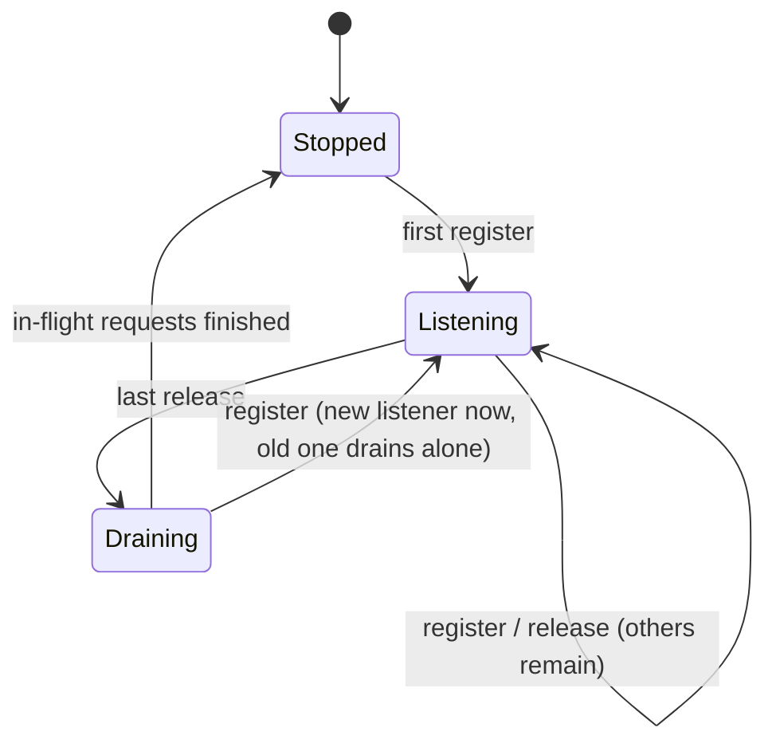

# Host Reviews on One Server per Process

## Context

Today every browser review surface starts its own HTTP server on `127.0.0.1:0`:

```text
review-launcher.ts
├── startPlanReviewSurface     → workspaceServer → startReviewWorkspaceServer → serveHttp (new port)
├── startCodeReviewSurface     → workspaceServer → startReviewWorkspaceServer → serveHttp (new port)
└── startArtifactReadSurface   → workspaceServer → startReviewWorkspaceServer → serveHttp (new port)
document-link-host.ts          → DocumentLinkHost.resolve                     → serveHttp (new port)
```

One `wld` process can hold several of these at once, each on a different random port. For the Remote SSH Epic, this
means each review needs its own SSH forward created while the connection is running. That needs OpenSSH multiplexing,
which the Windows OpenSSH client does not support, or a custom relay.

The owner chose a different shape during planning of
[child 10](10-open-remote-reviews-in-the-local-browser.md): **one review host per process, with every review and
artifact view registered on it by token**. Child 10 then forwards that one host once, at connection start. This child
is the local refactor that makes that possible. It has no remote behavior.

The change also stands on its own: fewer listeners per process, and one module that owns review URLs.

### PRD capabilities

- [Plan Review](../../prd/runwield-core-prd.md#plan-review) and Code Review behavior must survive unchanged: page
  tokens, feedback rounds, reopen, decision once, cancel on stop, Guided Review, uploads, images, file content.
- The Core PRD's TUI document-reader text ("The TUI owns one lazy loopback reader … TUI disposal stops the host") changes
  wording: the reader becomes a registration on the process review host. Its behavior (token rotation on Session
  replacement, old links fail closed, disposal revokes access) stays.

### Epic Scope Changes

- **New child** `09-host-reviews-on-one-server-per-process` (this Plan), order 9.
- [`10-open-remote-reviews-in-the-local-browser`](10-open-remote-reviews-in-the-local-browser.md), order 10: per-review forwards,
  the laptop forward registry, and `BrowserPort.reserveLoopbackPort` are removed. It now forwards the one host socket at
  connection start and depends on this child.
- [`11-package-and-qualify-remote-ssh-support`](11-package-and-qualify-remote-ssh-support.md), order 11: adds this child
  to its dependencies and uses the new child numbers.

## Objective

Each `wld` process runs at most one review host. Plan Review, Code Review, artifact read surfaces, and the TUI document
reader register on it under their own token and get URLs on the host's single origin. The host starts on the first
registration and stops when the last one leaves. All existing review behavior is unchanged.

## Approach

### The host dispatches by token

Every review request already carries its token. Pages use `?token=`. API calls send the `PLAN_UI_TOKEN_HEADER` or
`x-runwield-review-token` header or the query parameter. Images and file content fall back to the page address in
`Referer` (`hasReviewAssetToken` in `server.js`). Static assets are public.

The host uses the same sources to find the registered app, and hands it the request unchanged:

```text
review host request
  token = first registered of: ?token, workspace-token header, review-token header, Referer ?token
  token found                            → that registration's handler, request unchanged
  public workspace asset                 → any live registration (every app serves public assets)
  otherwise                              → 401, cache-control: no-store
```

Each app keeps its own token checks, so a request with mismatched sources still cannot reach another review's data.
The review frontend calls absolute paths (`/api/image`, `/assets/…`), so routing by path prefix (`/r/<id>/…`) was set
aside. It would require frontend changes for no gain; the token already identifies the review.

Some review requests carry no token of their own and depend on the `Referer`. For example, Plan Review and Code Review
poll `fetch("/api/review/conversation")` with no query or header. No review page strips its token from the address bar
(`updateReviewInteractionUrl` only adds `interaction`), and no review page sets a no-referrer policy. Referer dispatch
therefore reaches the right review.

> [!NOTE]
> **The host does not import `server.js`**
>
> `server.js` imports the host. To avoid an import cycle, `isPublicWorkspaceAsset` (a pure path list) moves to a small
> leaf module that both import. A token-less public asset request goes to any live registration, because every review
> app serves public assets before it checks its token.

### Registration replaces "start a server"

`startReviewWorkspaceServer` keeps its return shape (`url`, `waitForDecision`, `beginReviewRound`, `stop`), so
`review-launcher.ts` barely changes. Its body moves from "start a server" to "register on the host":

```diff
 startReviewWorkspaceServer(options)
   decision = registerReviewDecisionPromise(token)
   app = createReviewWorkspaceApp(...)
-  server = serveHttp({ hostname, port: 0, onListen, onError }, app.handler())
-  url = `http://${host}:${server.addr.port}`
+  registration = reviewHost.register(token, app.handler(), { onError })   # synchronous
+  url = registration.origin
   stop():
     resolve canceled decision
     app.cleanup()                     # also ends this review's open streams
-    server.shutdown()
+    await registration.release()     # host drains and stops when the registry is empty
```

`DocumentLinkHost` keeps its class and its lazy behavior. It registers its document-read handler under its token on
first `resolve`, re-registers on `rebind` (the old token is released, so old links fail closed), and releases on
`dispose`.

> [!WARNING]
> **Registration must be synchronous**
>
> `DocumentLinkHost.resolve` runs during TUI Markdown rendering (`mermaid-markdown.js`) and must return a URL right
> away. `register` therefore starts the listener synchronously, as `serveHttp` already does. On `rebind`, the reader
> registers the new token **before** it releases the old one, so the host never goes empty and the origin stays the same.

### One owner for bind address and origin

The host module alone decides where it listens and which origin goes into URLs. Locally that is `127.0.0.1:0` and the
bound port. Child 10 adds remote configuration (a Unix socket, and the laptop origin in URLs) in this one place, so no
review or TUI code learns about remote mode. `startReviewWorkspaceServer` loses its `host` and `port` options; no caller
passes them today.

### Lifetime



Stopping when empty keeps a finished `wld review` or one-shot command from staying alive because of an idle listener.
On the last release, the host calls `shutdown()`. Bun stops accepting connections at once and finishes in-flight
requests. A registration that arrives during that drain starts a fresh listener immediately. It never registers on the
draining one.

The local port can change after the host stops and restarts. A live review never sees that, because its registration
keeps the host running. In a TUI, the document reader's registration keeps the host up for the TUI's lifetime once a
link resolves, the same as its private listener today.

## Expected Change Surface

The boundaries this change is expected to touch. This list is guidance, not an allowlist: verify the real footprint
during implementation and change whatever the Implementation Steps need, including files not named here. Stop and report
only when discovery changes approved intent — the change reaches another subsystem, public behavior or architecture
shifts, migration or compatibility risk grows, or the Verification Plan no longer proves the objective.

- `src/ui/workspace/server/review-host.ts` (new) — the process review host: token registry, dispatch, lazy start, stop
  when empty, bind address and origin.
- A small leaf module under `src/ui/workspace/server/` — holds `isPublicWorkspaceAsset` so both `server.js` and the
  host use it without an import cycle.
- `src/ui/workspace/server.js` — `startReviewWorkspaceServer` registers on the host instead of calling `serveHttp` and
  drops its `host`/`port` options; it imports `isPublicWorkspaceAsset` from the leaf module.
- `src/review-workspace-server.ts` and `src/ui/review/review-launcher.ts` — follow the unchanged return shape; remove
  any per-server port assumptions.
- `src/ui/review/document-link-host.ts` — register on the host instead of owning a listener.
- `src/ui/workspace/routes/api/review-agent-handlers.js` (and widget handlers if needed) — `cleanupReviewAgentState`
  also closes that review's open event streams, because a host shutdown no longer closes them.
- `docs/prd/runwield-core-prd.md` — the TUI document reader wording.
- Tests under `src/ui/workspace/` and `src/ui/review/`, and `scripts/bun-test-files.json` for new test files.

Not changed: the review frontend (including browser storage), the design system, token semantics, decision promises,
`wld workspace serve`, and the ACP browser question server (`startSessionQuestionWorkspaceServer`). Planning confirmed
that review-content storage is already token-scoped: Plan Review drafts use `planReviewDraftKey(token)`, and Code Review
stores only the diff-style and file-panel preferences. No glossary change: "review host" is an internal module name,
not product language.

## Reuse Opportunities

- `createReviewWorkspaceApp` and `createDocumentReadWorkspaceApp` — unchanged per-review handlers.
- `hasWorkspaceToken`, `hasReviewAssetToken`, `PLAN_UI_TOKEN_QUERY`, `PLAN_UI_TOKEN_HEADER` — the token sources the host
  dispatches on.
- `isPublicWorkspaceAsset` — decides which token-less paths the host forwards; each app's existing
  `handleStaticRoute` call still serves them.
- `registerReviewDecisionPromise` / `resolveReviewDecision` — already keyed by token.
- `DocumentLinkHost` — existing lazy host pattern and fail-closed token rotation.
- `planReviewDraftKey` in `src/ui/workspace/react/plan-review-draft.ts` — Plan Review drafts are already token-keyed.

## Implementation Steps

- `src/ui/workspace/server/review-host.ts` exports the process review host. `register(token, handler, { onError })` is
  synchronous and returns a registration whose `origin` is already known and whose `release()` returns a promise. The
  promise resolves when the registration is gone, and, if it was the last one, when the listener has finished
  draining. Registering a token that is already registered throws. `review-host.ts` does not import `server.js`.
- The host starts its listener with `serveHttp` on `127.0.0.1:0` (automatic compression on) at the first registration
  and calls `shutdown()` after the last release. A registration during a drain starts a fresh listener at once; it never
  registers on the draining one.
- The host dispatches each request to the first registered token among, in order: the `token` query, the
  `PLAN_UI_TOKEN_HEADER` header, the `x-runwield-review-token` header, and the `token` query of the `Referer`. A request
  with no registered token goes to any live registration when `isPublicWorkspaceAsset` accepts its path. Otherwise it
  gets 401 with `cache-control: no-store`. A handler that throws returns the response from that registration's
  `onError`.
- `isPublicWorkspaceAsset` lives in a leaf module imported by both `server.js` and `review-host.ts`, with an unchanged
  path list.
- `startReviewWorkspaceServer` no longer calls `serveHttp` and has no `host` or `port` option. It registers its
  `createReviewWorkspaceApp` handler on the host, returns `url` equal to the host origin, and keeps `waitForDecision`,
  `beginReviewRound`, and `stop` semantics. `stop` resolves the canceled decision, runs `app.cleanup()`, then awaits
  `release()`. Its `onOutput` receives a `Listening on <origin>/` line at registration and the error stack from
  `onError`, which returns 500. Its `signal` aborts only that review.
- `cleanupReviewAgentState` closes every open event stream that belongs to that review and aborts its jobs, so a
  stopped Code Review leaves no open response on the shared host.
- Plan Review, Code Review, and artifact read surfaces opened in the same process share one origin. A conversation's
  later review rounds keep the same URL. Stopping one review leaves the others working.
- `DocumentLinkHost` imports no `serveHttp`. It registers its document handler on the host on the first successful
  `resolve`. When it is registered, `rebind` registers the new token first and then releases the old one, so links keep
  the same origin. `dispose` releases and awaits the release. Its `onError` keeps today's 500 "Unable to read document."
  response with `cache-control: no-store`. Its links use the host origin.
- The Core PRD TUI document-reader paragraph says the reader registers on the process review host, and keeps the
  existing rotation, fail-closed, and disposal requirements.

## Verification Plan

- Automated, host (`review-host.test.ts`, real listener):
    - Two registrations with tokens A and B share one origin. `GET /review/plan?token=A` reaches A's handler and
      `?token=B` reaches B's; a header-only API request and a referer-only image request reach the right handler.
      These fail if the host routes to the first or last registration.
    - An unknown token and a missing token get 401; a public asset gets 200 with no token.
    - Releasing A makes A's requests 401 while B still answers.
    - The 401 for an unknown token carries `cache-control: no-store`.
    - Releasing the last registration closes the listener: after `release()` resolves, a new connection to the old
      origin is refused.
    - A synchronous `register` right after the last `release()` (before it resolves) returns a working origin, and a
      request to it reaches the new handler.
    - A handler that throws gets that registration's `onError` response, and another registration still answers.
    - Registering a duplicate token throws.
- Automated, review surfaces (`review-launcher.test.ts`, `workspace-review.test.js`): a Plan Review and a Code Review
  started in one process have the same origin and different tokens; each approves independently; stopping the Code
  Review resolves its canceled decision and leaves the Plan Review page working. A second conversation round keeps the
  URL. A counterfeit that still starts one server per review fails the "same origin" assertion.
- Automated, Code Review streams: open an agent event stream for a Code Review, stop that review, and assert the stream
  ends while another review on the host still answers.
- Automated, document reader (`document-link-host.test.ts`): a resolved link and a review started in the same process
  share one origin. The existing tests stay: after `rebind`, the old link gets 401 with `no-store`, the new link works
  on the same origin, and after `dispose` with no other registration, a fetch of the old link is refused.
- Storage: no new test. The existing `plan-review-draft.test.ts` assertion that the draft key contains the token covers
  the only review-content key.
- Protected behavior: existing `plan-review.test.ts`, `code-review.test.ts`, `review-launcher.test.ts`,
  `review-consumers.integration.test.js`, `workspace-review.test.js`, `review-actions.test.ts`, review-agent and widget
  handler tests, and `document-link-host.test.ts` keep their assertions on tokens, feedback rounds, reopen, cancel on
  stop, Guided Review, uploads, images, and file content. Only assertions that a review owns a private server or port
  are expected to stop existing; rewrite them as host-registration assertions instead of deleting them.
- Commands: `bun scripts/run-tests.js <changed and new test files>`, `bun run seams:check`, and
  `bun run fmt:check <changed files>`.
- Headed browser (local): run a Plan Review and a Code Review at the same time from one TUI. Both pages load from the
  same `127.0.0.1:<port>`; expand a file, view an image, upload an annotation image, run Guided Review, submit Plan
  feedback and see the revision at the same URL, approve both. Click a Markdown document link in the TUI; it opens on
  the same origin. A finished `wld review` exits without hanging.

## Edge Cases & Considerations

- **Idle listener keeps a process alive.** Stop-when-empty prevents it. The test for a refused connection after the
  last release proves it.
- **Long-lived responses.** A host shutdown used to close a review's open streams for free. Per-review cleanup must now
  close them; the stream test covers Code Review, the only review with event streams today.
- **Shared origin storage.** Reviews in one process share `localStorage`. Review content is already token-keyed;
  shared preferences are intended and harmless (owner decision: storage is not secret, only inconvenient).
- **Token sources are listed twice.** The host's dispatch list must include every token source an app accepts. If an
  app later accepts a new source, the host needs it too. The host tests exercise each source, so a missing source fails
  a test. The apps' own checks stay unchanged.
- **Draining listener and a fixed address.** Locally, a fresh listener takes a new random port. Child 10 binds a fixed
  Unix socket path. Bun releases the listening socket when `shutdown()` starts, and child 10 removes a stale socket
  file before it binds.
- **Port changes between reviews.** After the host goes empty and restarts, a new review can get a new port. Old URLs
  from finished reviews were already dead.
- **Mixed token sources.** Dispatch picks one token; the chosen app still checks its own token, so no request reaches
  another review's data.
- **Assumption: ACP browser questions stay separate.** `startSessionQuestionWorkspaceServer` is out of scope; remote ACP
  clients are out of the Epic.
- **No new seam.** Tests use the real listener; the host takes no injected server factory. `seams:check` stays at zero.
