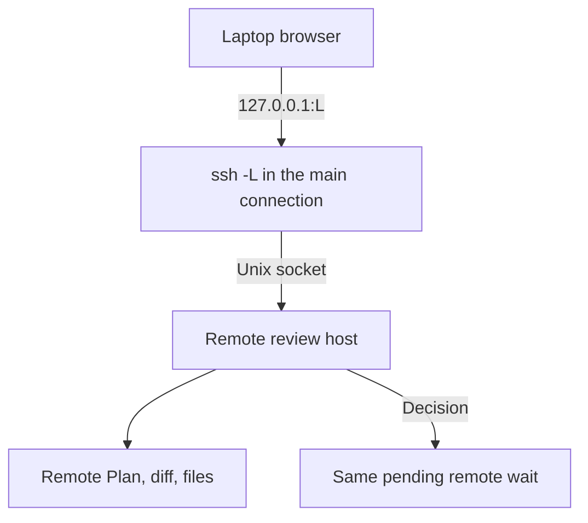

# Open Remote Reviews in the Local Browser

## Context

In a `wld remote` Session, Plan Review and Code Review run inside the remote TUI process on remote loopback. The remote
view gets `NO_OPEN_BROWSER_PORT`, so the TUI prints a remote `http://127.0.0.1:<port>/review/...?token=…` URL that does
not work on the laptop. Users must start a manual `ssh -L` forward (the child07 stopgap).

Two remote paths still use `SYSTEM_BROWSER_PORT` and run `xdg-open` on the server:

- `RunWieldTui` (`src/ui/tui/tui.ts`) defaults to `SYSTEM_BROWSER_PORT`; `tui-manager.ts` constructs it without a port,
  so a clicked TUI link opens on the remote host.
- The chat view "Open artifact" action (`src/ui/tui/chat-view.ts`) hard-codes `SYSTEM_BROWSER_PORT`.

Guided Review does not work remotely. The Code Review host spawns `wld guided-review`, which can pick an arbitrary `wld`
from the remote `PATH` and never receives the remote context: no laptop model, no laptop settings, and its
`createPromptReadySession` would write a Session on the server. Remote context lives in view process memory
(`runRemoteView` in `src/shared/remote/entry.ts`), not in environment variables.

After [child 09](09-host-reviews-on-one-server-per-process.md), every review, artifact view, and TUI document link
in a process lives on **one review host** with one origin. This child forwards that host once.

```text
laptop: wld remote (src/cmd/remote/index.ts)
├── control service (control.ts)          # bearer-authenticated HTTP, reached through ssh -R
├── laptop SFTP                           # personal mount, reached through ssh -R
└── ssh -tt -R … -L 127.0.0.1:L:<remote socket> host "wld --remote-supervisor"   # new: one -L
remote: supervisor (supervisor.ts)        # new: creates the private socket directory, removes it on exit
└── remote view (entry.ts runRemoteView)
    ├── TUI + Session runtime             # new: remote BrowserPort instead of NO_OPEN_BROWSER_PORT
    └── review host (review-host.ts)      # new: listens on the Unix socket, URLs use http://127.0.0.1:L
        └── Guided Review                 # new: in process, laptop model
```

### PRD capabilities

- [Remote workflows and local review](../../prd/remote-ssh-prd.md#remote-workflows-and-local-review): the **target
  requirement "Review remote work locally"** and its acceptance scenario (review opens in the laptop browser, shows
  remote content, decisions reach the same Session, browser close and reopen do not cancel the wait). This child
  delivers both.
- [Plan Review](../../prd/runwield-core-prd.md#plan-review) and
  [execution, validation, and recovery](../../prd/runwield-core-prd.md#execution-validation-and-recovery): review
  semantics survive unchanged.
- [Disconnect and recovery](../../prd/remote-ssh-prd.md#disconnect-and-recovery): SSH loss already stops the remote view
  and its review host (child08). The forward ends with the SSH process.

Out of scope: hosted Workspace registration, remote ACP clients (so ACP browser questions do not change), CLI-only
`wld review`/`wld plans ui`/`wld wr` run directly on the server, and any visual change to the review UI.

### Epic Scope Changes

See [child 09](09-host-reviews-on-one-server-per-process.md#epic-scope-changes). This child lost per-review
forwards, the laptop forward registry, and `BrowserPort.reserveLoopbackPort`; it gained a dependency on 09-host.

## Objective

In a remote Session, every review surface and TUI document link opens in the laptop browser at
`http://127.0.0.1:L/...`. That origin reaches the remote review host through one SSH forward set up at connection start,
so APIs, assets, polling, images, uploads, tokens, and pending decisions work unchanged. The transport has no
platform-specific path on the laptop; this child verifies it on macOS, and a Windows check is deferred. Guided Review runs with the remote worktree and the laptop model. No remote path runs a
browser on the server.

## Approach

### One forward, fixed at connection start



1. The launcher picks a free laptop loopback port `L` and a fresh remote directory
   `/tmp/wld-remote-<random hex>`, then adds `-L 127.0.0.1:L:<directory>/review.sock` to the existing long-lived
   `ssh -tt` command and passes the directory to `--remote-supervisor`. OpenSSH connects to the remote socket only when
   the browser connects, so the socket does not have to exist at launch.
2. The supervisor creates that directory with mode `0700` and uses it for both `control.sock` (today it makes its own
   `mkdtemp` directory) and `review.sock`. It removes the directory in its existing cleanup.
3. The remote view configures the review host (the one owner of bind address and origin from 09-host): listen on the
   Unix socket, put `http://127.0.0.1:L` in URLs.

```diff
 remote: supervisor
-  mkdtemp($TMPDIR/wld-remote-XXXX)          # control.sock only
+  mkdir(<launcher-chosen dir>, 0700)         # control.sock + review.sock; refuse if it exists
```

**Assumption (reviewable):** one launcher-chosen directory replaces the supervisor's `mkdtemp` directory. This keeps one
private directory and one cleanup path. The directory is under `/tmp` and not `$TMPDIR` because the launcher must know
the path before the remote process starts. A random 128-bit name and a non-recursive `mkdir` that refuses an existing
path prevent another user from taking the path first. If a user races to take the name, the connection fails, but that
user cannot get access.

Because every URL comes from the host origin, printed links, reopen links, `liveReviewUrl`, and "Open artifact: …"
text already are laptop URLs. No review, workflow, or TUI code changes how it builds a URL.

> [!TIP]
> **Why a Unix socket on the server**
>
> The remote end of `-L` must be known when `ssh` starts, before the remote process can pick a TCP port. A socket path
> in a private directory is known in advance, cannot collide, and other users on the server cannot connect to it.

Set aside during planning: OpenSSH multiplexing (`ControlMaster`) with a forward per review, which does not work with
the Windows OpenSSH client; a custom relay; a separate `ssh -L` per review, which signs in again each time.

### The laptop opens URLs

The `BrowserPort` interface does not change. The remote view gets a remote `BrowserPort` whose `open(url)` calls one new
authenticated control route, `POST /browser/open`, on the laptop. The laptop opens the URL with `SYSTEM_BROWSER_PORT`.

```text
/browser/open(url)
  requires bearer credential, ready, not shutting down     (like other capability routes)
  url origin == http://127.0.0.1:L        → open
  url is public http/https                → open            (TUI link clicks)
  anything else                           → 400, not opened
```

The body carries only a URL, never a review decision, so a transport retry cannot repeat a decision. The route lives in
a new `src/shared/remote/browser-bridge.ts` (laptop handler plus remote client), following the clipboard bridge pattern;
`control.ts` only dispatches.

### Guided Review runs in the remote view process

**Decision (owner, planning):** run the built-in guide in process in remote Sessions. Passing remote connection
details to a child `wld guided-review` process was set aside: it hands credentials to another process and duplicates
remote startup.

`createReviewWorkspaceApp` already takes the guide runner as a function (`runGuideCommand`). The remote view supplies an
in-process runner instead of `runConfiguredGuideCommand`. It runs the `guide` Agent in an in-memory Session through the
laptop model bridge, the same admission child07 gave delegated agents and reviewers. The prompt-to-result logic in
`src/cmd/guided-review/index.ts` moves into one shared function, so the CLI command and the in-process runner cannot
drift.

```text
local:  Code Review → runConfiguredGuideCommand → spawn `wld guided-review`      (unchanged)
remote: Code Review → in-process guide runner  → in-memory guide Session → laptop model
```

The remote view chooses the runner where it composes its ports, the same place it configures the review host. Review
code has no remote check.

Both selections follow the existing process-level pattern of `configureRemoteClipboardConnection`. Each is one
function that the remote view calls at startup. It returns a clear function and throws if the process already
configured it:

```text
runRemoteView
  configureRemoteReviewHost({ socketPath, origin })   # review-host.ts; throws if a listener already exists
  configureGuideRunner(inProcessGuideRunner)          # review-agent-handlers.js; server.js reads the selected runner
  startInteractiveSession({ browser: remote BrowserPort, ... })
```

When nothing configures them, the review host keeps `127.0.0.1:0` and the runner stays `runConfiguredGuideCommand`.
These are configuration functions, not `__deps` seams, so `seams:check` does not change.

## Expected Change Surface

The boundaries this change is expected to touch. This list is guidance, not an allowlist: verify the real footprint
during implementation and change whatever the Implementation Steps need, including files not named here. Stop and report
only when discovery changes approved intent — the change reaches another subsystem, public behavior or architecture
shifts, migration or compatibility risk grows, or the Verification Plan no longer proves the objective.

- `src/cmd/remote/index.ts` — pick `L` and the remote directory; add the `-L`; pass the directory to
  `--remote-supervisor`; include `L` in the remote view config.
- `src/shared/remote/supervisor.ts` and its argument parsing in `src/shared/remote/entry.ts` — create the
  launcher-chosen `0700` directory instead of `mkdtemp`, put both sockets in it, and remove it during existing cleanup.
- `src/shared/http-server.ts` — `serveHttp` can listen on a Unix socket path.
- `src/ui/workspace/server/review-host.ts` — new `configureRemoteReviewHost({ socketPath, origin })`, the one
  configuration point for the bind target and the public origin.
- `src/shared/remote/browser-bridge.ts` (new) and `src/shared/remote/control.ts` — the `/browser/open` route and the
  remote `BrowserPort` client.
- `src/shared/remote/entry.ts` — configure the review host, the remote `BrowserPort`, and the in-process guide runner.
- `src/ui/tui/tui.ts`, `src/ui/tui/tui-manager.ts`, `src/ui/tui/chat-view.ts`, `src/ui/tui/chat-session.ts` — use the
  Session's injected `BrowserPort` for link clicks and "Open artifact" instead of `SYSTEM_BROWSER_PORT`.
- `src/ui/workspace/server.js`, `src/ui/workspace/routes/api/review-agent-handlers.js`, `src/cmd/guided-review/index.ts`
  — `configureGuideRunner` selects the process guide runner (default stays `runConfiguredGuideCommand`); `server.js`
  reads the selected runner; one shared guide generation function.
- `src/shared/remote/verify-remote-workflows.ts` — the live harness reaches review through the product forward instead of
  its own `ssh -N -L`.
- `docs/prd/remote-ssh-prd.md`, `docs/prd/runwield-core-prd.md`, `docs/adr/018-remote-ssh-local-personal-authority.md`,
  `docs/domain-language.md` — delivered review behavior; ADR-018's "SSH forwards their full origin" line names the one
  connection-start forward of the review host.
- `scripts/bun-test-files.json` — list new test files.

Not changed: review frontend and design system, review tokens and decision handling, the review host's dispatch (from
09-host), ACP browser questions.

## Reuse Opportunities

- The process review host from 09-host — its single origin is what makes one forward enough.
- Clipboard bridge pattern (`clipboard-bridge.ts`, the `/clipboard/image` route, `configureRemoteClipboardConnection`)
  — authentication, readiness gating, and view-startup wiring.
- `SYSTEM_BROWSER_PORT` — the laptop route opens URLs through it.
- `createReviewAgentState({ runGuideCommand })` — existing function parameter for the guide runner.
- Child07's in-memory delegated Agent admission and laptop model bridge — Guided Review uses the same path.
- Fake `ssh` executables on `PATH` in `src/cmd/remote/index.test.ts` — environment faking for launcher arguments.

## Implementation Steps

- The long-lived `ssh` in `runRemoteCommand` includes `-L 127.0.0.1:L:/tmp/wld-remote-<random>/review.sock`, where `L`
  was free on laptop loopback when chosen, the random part has 128 bits, and the full socket path is under 100 bytes.
  The same directory is an argument to `--remote-supervisor`. With the existing `ExitOnForwardFailure=yes`, a taken `L`
  fails the connection with a message that names the port. The forward never binds a non-loopback address.
- The remote supervisor creates the launcher-chosen directory with a non-recursive `mkdir` and mode `0700` before it
  starts the view, refuses a path that already exists, puts `control.sock` in it in place of its own `mkdtemp`
  directory, and removes the directory on every exit path of its existing cleanup.
- `serveHttp` accepts a Unix socket path. `configureRemoteReviewHost({ socketPath, origin })` makes the review host
  listen on that socket (removing a stale socket file in its own directory before binding) and use
  `http://127.0.0.1:L` as the origin of every URL it hands out. It throws if the host already has a listener. When
  nothing configures it, the host keeps `127.0.0.1:0`.
- `src/shared/remote/browser-bridge.ts` handles `POST /browser/open` on the laptop: it opens URLs whose origin is
  `http://127.0.0.1:L` and public `http`/`https` URLs through `SYSTEM_BROWSER_PORT`, and refuses other loopback origins,
  `localhost`/`[::1]`, other schemes, and malformed input with a 4xx. It requires the bearer credential, returns 403
  before readiness and after shutdown, and never logs the URL query (review tokens) or the credential.
- The remote `BrowserPort` client calls `/browser/open` with the bearer credential, `redirect: "error"`, and a finite
  timeout, and returns `false` on any failure so the TUI prints the URL. It never runs a browser on the server.
- `runRemoteView` passes the remote `BrowserPort` to `startInteractiveSession`; `NO_OPEN_BROWSER_PORT` is no longer used
  there. `RunWieldTui` link clicks and the chat view "Open artifact" action use the Session's injected port, so no remote
  view path calls `SYSTEM_BROWSER_PORT`. Local TUI behavior is unchanged because local Sessions inject
  `SYSTEM_BROWSER_PORT`.
- Plan Review, Code Review, artifact read pages, and TUI document links reached through the forward show remote content:
  Plan text, diff, expanded file contents, images, uploads, and polling all hit the unchanged remote host. Feedback and
  approval resolve the original pending remote wait through the existing token checks.
- Closing the browser tab changes nothing on either side. `/plan-review` and the Code Review workflow action reopen the
  same laptop URL while the connection lives.
- `src/cmd/guided-review/index.ts` exports one guide generation function that both `runGuidedReviewCommand` and the
  in-process runner call. `review-agent-handlers.js` exports `configureGuideRunner(runner)`, and `server.js` creates
  review agent state with the selected runner instead of importing `runConfiguredGuideCommand` directly. `runRemoteView`
  configures the in-process runner. In a remote Session, Code Review's Guided Review runs the `guide` Agent in an
  in-memory Session in the remote view process, reads the remote worktree, uses the laptop model, creates no Session on
  the server, and never resolves `wld` from the remote `PATH`. When `RUNWIELD_GUIDED_REVIEW_COMMAND` is set, the
  in-process runner defers to `runConfiguredGuideCommand`. Local Guided Review still spawns `wld guided-review`.
- `verify-remote-workflows.ts` opens review through the product forward and no longer starts its own `ssh -N -L`.
- The Remote SSH PRD **Remote workflows and local review** section marks "Review remote work locally" and its review
  acceptance scenario delivered, removes the manual-forward stopgap text, and states that the SSH server must allow
  Unix-socket forwarding (the OpenSSH default). The Core PRD keeps Plan Review semantics and
  updates any remote review reference. ADR-018's review bullet describes the one connection-start forward of the review
  host. The `docs/domain-language.md` **Remote SSH connection** entry replaces "Automatic local browser forwarding
  remains target scope" with: reviews stay on the remote review host, and the laptop opens them through one forward set
  up at connection start.

## Verification Plan

- Automated, launcher (`src/cmd/remote/index.test.ts`, fake `ssh`): the long-lived `ssh` arguments contain exactly one
  `-L 127.0.0.1:L:<path>` with a numeric `L` and a path under 100 bytes; the view config the remote side receives carries
  the same `L`. Fails if the `-L` is missing or binds a non-loopback address.
- Automated, supervisor: the launcher-chosen directory exists with mode `0700` and holds `control.sock` when the view
  starts, a pre-existing path is refused, and the directory is gone after normal exit and after a forced view kill.
- Automated, remote review host: with remote configuration, a registered review is reachable with `fetch` over the Unix
  socket, the URL it returns has origin `http://127.0.0.1:L`, and nothing listens on a TCP port. Fails if the host still
  binds TCP or builds URLs from its real address.
- Automated, browser bridge (`browser-bridge.test.ts`, fake `open`/`xdg-open` on `PATH` that records its argument): a
  forwarded URL opens with path, query, and token intact; a public `https` URL opens; another loopback port,
  `localhost`, `file:`, and malformed input are refused and not opened; no credential gives 401; before readiness and
  after shutdown give 403. Captured logs contain neither the token nor the credential.
- Automated, remote composition (extend `chat-remote-composition.test.ts`): the interactive Session, the TUI link
  handler, and the artifact reader receive a `BrowserPort` that is not `SYSTEM_BROWSER_PORT`. A remote Plan Review in
  `remote-runtime-workflows-end-to-end.test.ts` calls `/browser/open` on the test control service with a
  `http://127.0.0.1:L` URL, and an approval sent over the Unix socket completes the remote wait.
- Automated, Guided Review: in a remote runtime fixture, Guided Review returns the guide output through the laptop model
  bridge, spawns no process, and creates no Session directory under the remote home.
  `src/cmd/guided-review/index.test.ts` still passes against the shared generation function.
- Protected behavior: existing review, review-host, document-link-host, review-agent handler, `remote/control`, and
  clipboard tests keep their assertions, including the local `wld guided-review` spawn. No behavior is expected to stop
  existing.
- Commands: `bun scripts/run-tests.js <changed and new test files>`, `bun run seams:check`, and
  `bun run fmt:check <changed files>`.
- Live on `sct` with matching built artifacts (headed browser on a macOS laptop):
    - Start `wld remote sct:<project>` and run planning to `plan_written`; the laptop browser opens
      `http://127.0.0.1:L/review/plan?token=…` and shows the remote Plan. Submit feedback, see the revision at the same
      URL, then approve; the remote workflow continues.
    - In Code Review, expand a file, view a remote-only image, upload an annotation image, and run Guided Review. The
      guide reads remote files and the laptop provider receives the request.
    - Close the tab during a pending review; reopen from the TUI action and `/plan-review`; the wait is still pending.
    - Click a printed review link and a Markdown document link in the laptop terminal; both open on `127.0.0.1:L`.
    - Kill the SSH process. `127.0.0.1:L` refuses connections on the laptop, the remote view is gone, the socket
      directory is removed, and an unrelated remote process survives.
    - Reconnect; the old URL does not reach a review, and new reviews use the new connection's origin.
    - Record results in `docs/plans/remote-ssh-development/manual-qa.md`, including an unchecked item for the deferred
      Windows laptop check (Plan Review opens and approves through the forward from Win32-OpenSSH).
- Documents: the Remote SSH PRD, Core PRD, ADR-018, and glossary state the delivered review behavior; none claims hosted
  Workspace or remote ACP support.

## Edge Cases & Considerations

- **Laptop port taken between choice and use.** The window is small. `ExitOnForwardFailure=yes` makes it a clear
  connection failure instead of a half-working Session; the user reconnects.
- **Stale URL after reconnect.** The old forward ends with the old `ssh`. If a new connection reuses `L`, the new host
  rejects the old token.
- **Host restarts while connected.** The review host stops when empty and starts again on the next review (09-host). It
  rebinds the same socket path, so the fixed forward keeps working.
- **Browser close is not disconnect.** Nothing in this child reacts to a closed tab.
- **Assumption: the server allows Unix-socket forwarding.** OpenSSH allows it by default (`AllowStreamLocalForwarding`).
  A server that blocks all forwarding (`DisableForwarding`, `AllowTcpForwarding no`) already fails at connection start,
  because the control service needs `-R`. Only a server that allows TCP forwarding and sets
  `AllowStreamLocalForwarding no` breaks review alone. On that server, the browser cannot load the page, and the TUI
  still has the URL. This child puts the requirement in the Remote SSH PRD and adds no probe. Child 11 can add a
  diagnostic if qualification finds such servers.
- **User SSH config.** Jump hosts, keys, and ports still apply. A user `ControlMaster` would make the main `ssh` a mux
  client; the forward still works there, but its lifetime follows the user's master. The live check covers the default
  configuration.
- **Deferred: Windows client check (owner decision).** Win32-OpenSSH should support forwarding to a remote Unix
  socket, because the Linux server handles the socket. No Windows laptop is available now, so this child does not run a
  Windows live check and does not claim Windows support. The owner will test it later on a Windows VM. Record the check
  as an open item in `docs/plans/remote-ssh-development/manual-qa.md`. If it fails, the fallback is a remote TCP port
  reserved during setup, decided with the owner. Until then, child 11 must not list Windows laptops in the supported
  matrix.
- **Assumption: public links open on the laptop.** A public `http(s)` link clicked in the remote TUI opens in the laptop
  browser, matching local behavior. This replaces today's `xdg-open` on the server.
- **Assumption: custom guide command.** A `RUNWIELD_GUIDED_REVIEW_COMMAND` set in the remote environment still runs on
  the server as configured; only the built-in guide moves in process.
- **No new seam.** Fake `ssh` and `open` executables fake the environment; the bridge takes no injected runner.
  `seams:check` stays at zero.
