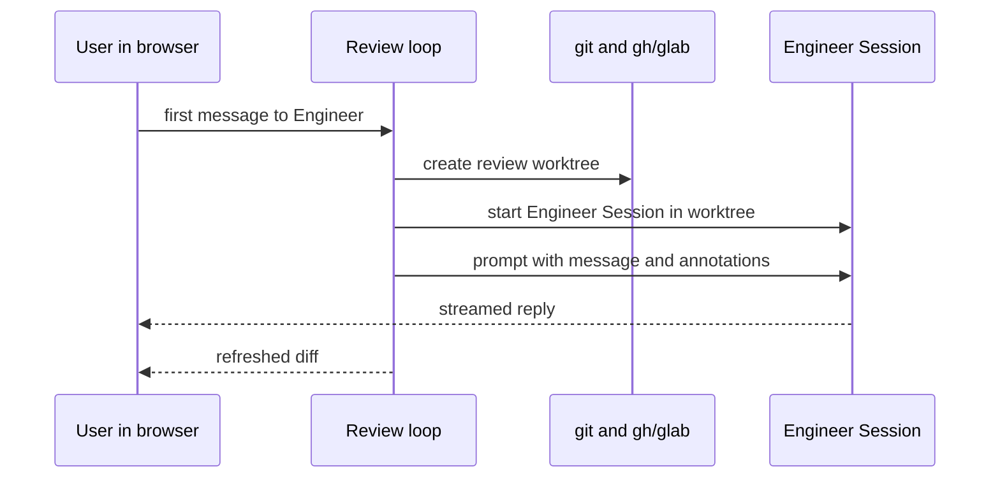

# Add the `wld review` Command

## Context

Today the RunWield code review page, Guided Review, and the review chat open only inside Plan validation. A user cannot
use them to review a pull request, a branch, or their own uncommitted work.

This Plan adds `wld review`. It opens the same code review page for three sources:

| Command                  | Left side (base)                     | Right side (head)                     | Where the Engineer works        |
| ------------------------ | ------------------------------------ | ------------------------------------- | ------------------------------- |
| `wld review <PR/MR URL>` | merge base with the PR target branch | PR head                               | review worktree, made on demand |
| `wld review <branch>`    | merge base with the current branch   | `<branch>`                            | review worktree, made on demand |
| `wld review`             | `HEAD`                               | staged, unstaged, and untracked files | the current checkout            |

### Decisions from the planning conversation

- **PR and branch mode are one idea.** Each compares a branch with its target. The branch comes from a different place,
  and only PR mode can post to the Forge (GitHub or GitLab).
- **The chat talks to the normal Engineer**, the Agent that users choose with `/agent`. It is not the internal Reviewer
  Feedback Engineer. One Engineer Session lasts for the whole review, so it remembers earlier messages.
- **The worktree is made only when needed.** In PR and branch mode, RunWield creates the review worktree the first time
  the user sends a message or annotations to the Engineer. Until then, the diff and Guided Review use git refs only.
- **PR mode has a destination switch**, like Plannotator:
  - **Post to PR**: two buttons. **Post comments** posts the annotations as a neutral review. **Approve** posts the
    annotations and approves.
  - **Engineer**: annotations and chat go to the Engineer, who edits the review worktree. The user can ask the Engineer
    to commit and push to the PR branch.
  - There is no "Request changes" action. Closing the tab does nothing.
- **Forge CLIs.** GitHub uses `gh` and GitLab uses `glab`. When the CLI is missing or not signed in, the Post to PR
  destination is unavailable and the page says which CLI and sign-in it needs. The rest of the review still works.
- **Only PRs of this repository.** RunWield accepts a PR URL only when its repository is a remote of the current
  checkout, for example `origin` or `upstream`. Fork PRs into this repository are allowed. RunWield never clones a
  repository.
- **Branch mode is a self-review.** It has no Approve button and no "Open PR" button. The user can ask the Engineer to
  push and open a PR.
- **Uncommitted mode has Approve & Commit.** The Operator writes the message with the bundled `commit` template rules,
  commits, and pushes. The tooltip says: "The Operator writes a commit message, commits, and pushes these changes."
- **Terminal behavior.** `wld review` prints the review link and short progress lines. It stays open until the review
  ends. The Engineer chat lives in the browser. The Engineer Session is an ordinary saved Session, so `wld resume` can
  open it later.
- **Cleanup.** When the review ends, RunWield removes a review worktree that has no work in it. It keeps a worktree that
  has uncommitted or unpushed work, and it prints the path and branch.

### PRD capabilities

- [Execution, validation, and recovery](../prd/runwield-core-prd.md#execution-validation-and-recovery) owns the current
  Code Review requirements: the live review URL in the TUI and the labels **AI Code Review** and **Code Review**. This
  Plan must not change them.
- No capability owns a review that runs without a Plan. This Plan **adds** a new Core capability, **Standalone code
  review**, with the requirements and scenarios in this Plan.

## Objective

`wld review` opens the RunWield code review page for a PR/MR URL, a branch, or the uncommitted changes, with working
Guided Review and an Engineer chat. Each mode has the actions agreed above, and each action has a real effect: a Forge
review, a commit and push, or Engineer edits that refresh the diff.

## Approach

### Reuse the review page; add a small loop that does not know about Plans

The validation loop in `src/shared/workflow/validation-human-review.ts` already does what the chat needs. It opens the
page, waits for a decision, runs an agent, then reopens the same page with a new diff. It is tied to Plan lifecycle
bookkeeping, so the new command gets its own loop with the same shape:

```text
wld review [target]
  resolveReviewTarget(target)          # PR, branch, or uncommitted; validates; fetches refs
  diff = target.computeDiff()
  for (;;)
    decision = runCodeReview(diff, standaloneReview payload)
    if decision is conversation turn
      ensureEngineerWorkspace()        # first time only: worktree + Engineer Session
      prompt Engineer, stream reply into reviewConversation
      diff = target.computeDiff()      # now includes the Engineer's edits
      continue
    if reviewAction == post_comments | approve_pr → post to Forge, end
    if reviewAction == approve_commit             → Operator commits and pushes, end
    if canceled / exit                            → end with no action
  cleanUpReviewWorktree()
  print summary (worktree kept or removed, Engineer Session id)
```

The page already supports this round trip without Plans. `startCodeReviewSurface` keeps one page open across rounds
through `reviewConversation`, and `CodeReviewSurface.tsx` polls `conversationStatusUrl` until the revision changes.

### New module layout

```text
src/cmd/review/index.ts            # argument parsing, terminal output, exit code
src/shared/standalone-review/
├── review-target.ts               # resolves the three targets and computes their diffs
├── review-worktree.ts             # creates, reuses, and cleans up the review worktree
├── forge-review.ts                # gh/glab availability, PR lookup, posting through Plannotator
├── review-commit.ts               # Approve & Commit through the Operator, then checks the result
└── review-loop.ts                 # the decision loop above
```

### One diff rule for all modes

`getWorktreeReviewDiff` in `git-snapshot.ts` accepts only `refs/heads/<branch>`, and it always reads the working tree.
The new modes need a remote base and, before the worktree exists, a commit as the head. Split it so the merge-base rule
stays in one place:

```diff
+getReviewDiff(cwd, { baseRef, head: { kind: "ref", ref } | { kind: "worktree" } })
+  merge-base(baseRef, headCommit) → diffTrees(baseTree, headTree or captureWorktreeTree)
 getWorktreeReviewDiff(cwd, targetBranch)
-  resolve refs/heads/<branch>, merge-base, diff against the working tree
+  resolve refs/heads/<branch> (same errors as today), then getReviewDiff(..., { kind: "worktree" })
```

Each mode then uses:

- **PR, before the worktree:**
  `getReviewDiff(cwd, { baseRef: <fetched base SHA>, head: { kind: "ref", ref: <headSha> } })`.
- **Branch, before the worktree:** `baseRef` is the current branch and the head is `<branch>`.
- **PR or branch, after the worktree:** the same base, with `{ kind: "worktree" }` in the review worktree.
- **Uncommitted:** `baseRef: "HEAD"` with `{ kind: "worktree" }` in the current checkout.

> [!TIP]
> **Local git, not the Forge diff**
>
> PR mode fetches `pull/<n>/head` (GitHub) or `merge-requests/<iid>/head` (GitLab) and the target branch from the
> matching remote. The local merge-base diff is the same three-dot diff the Forge shows. One diff path also covers the
> refresh after Engineer edits. The Forge API supplies only metadata: title, body, head SHA, and base branch.

### Forge posting reuses the vendored Plannotator code

`third_party/plannotator/packages/shared/` (import alias `@plannotator/shared/`) already has GitHub and GitLab support:
`parsePRUrl`, `checkAuth`, `fetchPR`, and `submitPRReview` in `pr-provider.ts`, plus `parseRemoteUrl` in `repo.ts`.
`submitPRReview` already posts line comments, file comments, and the body. It returns a partial result when GitLab
accepts only part of a review.

RunWield supplies:

- the `PRRuntime` subprocess port that runs `gh` and `glab`;
- the mapping from page annotations to `PRReviewFileComment`. A line annotation becomes `path`, `line = lineEnd`,
  `start_line = lineStart` when the range has more than one line, and `side`: `old` is `LEFT`, `new` is `RIGHT`. A file
  annotation becomes a file-level comment. A global annotation and the free-text feedback become the review body.

**The posted lines must match what the user saw.** Post to PR is enabled only when the shown diff is the PR diff at a
known head SHA. That is true when no review worktree exists, or when the review worktree is clean and its `HEAD` equals
the PR head. Before posting, RunWield fetches the PR metadata again. If the head SHA changed, RunWield does not post. It
refreshes the diff and tells the user to review again.

### The review worktree is made on demand



- **PR mode:** `git worktree add --detach <path> <headSha>`, then `gh pr checkout <n>` or `glab mr checkout <iid>`
  inside it. The Forge CLI sets up the branch so that the Engineer can push to the PR, including fork PRs that allow
  edits from maintainers.
- **Branch mode:** if `<branch>` is already checked out in a worktree, the Engineer works there, and RunWield never
  removes that worktree. Otherwise, `git worktree add <path> <branch>`.
- **Location:** `review-worktrees/` next to the Plan worktree root from `resolveWorktreeParent`. Review worktrees are
  not entries in `worktrees.json`, because that registry belongs to Plan execution. A separate directory keeps them out
  of Plan worktree recovery and `wld plans doctor`.

### Engineer chat and Approve & Commit

- **Engineer chat:** `createSessionRuntime({ ownerProcessKind: "workspace" })`, then
  `createPromptReadySession({ cwd,
  agentName: AGENTS.ENGINEER })`. The loop subscribes to Session events and copies
  assistant text into `reviewConversation.events`, so the browser streams the reply. The first prompt tells the Engineer
  what is under review (the PR or branch, base, and head) and that the user directs commits and pushes.
- **Approve & Commit:** an Operator Session in the current checkout gets the `src/prompt-templates/commit.md` body and
  one push rule: when the branch has no upstream, use `git push -u origin HEAD`. After the Operator finishes, RunWield
  checks the result itself and does not trust the Operator's text:
  - the working tree is clean;
  - `HEAD` moved;
  - `@{u}` equals `HEAD`.

  If a check fails, RunWield reports which one failed. The commits stay in place.

**Option set aside:** run the existing validation loop with a fake Plan. That would write Plan front matter and Delivery
Evidence for work that has no Plan, and it would keep the Reviewer Feedback Engineer instead of the normal Engineer.

## Expected Change Surface

This list is guidance, not an allowlist. Verify the real footprint during implementation and change whatever the
Implementation Steps need, including files not named here. Stop and report only when discovery changes approved intent:
the change reaches another subsystem, public behavior or architecture shifts, migration or compatibility risk grows, or
the Verification Plan no longer proves the objective.

- `src/cmd/registry.js` — adds the `review` command (CLI surface only) with usage and notes.
- `src/cmd/review/index.ts` — the new command entry: parse arguments, print progress, set the exit code.
- `src/shared/standalone-review/*` — the new module described in Approach.
- `src/shared/workflow/git-snapshot.ts` — adds `getReviewDiff`. `getWorktreeReviewDiff` delegates to it and keeps its
  current errors.
- `src/shared/workflow/guided-review.js` — `buildGuidedReviewPrompt` works without a Plan. It uses the PR title and body
  as context when they exist, and it names the real head ref so that the Guide can read files with `git show`.
- `src/ui/review/code-review.ts`, `src/ui/review/review-launcher.ts` — pass a `standaloneReview` payload to the page.
  The gitRef and agent label come from the caller, not from a Plan name.
- `src/ui/workspace/routes/api/review-handlers.js` — `reviewFeedbackApi` passes a validated `reviewAction` field
  through.
- `src/ui/workspace/react/CodeReviewSurface.tsx` — mode-specific actions: the destination switch, Post comments,
  Approve, Approve & Commit, and no Approve in branch mode. It also shows Forge availability and a short result message.
- `docs/prd/runwield-core-prd.md` — the new **Standalone code review** capability.
- `docs/domain-language.md` — the new **Standalone Code Review** and **Review Worktree** terms.
- Help output tests under `src/cmd/__tests__/` or `src/cmd/help/`, if they list every CLI command.

Not changed: the validation Code Review loop, Plan lifecycle, `worktrees.json`, and the `wld guided-review` protocol.

> [!NOTE]
> **Same page, two Plans**
>
> The draft Plan `docs/plans/edit-code-to-suggest-in-code-review.md` also changes the `CodeReviewSurface.tsx` toolbar.
> The two Plans do not depend on each other, but whichever lands second must merge the toolbar changes.

## Reuse Opportunities

- `src/ui/review/code-review.ts` `runCodeReview` and `review-launcher.ts` `startCodeReviewSurface` — the page, image
  loading, and the conversation rounds that keep the page open.
- `src/shared/workflow/validation-human-review.ts` `formatCodeReviewAnnotations` — the Engineer prompt text for
  annotations.
- `src/shared/workflow/git-snapshot.ts` `captureWorktreeTree` and `diffTrees` — the diff for every mode.
- `src/shared/worktree.js` `resolveWorktreeParent`, `resolveCurrentCheckoutBranch`, and `removeWorktreeGitArtifacts` (it
  refuses to remove the primary checkout or a dirty worktree).
- `third_party/plannotator/packages/shared/pr-provider.ts` and `pr-types.ts` — `parsePRUrl`, `checkAuth`, `fetchPR`,
  `submitPRReview`, and `PRReviewSubmissionResult`. Also `repo.ts` `parseRemoteUrl`.
- `src/cmd/guided-review/index.ts` — how to start a prompt-ready Session in a directory and read usage events.
- `src/cmd/share/index.ts` `SYSTEM_GITHUB_CLI_PORT` — the pattern for a subprocess port constant.
- `src/prompt-templates/commit.md` — the commit message rules.

## Implementation Steps

1. `getReviewDiff(cwd, { baseRef, head })` in `src/shared/workflow/git-snapshot.ts` returns the merge-base diff from
   `baseRef` to a commit ref or to the working tree, including untracked files. `getWorktreeReviewDiff` calls it and
   still throws `WorktreeReviewTargetError` and `WorktreeReviewComparisonError` in the same cases as before.
2. `src/shared/standalone-review/review-target.ts` exports `resolveReviewTarget(projectRoot, arg)`. It returns one of
   three typed targets, and each target has `computeDiff(cwd)`, `gitRef` (a readable description of the head), and
   `baseLabel`. It rejects these cases with a clear message and no side effects:
   - the directory is not a git repository;
   - the PR/MR URL repository does not match the host and owner/repo (or GitLab project path) of any `git remote -v`
     entry;
   - the URL is not a PR or MR URL;
   - the named branch does not exist;
   - the named branch is the current branch (the message suggests `wld review`);
   - uncommitted mode with no changes.
3. For a PR target, the resolver gets metadata with `fetchPR` and fetches the PR head and the base branch from the
   matching remote, so that `computeDiff` works with no worktree. When `gh`/`glab` is missing or not signed in, the
   command stops. It names the CLI and the `gh auth login` / `glab auth login` command, because the PR head and base
   cannot be resolved without it.
4. `src/shared/standalone-review/forge-review.ts` exports:
   - a subprocess `PRRuntime` port for `gh` and `glab`;
   - `postForgeReview(target, { action: "comment" | "approve", feedback, annotations })`, which fetches the PR metadata
     again, refuses when the head SHA differs from the reviewed SHA, maps annotations as described in Approach, and
     calls `submitPRReview`. It returns posted, partial (with the failed comments), or refused, each with a message.
5. `src/shared/standalone-review/review-worktree.ts` exports `ensureReviewWorktree(target)` and
   `settleReviewWorktree(worktree)`:
   - `ensureReviewWorktree` creates the worktree only on its first call. It reuses an existing checkout of the branch in
     branch mode, and it runs `gh pr checkout` / `glab mr checkout` in PR mode.
   - `settleReviewWorktree` removes a worktree that RunWield created when it is clean and its `HEAD` is on its upstream.
     Otherwise it keeps the worktree and returns its path and branch. It never removes a reused or primary checkout.
6. `src/shared/standalone-review/review-commit.ts` exports `approveAndCommit(cwd)`. It runs the Operator with the
   `commit.md` template body and the upstream push rule. Then it checks: the tree is clean, `HEAD` moved, and `@{u}`
   equals `HEAD`. It returns a result that names each failed check. In detached `HEAD` it refuses before it starts the
   Operator.
7. `src/shared/standalone-review/review-loop.ts` exports `runStandaloneReview(target, { browser, print })`, the loop in
   Approach:
   - Conversation turns create the Engineer Session once, in the review worktree (PR or branch mode) or in the current
     checkout (uncommitted mode), with `AGENTS.ENGINEER`. They stream the reply into `reviewConversation.events` and
     recompute the diff.
   - `reviewAction` values `post_comments`, `approve_pr`, and `approve_commit` call steps 4 and 6. A refused or failed
     action keeps the review open and shows the reason on the page. A completed action ends the review.
   - Cancel or exit ends the review with no Forge or git action.
   - It always calls `settleReviewWorktree` and closes the Sessions at the end, including on Ctrl+C.
8. `wld review` is registered in `src/cmd/registry.js` (surfaces `["cli"]`) and runs `runStandaloneReview` through
   `src/cmd/review/index.ts`. It prints:
   - the review URL;
   - a progress line when the worktree and the Engineer Session start;
   - the Forge or commit result;
   - the kept worktree path and branch, or "removed";
   - the Engineer Session id for `wld resume`.

   `wld review --help` shows the three forms.
9. `buildGuidedReviewPrompt` accepts optional `reviewContext` text. When there is no Plan, the prompt grounds the
   explainer in that context (the PR title and body) or in the diff alone. It does not ask the model to explain a
   missing Plan. In PR and branch mode before the worktree exists, the prompt states the head ref and says to read files
   with `git show <ref>:<path>`. Validation Guided Review prompts are unchanged when a Plan is present.
10. `startCodeReviewSurface` accepts and passes a `standaloneReview` payload with these fields:
    - `mode`;
    - `forge` (`platform`, `label`, `available`, `unavailableReason`, `postEnabled`, `postDisabledReason`);
    - `commit` (`enabled`, `disabledReason`);
    - `reviewContext`.

    The agent label shows the Engineer's display name. `reviewFeedbackApi` accepts `reviewAction` only as
    `post_comments`, `approve_pr`, or `approve_commit`, and it drops any other value.
11. `CodeReviewSurface.tsx` renders the actions by mode. The validation review (no `standaloneReview`) shows exactly the
    actions it shows today.
    - **PR:** a destination switch, **Post to PR** or **Engineer**. Post to PR shows **Post comments** and **Approve**.
      They are disabled, with the reason as a tooltip, when `postEnabled` is false. Engineer shows **Send to Engineer**.
    - **Branch:** **Send to Engineer** only. There is no Approve button.
    - **Uncommitted:** **Send to Engineer** and **Approve & Commit**. The tooltip is "The Operator writes a commit
      message, commits, and pushes these changes."
    - A completed action shows a short final message. A refused or failed action shows its reason and keeps the page
      usable.
    - New controls use existing `--rw-*` tokens and design-system components. If a new visual pattern is necessary, it
      is documented in `docs/design-system.md`.
12. `docs/prd/runwield-core-prd.md` has a **Standalone code review** capability, linked from the capability list. Its
    requirements and acceptance scenarios match this Plan: the three sources, the Engineer chat, the on-demand worktree,
    Post comments and Approve, Approve & Commit, the repository-remote rule, the missing-CLI message, and the cleanup
    rule. The existing Code Review requirements are unchanged.
13. `docs/domain-language.md` defines **Standalone Code Review** (Code Review of a PR, branch, or uncommitted changes
    without a Plan or Plan lifecycle) and **Review Worktree** (a worktree created on demand for Standalone Code Review,
    outside the Plan worktree registry). It notes that the gate **Code Review** still means the Plan validation gate.

## Verification Plan

**Automated:**

- `deno run -A scripts/run-tests.js src/shared/standalone-review/ src/shared/workflow/git-snapshot.test.ts src/ui/review/ src/ui/workspace/routes/api/ src/cmd/review/`
- `deno run -A scripts/run-tests.js src/shared/workflow/guided-review.test.ts src/shared/workflow/validation-loop-human-review.test.js src/ui/workspace/workspace-code-review.integration.test.ts`

**New tests.** Use a real Git repository through `defineGitFixture`. Fake only the `gh`/`glab` subprocess port and the
agent turns.

- `review-target.test.ts`:
  - The uncommitted target diff contains a staged, an unstaged, and an untracked file.
  - The branch target diff contains only the branch's commits since the merge base, not later commits on the current
    branch.
  - Rejections leave the repository unchanged: a foreign PR URL, a missing branch, the current branch, and a clean tree
    in uncommitted mode.
  - With a fixture remote that has a `pull/1/head` ref, the PR target's diff matches the merge-base diff, and no
    worktree exists afterwards.
- `forge-review.test.ts`:
  - The annotation mapping produces the correct `path`, `line`, `start_line`, and `side`, a file-level comment, and the
    body.
  - `comment` and `approve` reach `submitPRReview` with the matching action.
  - A changed head SHA refuses without a submit call.
  - A partial GitLab result is reported with the failed comments.
- `review-worktree.test.ts`:
  - No worktree exists until `ensureReviewWorktree` is called.
  - A second call returns the same worktree.
  - Settle removes a clean worktree that RunWield created.
  - Settle keeps a dirty worktree and a worktree with unpushed commits, and it reports the path and branch.
  - Settle never removes a reused branch checkout.
- `review-commit.test.ts`: with a fake Operator turn that commits but does not push, the result names the `@{u}` check.
  In detached `HEAD`, the Operator never starts.
- `review-loop.test.ts`, with a fake browser decision sequence:
  - A conversation turn starts the Engineer Session with agent `engineer` in the worktree, and the next round's diff
    includes the Engineer's file change.
  - `post_comments` ends the loop after one Forge call.
  - Cancel ends the loop with zero Forge calls, zero commits, and a settled worktree.
  - A test that replaces the Engineer step with a no-op must fail the "next diff includes the change" assertion.
- `git-snapshot.test.ts`: the existing `getWorktreeReviewDiff` cases still pass, and the new `getReviewDiff` ref-head
  case passes.
- `CodeReviewSurface` tests: each mode renders exactly its buttons, and the validation review (no `standaloneReview`)
  renders the same buttons as before.

**Behavior that must stay protected:** the validation Code Review loop (Reviewer Feedback Engineer repair, approval
bookkeeping, Delivery Evidence), the `getWorktreeReviewDiff` error contract, and validation Guided Review prompts that
include a Plan. No existing behavior is expected to stop.

**Manual, in a headed browser:**

1. In this repository with an edited file and a new file, run `deno task cli review`. The link opens. Guided Review
   generates. Send one annotation to the Engineer, check that it edits the file, and check that the diff refreshes.
   Approve & Commit, then check `git log -1` and that the remote branch has the commit.
2. Run `deno task cli review <some-branch>`. Check that no Approve button shows and that `git worktree list` has no new
   entry. Send a message to the Engineer, then check that a review worktree appears. Close the review and check that the
   clean worktree is removed.
3. Run `deno task cli review <URL of a test PR in this repository>`. Check that Guided Review works before any worktree
   exists. **Ask the user before posting**, then post a comment and approve on a PR the user picks. Run
   `deno task cli review https://github.com/some-other/repo/pull/1` and check that it is rejected.
4. With `gh` signed out, or with `PATH` set so that `gh` is not found, run PR mode and check the message that names
   `gh auth login`.

**PRD and glossary:** the new Core capability's scenarios map to the checks above. The glossary defines only the two
terms this Plan makes true.

## Edge Cases & Considerations

- **The PR moved during the review.** Posting refuses when the head SHA changed, so line comments never attach to the
  wrong code. The diff refreshes so the user can review again.
- **The PR branch is already checked out locally.** `gh pr checkout` can fail when its branch is in use in another
  worktree. Then RunWield retries with the `--branch wld-review/<platform>-<number>` option, which keeps the push
  tracking. This is a reviewable assumption; verify it with real `gh` during manual check 3.
- **Fork PR without maintainer edits.** The Engineer can commit locally but the push fails. The Engineer reports the
  Forge error, and the kept worktree keeps the work.
- **Engineer edits in PR mode.** Post to PR stays disabled until the Engineer's changes are pushed and the worktree is
  clean at the PR head, because the shown diff is no longer the PR diff.
- **Partial GitLab post.** RunWield reports what posted and prints any comment that failed, so no text is lost. A retry
  button is out of scope for this Plan (reviewable assumption).
- **Approve & Commit with a failed push.** The commit stays, and RunWield shows the push error. Approve & Commit is
  disabled in detached `HEAD`.
- **Ctrl+C or a closed terminal.** The loop closes the page and the Sessions, and it settles the worktree with the same
  keep-or-remove rule.
- **Closed tab.** Nothing is posted or committed. The command ends when the page reports exit, or when the user presses
  Ctrl+C.
- **Engineer Session ownership.** The Engineer Session uses `ownerProcessKind: "workspace"`, like `wld guided-review`.
  The Session writer lock is released when the Session closes, so `wld resume` can open it afterwards.
- **Assumption: the Operator can run as a prompt-ready Session** through `createPromptReadySession`, like the Guide does
  in `wld guided-review`. If it cannot, use the isolated-session path that validation uses for the Operator.
