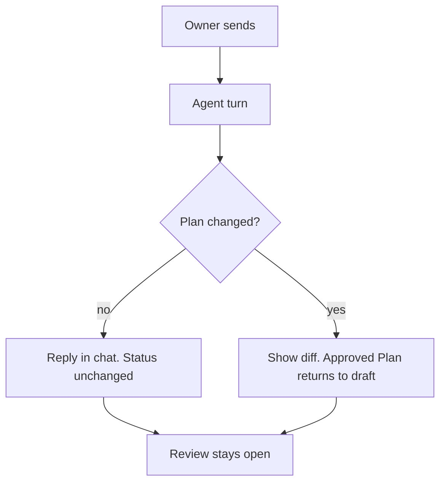
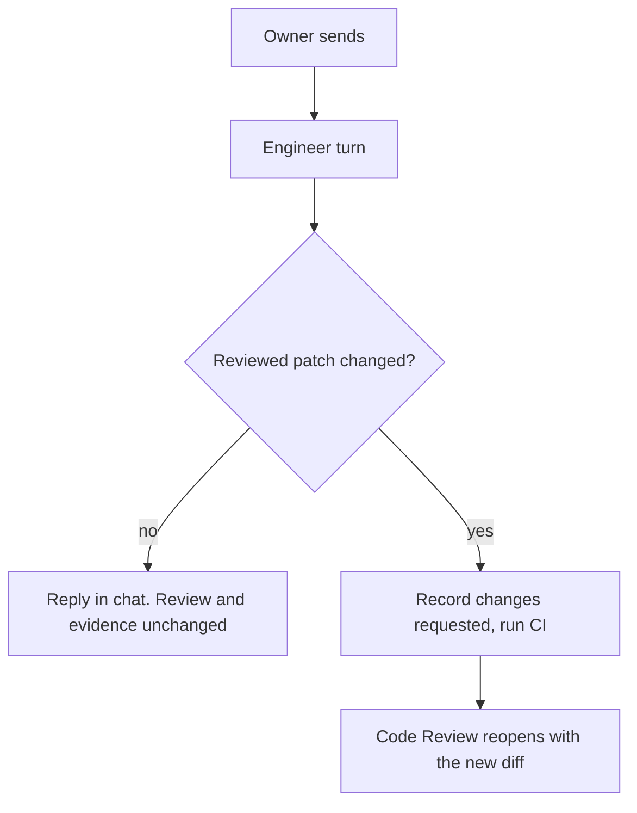

# Product Requirements Document: Conversational Review

Last updated: 2026-10-19 EDT

**Status:** Proposed. Nothing in this document has shipped.

**Document role:** Transient feature proposal. These documents own the affected capabilities:

- [Core Plan review](runwield-core-prd.md#plan-review)
- [Core Plan lifecycle](runwield-core-prd.md#plan-lifecycle)
- [Core Code Review gate](runwield-core-prd.md#code-review-gate)
- [Core Semantic review and repair](runwield-core-prd.md#semantic-review-and-repair)
- [Workspace Browser Plan review and workflow](runwield-workspace-prd.md#browser-plan-review-and-workflow)

When each Plan ships, fold its lasting requirements into those owners and remove the delivered part of this document.

## Background

Plan review and Code Review both have a chat with the Agent that wrote the work. Today, every message in that chat is
treated as a review decision: "return this for changes." That makes conversation expensive and unnatural.

In Plan review, the Planner or Architect can only answer by publishing a new Plan revision. In Code Review, a question
starts a repair, a CI run, and records "Changes requested". This proposal makes both chats normal conversations.
The Agent changes the work only when the work must change.

## Problem Description

**Plan review today:**

- Every chat send and every Send Annotations submits a "deny" decision. The Plan moves to the `feedback` status, and
  its front matter is written each time.
- The chat turn can only end when the Agent republishes the Plan for review. A pure question gets a reply such as
  "I reviewed that request and left the Plan unchanged." If the Agent finishes without republishing, the browser shows
  an error. A turn longer than 180 seconds also shows an error.
- Review input goes to the Agent in three ways: chat Send, Send Annotations (which closes the review round), and a
  button that attaches annotations to the chat. Question answers attach automatically, but annotations do not.
- `feedback` behaves like `draft` almost everywhere. Its only distinct effect is a "needs attention" display. That
  display is wrong after the Agent revises the Plan, because the Plan then waits for the owner but still shows
  `feedback`.

**Code Review today:**

- Every chat message records Delivery Evidence "Changes requested", clears the review decision, moves the Plan from
  `reviewed` to `implemented`, starts a repair, and runs CI again before Code Review reopens.
- "Why did you use a Set here?" costs a full CI run and leaves a false record of requested changes.

**Goals:**

- Review chat is a conversation. The Agent replies, and it changes the work only when needed.
- All review input (annotations, attachments, direct edits, question answers) queues on the chat by default and goes
  out with the next send.
- Plan status reflects lifecycle facts, not conversation activity.
- A conversation decision that never reached the Plan is visible before approval.

**Non-goals:**

- Threaded comments, "unaddressed" comment state, and a GitHub-style split between "comment" and "request changes".
  These belong to the [Collaborative SaaS Workspace](runwield-workspace-prd.md#collaborative-saas-workspace).
- Changes to standalone Code Review (`wld review`). It already has a chat with Engineer that does not force a repair.
- Forcing the Agent to revise the Plan after every message.

## Why Are We Building It?

Review is where the owner and the Agent agree on what to build and whether it was built correctly. That is the core of
the planning-first learning loop. When asking a question costs a Plan revision or a CI run, owners ask fewer
questions, and the Plan is less likely to be right.

The change also removes a lifecycle status whose meaning gets weaker as review becomes more conversational. In a future
multi-user Workspace, several people and the Agent discuss the same Plan. That collaboration must flow as comments, not
as Plan status changes.

## Audience

- **Primary:** an experienced developer who reviews Plans and code changes from RunWield in the browser or Workspace.
- **Secondary:** Planner, Architect, and Engineer, which receive cleaner and more complete review context.
- **Out of scope:** multi-reviewer teams. Their review model is deferred to the Collaborative SaaS Workspace.

## Product Fit, Prototypes, and Descriptions

The change touches the right rail of the review layout and what happens after a send.

**Right rail after the change:**

```text
Right rail (chat is the default tab)
├── Chat
│   ├── conversation history
│   ├── queued context: [3 annotations ×] [2 answers ×] [1 image ×]
│   └── composer + Send        # sends the message, the queue, or both
└── Annotations
    └── annotation cards       # list and edit; no button that closes the review
```

**Question card after the change:**

```text
Should this also cover Epics?   (recommended: Yes)
( ) Yes   ( ) No   ( ) Other: ____
[Submit answer]      # sends this answer to the Agent now
```

**One chat turn in Plan review:**



**One chat turn in Code Review:**



**Approval after a chat-only exchange:**

```text
Some of the conversation since the last revision is not in the Plan.
[Ask Planner to update the Plan]   [Approve as is]   [Cancel]
```

## Capability Requirements

### Plan and Epic review conversation

**Scope and maturity:** Proposed change to [Core Plan review](runwield-core-prd.md#plan-review) and
[Workspace Browser Plan review](runwield-workspace-prd.md#browser-plan-review-and-workflow). Delivered by Plan 1.

**Requirement: The chat is the review's conversation.** The Planner or Architect can reply in chat without changing
the Plan. It revises the Plan only when its answer changes scope, behavior, a decision, or verification. A reply-only
turn writes nothing to the Plan. The review stays open across turns, and the owner can chat, answer questions, edit,
or approve after any turn. A long turn is not an error.

**Requirement: Review input queues on the chat by default.** When the right rail opens, it shows chat. Every new
annotation, attachment, direct Plan edit, and question answer is added to the chat queue automatically. Each queued item
type has an X that removes it from the next send without deleting the item. Send is enabled when there is a message, a
queued item, or both.

**Requirement: Remove Send Annotations.** The Annotations pane lists and edits notes. It has no button that closes the
review round. The button that attaches annotations to the chat is also removed, because annotations are already queued.

**Requirement: Submit one answer now.** Each question card has a Submit answer button. It sends that one answer to the
Agent immediately as a chat turn. A submitted answer leaves the queue, and its card shows that it was sent. It is not
sent again with the next chat message. While the Agent is working, Submit answer is disabled and the answer stays
queued for the next send.

**Requirement: Only a Plan revision cancels approval.** A Plan revision during review moves an `approved` or
`ready_for_work` Plan back to `draft`, and the owner approves it again. A reply-only turn does not change the status.
Formatting-only changes keep the decision valid, as Core Plan review already requires.

**Requirement: Warn about conversation that is not in the Plan.** If at least one chat turn happened after the last
Plan revision, either approval action shows a confirmation. The owner can ask the Agent to update the Plan, approve as
is, or cancel. This check does not use an LLM. The existing open-questions confirmation still applies.

**Requirement: Keep approval context.** If the owner approves with items still queued, those items go to the next
Agent as approval context, as they do today.

**Acceptance scenarios:**

- Given a draft Plan in review, when the owner asks a question in chat and the Planner replies without editing, then
  the reply appears in chat, the Plan file is unchanged, its status stays `draft`, and the review stays open.
- Given an approved Plan in review, when the owner sends an annotation and the Planner revises the Plan, then the diff
  appears, the status becomes `draft`, and approval is required again.
- Given an approved Plan in review, when the Planner only replies, then the status stays `approved`.
- Given two annotations and one question answer, when the owner opens chat, then all three are queued. When the owner
  removes the annotations with X and sends a message, only the message and the answer go to the Agent, and the
  annotations remain on the Plan.
- Given an answered question, when the owner clicks Submit answer, then the Agent receives that answer immediately and
  the card shows it was sent. The next chat send does not include it again.
- Given the Agent is working, then Submit answer is disabled and a new answer stays queued.
- Given a chat-only turn after the last revision, when the owner clicks Approve & Run, then the confirmation appears.
  Ask Planner to update the Plan sends a turn and keeps the review open. Approve as is continues approval.
- Given a turn that lasts several minutes, when it ends, then the reply or revision appears with no timeout error.
- Given an Epic in review, the same rules apply with Architect.

### Plan Status without `feedback`

**Scope and maturity:** Proposed change to [Core Plan lifecycle](runwield-core-prd.md#plan-lifecycle). Delivered by
Plan 1.

**Requirement: Every unapproved Plan is a draft.** Core removes the `feedback` status. A Plan that is not approved is
`draft`, with or without annotations or chat history. Opening a review on a Plan past approval also moves it to
`draft` when it is revised. The ordinary lifecycle becomes `draft → approved → ready_for_work → implemented →
reviewed → verified`.

**Requirement: Existing `feedback` Plans read as `draft`.** Plans saved with `feedback` keep working everywhere a draft
works: board, CLI, TUI, load-plan, Epic and Sequence handling, and dependencies. No user action is required.

**Requirement: Conversation does not write Plan front matter.** A chat turn writes Plan front matter only when the
Plan itself is revised. "Plan changed after review opened" conflicts no longer come from conversation.

**Acceptance scenarios:**

- Given a saved Plan with status `feedback`, when the owner opens the board or loads the Plan, then it shows and
  behaves as `draft`.
- Given a draft Plan, when the owner sends five chat messages and the Planner only replies, then the Plan file is
  byte-identical after the five turns.
- Given a Plan in progress that is reopened for review and revised, then it becomes `draft`.

### Code Review conversation

**Scope and maturity:** Proposed change to [Core Code Review gate](runwield-core-prd.md#code-review-gate) and
[Semantic review and repair](runwield-core-prd.md#semantic-review-and-repair). Delivered by Plan 2, after Plan 1.

**Requirement: Same chat model as Plan review.** Code Review uses the review queue from Plan 1: chat is the default
tab, review input is queued by default, X removes items, and there is no send button that closes the review.

**Requirement: Reply or repair.** Engineer can reply in chat or edit code. After the turn, RunWield checks whether the
reviewed patch changed. It uses the patch itself, not the Agent's report.

- **Patch changed:** RunWield records "Changes requested" in Delivery Evidence, clears the review decision, moves the
  Plan back to `implemented`, runs CI, and reopens Code Review with the new diff and the same conversation.
- **Patch unchanged:** only the conversation continues. The review decision, Delivery Evidence, lifecycle status, and
  CI results do not change.

**Requirement: Scope changes need a Plan Deviation.** If the conversation agrees to change the Plan's scope, that
change becomes authority only through a confirmed [Plan Deviation](runwield-core-prd.md#plan-deviations). A chat reply
alone does not change what AI review and Work Records check against.

**Acceptance scenarios:**

- Given a reviewed Plan in Code Review, when the owner asks why a change was made and Engineer only replies, then no CI
  run starts, no "Changes requested" evidence is recorded, the status stays `reviewed`, and approval is still
  available.
- Given the same review, when the owner asks for a fix and Engineer edits a file, then "Changes requested" is
  recorded, CI runs, and Code Review reopens with the new diff and chat history.
- Given Engineer reports a fix but the patch did not change, then RunWield treats the turn as a reply.
- Given the conversation agrees to drop a Plan requirement, then approval keeps the original requirement unless the
  owner confirms a Plan Deviation.

## Success Metrics

Measured by the owner's own use during the first weeks after each Plan ships. No new analytics are required.

- **Reply-only turns exist.** Some Plan review chat turns end with a reply and no revision. Today every turn must
  republish the Plan. Evidence: local workflow metrics or Session history.
- **Fewer wasted CI runs.** Code Review questions no longer start CI. Evidence: Code Review rounds without a patch
  change produce no CI run.
- **The approval warning stays useful.** The owner does not click through it on most approvals. If they do, change it
  to check only turns that had queued annotations (see Open Questions).

## Delivery

Two Plans, in order:

1. **Plan review conversation (Plan 1).** The shared review queue, Submit answer, removal of Send Annotations,
   reply-only turns, removal of `feedback`, and the approval warning. Covers Plan and Epic review.
2. **Code Review conversation (Plan 2).** Reuses the queue from Plan 1 and adds the reply-or-repair rule based on the
   reviewed patch.

Plan 1 goes first so both surfaces share one chat model. Hand off to `/agent planner` for each Plan.

## Attached Research and Other Evidence

Code reading on 2026-10-19 (facts, not measurements):

- Chat Send and Send Annotations both submit a `deny` decision, and the server records `review_feedback`, which sets
  `feedback` (`src/ui/workspace/react/PlanReviewSurface.tsx`, `src/shared/workflow/plan-review-actions.ts`).
- The browser waits up to 180 seconds for a new Plan review interaction and reports an error if the Agent finishes
  without one (`waitForPlannerReview` in `PlanReviewSurface.tsx`).
- `feedback` appears in the same transition, review-eligible, reshapeable, and unstarted sets as `draft`. Its only
  distinct effect is a "needs attention" stage display (`src/shared/workflow/plan-lifecycle.js`,
  `src/shared/workflow/workflow-presentation.ts`).
- A Code Review chat turn records "Changes requested", runs `validation_failed`, and dispatches a repair
  (`src/shared/workflow/validation-human-review.ts`).
- Standalone Code Review already has an Engineer chat that does not force a repair
  ([Core Standalone code review](runwield-core-prd.md#standalone-code-review)).

## Risks and Mitigations

| Risk                                                        | Impact                                                             | Mitigation                                                                                         |
| ----------------------------------------------------------- | ------------------------------------------------------------------ | -------------------------------------------------------------------------------------------------- |
| A decision stays in chat and never reaches the Plan         | Engineer builds the wrong thing; AI review checks against the Plan | Agent revises when an answer changes what gets built; the approval warning catches chat-only turns |
| The approval warning becomes a click-through prompt         | Owners ignore it                                                   | Measure; narrow it to turns with annotations if needed                                             |
| Reply-only turns let the review stay open indefinitely      | A Session waits on review for a long time                          | Core already requires long review waits to stay light and responsive                               |
| Old `feedback` Plans behave differently                     | Board or load-plan errors                                          | Read `feedback` as `draft` everywhere, with regression coverage                                    |
| A Code Review edit that does not change the patch is missed | A real fix is skipped                                              | The patch, not the report, decides; an unchanged patch is the correct result                       |

## Open Questions

- **Approval warning scope.** It checks after any chat turn for now. After real use, decide whether it should check
  only turns that included queued annotations. This affects how often owners see it.

## Proposed Domain Language

These terms are proposed. Do not add them to `docs/domain-language.md` until the implementing Plan makes them true.

- **Feedback** (changed): review context the owner sends to the planning or engineering Agent in a review
  conversation turn: annotations, attachments, direct edits, and question answers, with or without a message. Feedback
  is not a decision and does not by itself change Plan status. _Avoid_: Denial, rejection.
- **Review Queue** (new): the review context waiting in a review chat for the next send. Items enter it by default and
  the owner can remove them from one send. _Avoid_: Attachments, context chip.
- **Review Loop** (changed): the conversation where the owner and a planning Agent discuss a Plan until the owner
  approves it. Revisions happen only when the Plan must change. _Avoid_: Feedback loop, approval cycle.
- **Revision** (changed): a planning pass that changes the Plan during review. A reply without a Plan change is not a
  Revision.
- **Plan Status** (changed): remove `feedback` from the list of statuses.

**Affected relationships:**

- Replace "Denied Plan review produces Feedback, and each response to Feedback produces one Revision" with "A review
  conversation turn can carry Feedback. A turn produces a Revision only when the Plan changes, and a Revision returns
  an approved Plan to `draft`."
- Code Review: a conversation turn records "Changes requested" only when the reviewed patch changes.
