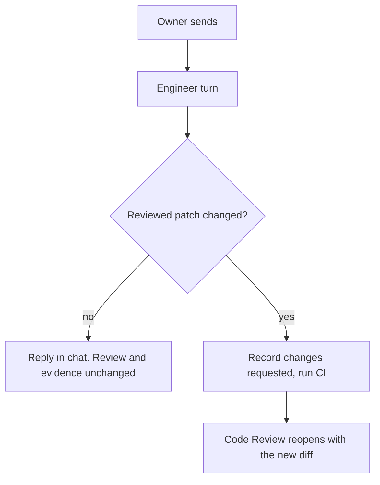

# Product Requirements Document: Conversational Review

Last updated: 2026-10-19 EDT

**Status:** Slice 1 shipped. Code Review conversation remains proposed.

**Document role:** Transient proposal for the remaining Code Review change. Delivered Plan and Epic review requirements
now live in [Core Plan review](runwield-core-prd.md#plan-review),
[Core Plan lifecycle](runwield-core-prd.md#plan-lifecycle), and
[Workspace Browser Plan review](runwield-workspace-prd.md#browser-plan-review-and-workflow).

The remaining owners are [Core Code Review gate](runwield-core-prd.md#code-review-gate) and
[Core Semantic review and repair](runwield-core-prd.md#semantic-review-and-repair). After slice 2 ships, fold its lasting
requirements into those capabilities, update references, and remove this document.

## Background

Plan review now supports a normal conversation with Planner or Architect. Code Review still treats each chat message
as a request for changes. A question starts a repair and CI and records “Changes requested”. The remaining proposal lets
Engineer reply without changing the work or invalidating the review.

## Problem Description

“Why did you use a Set here?” still costs a CI run and leaves a false record of requested changes. Owners need to ask
questions without requesting repairs. When a repair is needed, checks and a refreshed Code Review must still follow.

**Goals:** Use the Plan review queue in Code Review. Change review state only when the reviewed patch changes.

**Non-goals:** Threaded comments, unaddressed-comment tracking, and multi-reviewer teams belong to the
[Collaborative SaaS Workspace](runwield-workspace-prd.md#collaborative-saas-workspace). Standalone Code Review
(`wld review`) is unchanged; it already has an Engineer chat that does not force a repair.

## Why Are We Building It?

Owners must be able to understand the work before approving it. A question should not require a repair, consume another
CI run, or claim a decision the owner did not make.

## Audience

Developers who review RunWield changes in the browser or Workspace, and Engineer receiving their review context.
Multi-reviewer collaboration is out of scope.

## Product Fit, Prototypes, and Descriptions

Slice 2 proposes the chat-first Review Queue already used in Plan review: annotations and images queue by default;
per-type X excludes context from one send without deleting it. Send accepts a message, queued context, or both.

## Capability Requirements

### Code Review conversation

**Scope and maturity:** Proposed change to [Core Code Review gate](runwield-core-prd.md#code-review-gate) and
[Semantic review and repair](runwield-core-prd.md#semantic-review-and-repair). Slice 2 follows the shipped slice 1.
Code Review still uses its existing repair-on-send behavior until slice 2 ships.

**Requirement: Same chat model as Plan review.** Code Review uses the Review Queue from slice 1: chat is the default
tab, review input is queued by default, X excludes item types from the next send without deleting them, and there is no
send button that closes the review.

**Requirement: Reply or repair.** Engineer can reply in chat or edit code. After the turn, RunWield checks whether the
reviewed patch changed. It uses the patch itself, not the Agent's report.

- **Patch changed:** RunWield records “Changes requested” in Delivery Evidence, clears the review decision, moves the
  Plan back to `implemented`, runs CI, and reopens Code Review with the new diff and the same conversation.
- **Patch unchanged:** only the conversation continues. The review decision, Delivery Evidence, lifecycle status, and
  CI results do not change.

**Requirement: Scope changes need a Plan Deviation.** If the conversation agrees to change the Plan's scope, that
change becomes authority only through a confirmed [Plan Deviation](runwield-core-prd.md#plan-deviations). A chat reply
alone does not change what AI review and Work Records check against.

**Acceptance scenarios:**

- Given a reviewed Plan in Code Review, when the owner asks why a change was made and Engineer only replies, then no CI
  run starts, no “Changes requested” evidence is recorded, the status stays `reviewed`, and approval stays available.
- Given the same review, when the owner asks for a fix and Engineer edits a file, then “Changes requested” is recorded,
  CI runs, and Code Review reopens with the new diff and chat history.
- Given Engineer reports a fix but the patch did not change, RunWield treats the turn as a reply.
- Given the conversation agrees to drop a Plan requirement, approval keeps the original requirement unless the owner
  confirms a Plan Deviation.

## Success Metrics

No new analytics are required. After slice 2 ships, Session history or local workflow metrics must show that Code Review
turns without patch changes do not start CI.

## Delivery

1. **Slice 1: Plan review conversation — shipped.** Plan and Epic review support reply-only turns, the Review Queue,
   Submit answer, and the approval warning. Send Annotations remains only on no-chat fallback surfaces. Legacy
   `feedback` Plans read as `draft`.
2. **Slice 2: Code Review conversation — proposed.** Reuse the queue and add reply-or-repair based on the reviewed patch.
   See the [Code Review conversation Plan](../plans/conversational-review/02-code-review-conversation.md).

## Attached Research and Other Evidence

Code Review chat still records “Changes requested”, runs `validation_failed`, and dispatches repair through
`src/shared/workflow/validation-human-review.ts`. This is source evidence, not a usage measurement.
[Standalone Code Review](runwield-core-prd.md#standalone-code-review) already supports chat without forced repair.

## Risks and Mitigations

- **A patch edit is missed:** compare the reviewed patch, not Engineer's report. An unchanged patch is a reply.
- **Scope stays only in chat:** require a confirmed Plan Deviation before it changes execution or review authority.

## Open Questions

- **Plan approval warning scope:** the shipped warning follows any completed owner turn after the latest revision.
  After real use, decide whether to narrow it to turns with queued annotations. The owning behavior is in
  [Workspace Browser Plan review](runwield-workspace-prd.md#browser-plan-review-and-workflow).

## Proposed Domain Language

The shared terms from slice 1 are now in [the glossary](../domain-language.md). Slice 2 proposes one additional
relationship: a Code Review conversation turn records “Changes requested” only when the reviewed patch changes. Do not
add this relationship to the glossary before slice 2 ships.
