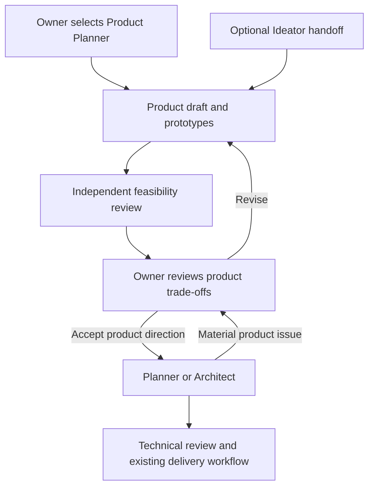

# Product Planner and Reviewable Prototypes

**Status:** Agreed product direction; proposed capabilities, not implemented or runtime-verified.

**Current scope:** Local prototype review with Plannotator, including owner annotations and Agent iteration, is required.
Uploading prototypes to the Plan share server and review by other people are deferred. Existing Plan sharing is unchanged.
Prototype files stay local and out of repository commits. Cross-machine portability is an accepted MVP limitation,
documented internally only; do not add UI messaging about missing capabilities.

## Background

RunWield needs a product-first planning stage before technical planning. Product Planner will help an owner shape a
feasible product experience through requirements, interactive prototypes, and review. Planner or Architect will then
add technical decisions and executable work. Prototypes will remain part of the Plan's review material rather than
exist only as disposable local experiments.

## Problem Description

The owner describes Planner and Architect as technical leads with product sense. The missing role has the opposite
emphasis: roughly 90% product judgment and 10% technical skill. It must resolve user needs, behavior, visual design,
scope, and trade-offs without making the owner design the implementation.

Current evidence supports parts of this journey, not the complete workflow:

- Ideator develops understanding; Planner and Architect produce technical planning artifacts.
- The prototype Skill supports local exploration, but treats executable prototypes as ignored, disposable artifacts.
- Plan review supports annotations and revision conversations. Shared review supports revision-bound comments.
- Plannotator documents HTML annotation. RunWield already embeds its review components, but retained, interactive Plan
  prototypes and prototype-state annotations are not established by the inspected implementation.

**Goals:** Make product intent concrete before technical planning, test feasibility early, preserve reviewed UX through
handoff, and let the owner give precise feedback on interactive prototypes in local review.

**Non-goals:** Change or retune Router; require an Ideator stage; replace Planner or Architect; produce production code
from the product stage; add roadmap or backlog management; upload prototypes to the Plan share server or enable review
by other people in this delivery; allow shared reviewers to direct Agents; adopt Replica Hub or the full Plannotator
Artifact Server.

## Why Are We Building It?

Users should agree on the experience before implementation choices dominate the discussion. A clickable prototype can
expose a misunderstood journey that a written Plan misses. An independent feasibility review can expose a promise that
relies on unavailable data, permissions, or platform capabilities.

The expected benefit is less product rework during technical planning and implementation. This is a product hypothesis,
not measured improvement. The retained Plan package should explain both what users agreed to and why.

## Audience

The primary user is the owner shaping a software change with RunWield. They may be an experienced developer, PM, or PO;
they should not need to express trade-offs as architecture decisions. Planner, Architect, and implementation Agents
consume the accepted product intent. Review by other people is a deferred audience, not part of this delivery.

Agent interaction remains single-player: one owner reviews the prototype locally and directs the planning conversation.

## Product Fit, Prototypes, and Descriptions

| Agent                | User's job                                   | Result                                                                     |
| -------------------- | -------------------------------------------- | -------------------------------------------------------------------------- |
| Ideator              | Explore what is worth pursuing and why       | Clear understanding; a PRD when requested                                  |
| Product Planner      | Shape a feasible product experience          | Reviewable product Plan draft, acceptance scenarios, and useful prototypes |
| Planner or Architect | Determine how to deliver the accepted intent | Technical Plan or Epic and the existing downstream workflow                |

Product Planner is directly selectable. Ideator offers an optional handoff when the user wants a concrete product
proposal. Router remains unchanged. Product Planner can perform its own discovery; a vague request does not force an
Ideator visit first.

The product review pairs written requirements with interactive examples. The owner can inspect behavior, annotate the
prototype or text locally, and discuss a revision with Product Planner, as they do with Plans today. This workflow does
not require publishing the prototype to the Plan share server. Review by other people is deferred.

**Selected basis:** Reuse Plannotator's HTML annotation support within RunWield's review experience. This is an explicit
product-direction choice, not a claim that the current integration already supports the journey. No prototype of this
new review experience was produced during discovery. The [tool comparison](../research/prototype-review-options.md)
provides the references and limitations.

## Capability Requirements

Capabilities below are **target additions or changes**, except the explicitly deferred shared-review capability.
Deferred requirements and scenarios are excluded from this delivery's implementation and acceptance scope. Existing
technical planning, Plan sharing, and delivery behavior remains in place unless a requirement explicitly changes it.

### Product-first planning

**Requirement: Select a product-focused partner without changing Router.** The owner can select Product Planner through
the existing Agent selection experience. Ideator offers it as an optional next step and carries forward settled goals,
constraints, and decisions when the owner chooses the handoff. Neither Agent forces a two-stage interview.

**Requirement: Produce a product-grounded Plan draft.** Product Planner establishes users, problems, desired outcomes,
journeys, scope and non-goals, important states, acceptance scenarios, and accepted trade-offs. It uses prototypes
commonly when interaction or visual decisions need review, but does not manufacture UI for non-UI work.

Its technical skills support repository research, constraint discovery, and prototype creation. It does not fill the
draft with invented implementation steps or treat prototype code as a production solution.

**Acceptance scenarios:**

- Given an owner with an unresolved product idea, when they select Product Planner directly, it performs discovery and
  develops a product proposal without requiring an Ideator session first.
- Given settled decisions in Ideator, when the owner accepts an offered Product Planner handoff, the new stage uses
  those decisions without restarting the interview or silently changing them.
- Given a product draft without technical steps, when the owner opens it for review, they can discuss and revise it
  without being told it is ready for implementation.
- Given a request with no useful visual question, when Product Planner shapes it, the draft contains observable
  acceptance scenarios without an unrelated UI prototype.

**Shared requirements:** [Core Agent customization](runwield-core-prd.md#agent-and-skill-customization),
[Plan authoring](runwield-core-prd.md#plan-authoring-and-external-adoption). Preserve
[request routing](runwield-core-prd.md#request-routing).

### Feasibility and product trade-offs

**Requirement: Independently challenge the product promise.** Product Planner uses a bounded feasibility-review
subagent to examine the draft against current project behavior, relevant external capabilities, dependencies, and
constraints. This follows the independent-challenge pattern used in technical Plan review, but asks a different
question: what must be true for the proposed experience to work?

The review separates supported facts, uncertainty, genuine blockers, and feasible alternatives. It distinguishes
“unsupported today” from “not feasible.” It does not treat existing code or policy as a veto on the owner's product
intent and does not take over architecture design.

**Requirement: Explain choices in product terms.** Product Planner owns reconciliation and the conversation. It explains
how a constraint affects experience, scope, effort, or risk and asks the owner about consequential trade-offs. Important
uncertainty is checked before investing heavily in a prototype; the proposal receives a feasibility check before
technical handoff. New product promises require reconsideration of the affected findings, not automatic reuse of an
older verdict.

**Acceptance scenarios:**

- Given a draft that promises instant updates, when research shows a required capability is unavailable, Product
  Planner explains the available experiences and their trade-offs before presenting the promise as feasible.
- Given a reviewer finding that a capability is absent from current code but technically achievable, Product Planner
  presents it as new work and a scope decision, not an impossibility.
- Given an unresolved dependency, when the owner reviews the proposal, it is identified as unverified rather than
  hidden behind a polished prototype or a feasibility pass.

### Interactive prototype review

**Scope and maturity:** Required target for this delivery. Local Plannotator review is not deferred.

**Requirement: Review the experience, not prototype code quality.** The owner can interact with a prototype locally, annotate
visible text or elements using Plannotator's HTML support, and send that feedback into the product conversation.
Product Planner can revise both the experience and its written requirements in response.

Prototype code is disposable and not production-ready. The accepted visuals, interactions, and UX are the useful
output. Existing project design guidance and components should inform prototypes where practical; source reuse does
not make their implementation production-approved.

**Requirement: Keep feedback tied to what was reviewed.** Review context identifies the prototype revision and the
relevant screen or state. An earlier comment remains understandable after a revision changes or removes its target.
The user must not be shown an old annotation as if it referred to a different current control.

**Requirement: Preserve a simple, contained review experience.** The first-release default is self-contained interactive
HTML with sample data and simulated interactions. The owner opens and reviews the prototype locally without publishing
it to the Plan share server or starting the production application. Prototype content must not gain access to review
credentials, private Session content, or production mutations.

**Acceptance scenarios:**

- Given an owner reviewing a checkout prototype, when they annotate the empty-cart action and send feedback, Product
  Planner receives the comment in the context of that revision and empty-cart state, then can propose a revision.
- Given a revised prototype that removes the annotated action, when the owner opens the earlier feedback, its original
  context remains identifiable rather than attaching the comment to an unrelated element.
- Given a local product draft with a prototype, when the owner opens review without publishing to the Plan share
  server, they can exercise the prototype, annotate it, send feedback to Product Planner, and review the resulting
  revision in the local review workflow.
- Given interactive prototype content, when it runs in review, it does not receive the surrounding review credentials
  or permission to mutate production data.

**Shared requirements:** [Browser Plan review](runwield-workspace-prd.md#browser-plan-review-and-workflow),
[document reader](runwield-workspace-prd.md#document-reader).

### Shared feedback with owner-led iteration

**Scope and maturity:** Deferred and excluded from this delivery. This covers uploading prototypes to the Plan share
server and enabling other people to review them. The requirements and scenarios below preserve future intent; they are
not current implementation work or acceptance gates. Local Plannotator review remains required above.

**Deferred requirement: Publish prototypes for shared review.** A published Plan revision includes the prototype
material needed to review its product intent. Shared reviewers can annotate and reply under existing shared-review
access rules. Plan text and prototypes must represent the same published product proposal.

**Deferred requirement: Keep Agent control with the owner.** Shared feedback does not start Agent turns, revise the draft,
authorize implementation, or grant access to the private Session. The owner brings feedback into Product Planner and
controls the next published revision. Comments are input to a decision, not automatic acceptance of a requested change.

**Deferred acceptance scenarios:**

- Given a shared product proposal, when a reviewer follows its review link, they can exercise the published prototype
  and annotate it without installing local tooling or starting the owner's application.
- Given two shared reviewers with conflicting comments, when they submit feedback, both comments remain available and
  no competing Agent revisions begin. The owner resolves the trade-off with Product Planner.
- Given a published prototype and comments on its original revision, when the owner publishes a revised proposal,
  reviewers can distinguish the new proposal from the earlier reviewed version and its feedback.
- Given a reviewer link, when the reviewer opens the prototype, their access does not expand to maintainer actions,
  the owner's conversation, or Agent control.

**Shared requirements:** Preserve [Shared Plan collaboration](runwield-workspace-prd.md#shared-plan-collaboration),
including explicit publication, revision-bound comments, access separation, and content privacy. Future prototype
sharing must use those rules, not introduce a second sharing service. This delivery leaves existing Plan sharing
unchanged and does not add prototype publication or shared prototype annotations.

### Product acceptance and technical handoff

**Requirement: Treat accepted text and experience as one agreement.** Accepted journeys, behavior, and explicitly
approved visual choices define intended delivery. Sample data and incidental details remain illustrative unless
explicitly accepted. Product Planner keeps the prototype and written requirements aligned and resolves consequential
conflicts with the owner; downstream Agents must not silently choose one over the other.

**Requirement: Separate product acceptance from execution approval.** Accepting the product direction authorizes
technical planning, not implementation. The draft stays non-executable until the existing technical planning,
approval, and readiness requirements are met. Product approval is a separate, revision-bound record, not a boolean or a
new `product_approved` Plan Status. The Plan remains `draft` while technical planning is incomplete. Accepted product
intent and prototype revisions remain identifiable as technical detail is added; accepting a product proposal must not
make it appear implementation-ready.

**Requirement: Continue now or save accepted intent.** The owner can accept the product proposal and continue to Planner
or Architect, or save the accepted proposal for later technical planning. Both preserve the accepted product revision.
Resuming a saved acceptance starts at technical planning, not execution.

**Requirement: Preserve intent through either technical path.** Planner can develop a bounded Plan; Architect can develop
an Epic. Both receive the accepted scope, journeys, scenarios, prototype references, feasibility evidence, decisions,
and remaining uncertainties. Decomposition preserves relevant product intent for child work without requiring the
owner to restate it.

Planner and Architect can revisit feasibility. Material changes to accepted behavior or visual experience return to
the owner for product agreement, with Product Planner available to revise the proposal. Technical details that preserve
the agreement do not require another product interview. Implementation code is developed and verified through the
normal workflow; prototype files are not promoted as production-ready output.

**Acceptance scenarios:**

- Given a product draft, when the owner accepts and continues, Planner or Architect receives the accepted proposal for
  technical planning; implementation does not start merely because the product direction was accepted.
- Given a product draft, when the owner accepts and saves for later, its accepted product revision remains identifiable.
  A later continuation starts technical planning rather than execution.
- Given an accepted live-collaboration experience, when Architect discovers a material delivery constraint, the owner
  receives the product trade-off rather than a silent replacement with manual refresh.
- Given an accepted visual layout and journey, when Planner adds technical decisions, those decisions preserve the
  experience or explicitly return the proposed change for owner agreement.
- Given a proposal that becomes an Epic, when its child work is planned, the relevant prototype and acceptance
  scenarios remain available to the Agents and owner reviewing that work.

**Shared requirements:** [Core Plan review](runwield-core-prd.md#plan-review),
[Plan lifecycle](runwield-core-prd.md#plan-lifecycle),
[Epic decomposition](runwield-core-prd.md#epic-decomposition-and-hold).

### Prototype retention with the Plan

**Requirement: Retain local review material for the Plan's active life.** Prototypes remain associated with the Plan on
the same machine while it is being shaped, technically planned, implemented, and reviewed. Closing a preview, restarting
a Session, handing work to another Agent, or using a registered planning/execution worktree does not discard them.
Disposal of prototype code means no production-quality or reuse promise, not deletion after product acceptance.

**Requirement: Keep prototype files out of repository commits.** Retain the files locally for this MVP rather than
commit them beside the Plan. Prototypes live with the Plan in the local home Plan Store, which another machine does not
have, so their references can be unusable there. The owner accepts this known problem until a hosted Plan Store serves
the same Plans. This delivery does not add prototype export, synchronization, or migration machinery.

**Requirement: Document the limitation internally, not in the UI.** Keep the portability limitation in this PRD and the
implementation Plans. Do not add missing-capability notices, missing-prototype warnings, or portability banners to the
UI, or add public user-documentation work for this limitation.

Archive or deletion of the Plan is the retention boundary. The reviewable default is to follow the Plan's existing
archive and deletion policy for associated prototype material, rather than create an independent permanent prototype
library. This proposal does not promise indefinite retention after archival. Shared prototype retention is deferred
with prototype publication; existing shared-Plan retention rules remain unchanged.

**Acceptance scenarios:**

- Given an accepted local prototype, when the owner resumes the Plan in a later Session or opens it during
  implementation on the same machine, the reviewed prototype remains available without reconstructing it from the
  conversation, including across registered planning/execution worktrees.
- Given a Plan referencing a local prototype, when the workflow commits or delivers the Plan, the prototype files are
  not included in repository commits. Moving that Plan to another machine does not imply prototype availability; this
  known limitation is recorded internally without new UI capability or missing-prototype messaging.
- Given an active Plan, when its temporary preview is closed or its Agent changes, its prototype review material is
  not deleted as disposable scratch work.
- Given a Plan reaching archive or deletion, when its retention policy is applied, associated prototype material is
  handled with that Plan rather than left as an independently managed live service.

**Shared requirements:** [Core Plan lifecycle](runwield-core-prd.md#plan-lifecycle).

## Proposed Domain Language

These are future definitions. The implemented glossary remains unchanged until the implementing work makes them true.
“Plan package” is descriptive shorthand here, not a proposed new lifecycle object.

| Term                   | Intended definition and stable relationships                                                                                                                                        | Avoided aliases and affected terms                                                                                       |
| ---------------------- | ----------------------------------------------------------------------------------------------------------------------------------------------------------------------------------- | ------------------------------------------------------------------------------------------------------------------------ |
| Product Planner        | Selectable product-first Agent that owns product discovery, drafts, prototype iteration, and translation of feasibility findings before Planner or Architect takes over             | PM and PO may describe its human audience, not alternate canonical Agent names. Distinct from Planner and Ideator        |
| Product Draft          | Reviewable product-focused draft of a Plan, with technical planning still incomplete; may become a bounded technical Plan or an Epic                                                | Not a PRD, Approved Plan, or Ready For Work Plan; not a new Plan Status                                                  |
| Plan Prototype         | Interactive review material associated with a Plan and its relevant revisions; accepted experience informs delivery while its code remains disposable                               | Not production code, a Guided Review Widget, or an independent artifact service                                          |
| Product Acceptance     | Owner agreement to product intent and the accepted prototype experience before technical planning                                                                                   | Not execution authorization, Approve & Run, or technical readiness                                                       |
| Plan, extended meaning | A work proposal that may start as a Product Draft and gain an implementation strategy; its associated prototypes remain review material, not a second authority for lifecycle state | Extends today's implementation-strategy definition; preserves Plan Lifecycle, Planner, Architect, and Epic relationships |

## Success Metrics

- **Product clarity:** Observe whether the owner can identify and resolve a concrete UX issue through local prototype
  annotations and Agent iteration rather than a separate manual explanation.
- **Handoff fidelity:** Review whether technical planning preserves accepted product intent and explicitly returns
  material changes for agreement.
- **Useful feasibility review:** Record examples where independent evidence changes or qualifies a product promise
  before technical planning, without blocking feasible new work merely because it is not implemented today.

Baselines, numeric targets, and observation periods are not yet agreed. Use representative real tasks and review
outcomes initially; this PRD does not require a new analytics system. Capability scenarios above define acceptance,
not measured product improvement.

## Delivery and Capability Ownership

The delivery includes the selectable Agent, Ideator handoff, feasibility review, local Plannotator prototype review and
owner annotations, Agent iteration, retained review material, and technical handoff.

**Excluded and deferred:** Uploading prototypes to the Plan share server, review and annotations by other people, and
shared prototype publication, access, and retention work. Prototype files in repository commits and cross-machine
prototype portability are also excluded from this MVP. These are not prerequisites for completing this delivery.
Local prototype review is a required capability, not merely a trial or follow-up.

The current scope has two distinct areas to plan: retained prototypes with local review, and Product Planner with its
feasibility review and handoffs. No shared-prototype-review child Plan belongs in the current execution scope.

Use `/agent planner` for technical planning from this PRD. If the work requires an Epic, Architect owns that artifact
and decomposition. No implementation Plan, release date, or delivery sequence has been approved in this document.

| Lasting owner                                                                                                                                                                                               | Proposed change to reconcile with delivery                                                                  |
| ----------------------------------------------------------------------------------------------------------------------------------------------------------------------------------------------------------- | ----------------------------------------------------------------------------------------------------------- |
| [Core Plan authoring](runwield-core-prd.md#plan-authoring-and-external-adoption), [review](runwield-core-prd.md#plan-review), and [Agent customization](runwield-core-prd.md#agent-and-skill-customization) | Product Planner, product drafts, feasibility review, acceptance boundaries, handoff, and retention          |
| [Workspace browser review](runwield-workspace-prd.md#browser-plan-review-and-workflow)                                                                                                                      | Local interactive prototype review, revision context, and owner annotations with Agent iteration            |
| [Shared collaboration](runwield-workspace-prd.md#shared-plan-collaboration)                                                                                                                                 | Deferred: prototype publication and review by other people; preserve existing Plan sharing in this delivery |
| [Root Plan concept](runwield.md#plan)                                                                                                                                                                       | Extend the product description and link to the owning capabilities without duplicating their requirements   |

Update owning capabilities, acceptance scenarios, affected references, and domain language in the changes that deliver
behavior. Retain unmet scope as target or deferred. After consolidation, remove this transient proposal according to
repository policy. Current Router behavior is preserved, not part of the proposed change.

## Attached Research and Other Evidence

- **Owner interview in this Session:** establishes the product-first role, explicit selection, unchanged Router,
  feasibility subagent, Plannotator choice, prototype acceptance and retention. The owner subsequently narrowed delivery
  to local review and deferred prototype publication to the Plan share server and review by other people. Prototype
  files remain outside repository commits; cross-machine breakage is an accepted, internal-docs-only MVP limitation.
- [Prototype review options](../research/prototype-review-options.md): distinguishes embedded Plannotator UI from Artifact
  Server and compares alternatives. Its earlier open product questions are superseded by the decisions in this PRD.
- [Replica assessment](../research/replica-integration-assessment.md): explains the original comparison and why a separate
  Copilot canvas or Hub is not the selected basis.
- [Current prototype Skill](../../src/skills/prototype/SKILL.md): evidence for the existing disposable-prototype workflow,
  which must change for retained Plan Prototypes without making unrelated experiments permanent.

Research inspected documentation and selected source, not a working integration. Package compatibility, local HTML
review, and preservation of interactive context require verification during technical planning and delivery. Shared
prototype review is future work.

## Risks and Mitigations

- **Known MVP problem — cross-machine prototype references:** local files do not accompany a cloned or copied Plan.
  The owner accepts broken references on another machine until a hosted Plan Store resolves portability.
  Preserve same-machine review and retention; record the limitation internally without adding UI messaging.
- **Polished fiction:** A convincing prototype hides unsupported promises. Use independent feasibility evidence and make
  simulation and unresolved constraints visible.
- **Accidental requirements:** Placeholder data or incidental styling becomes a delivery obligation. Make accepted
  behavior and visual choices clear and keep written intent aligned.
- **Lost review context:** A comment points to a changed control or different state. Preserve revision and state context;
  do not silently reattach feedback.
- **Prototype code becomes production by default:** Preserve the experience, not an assumption that its implementation
  is sound. Keep the normal engineering and verification workflow.
- **Scope expands into shared review:** Keep prototype upload to the Plan share server and review by other people out
  of this delivery. Do not remove existing Plan sharing or weaken the required local review workflow.
- **Reuse is mistaken for completed integration:** Verify the pinned Plannotator capabilities and local review isolation.
  Do not replace the selected review approach or reduce agreed scope silently if compatibility work is needed.

## Open Questions and Reviewable Defaults

No unresolved product choice blocks technical planning. The following need evidence or remain explicit defaults:

- **Compatibility:** Which supported Plannotator version satisfies the agreed HTML review journeys? Technical planning
  must verify this without treating upstream documentation as proof of local support.
- **Prototype breadth:** Self-contained simulated experiences are the initial default. Arbitrary live application
  inspection, production integrations, and complete browser-state replay are outside the initial scope.
- **Archive handling:** Follow the Plan's existing retention policy for its associated prototype material; no separate
  permanent library is proposed.
- **Measurement:** Establish outcome baselines and targets through real use rather than inventing them during synthesis.
