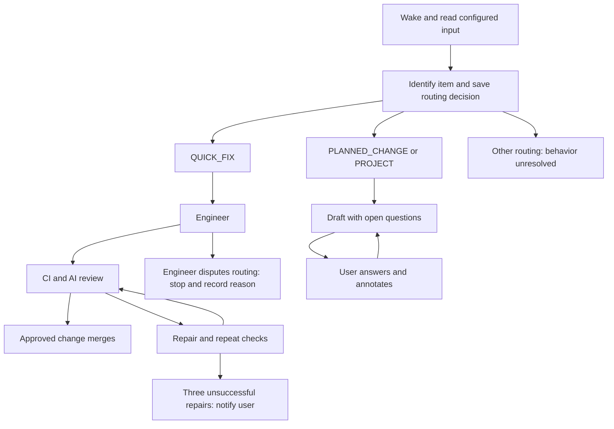

# Product Requirements Document: RunWield Factory

**Document role:** Proposed product PRD. This records agreed direction, open questions, and unexplored branches. It does not authorize implementation or claim shipped capability.

**Product sequence:** Connect → SaaS start → Factory.

**Ownership proposal:** Factory is a new product within the RunWield family and part of the SaaS offering. This document is its proposed requirements owner. The repository currently names five living central PRDs. Adding Factory as a lasting owner requires an explicit update to that policy when the product proceeds. This draft does not change those documents or the current glossary.

## Background

RunWield Factory advances user-selected requests without requiring a person to start each Agent turn. It delivers bounded QUICK_FIX work through implementation, validation, AI review, and merge. It prepares larger work for human planning review rather than executing it automatically.

Factory uses reusable RunWield Core pieces. Those pieces remain free, and experienced developers can assemble other flows. Factory supplies one supported composition as a SaaS product. Core and Workspace keep their existing default workflows.

## Problem Description

Experienced users already connect scheduled coding requests, review, and publication by hand. The owner reports a migration flow in which Codex runs every two hours, selects related JavaScript files, converts them to TypeScript, and opens a PR. The owner then runs a separate review pass and merges changes without review findings.

The missing product is not another coding Agent. It is a repeatable path from authorized input to either a verified small change or a useful human checkpoint. That path must preserve work, prevent duplicate intake, and expose disagreement instead of forcing every request through implementation.

The owner also reports that Work Records can become a large pile. Factory must not multiply that problem by treating every run as a new permanent lesson.

### Goals

- Deliver QUICK_FIX requests from user-defined inputs with CI and AI review, without routine human merge approval.
- Prepare larger requests as drafts with open questions for human review.
- Let experienced developers use the free pieces in different compositions.
- Improve future routing and work through concise, human-approved learning changes.
- Keep planning the preferred path for material work.

### Non-goals

- Change interactive QUICK_FIX, Core's default workflow, or Workspace's existing workflow.
- Manage an Agent fleet or promise a fully autonomous software organization.
- Execute planned work merely because Factory prepared it or a user approved its draft.
- Accept existing PRs as input to the default Factory flow.
- Replace issue trackers or decide product priorities without user direction.
- Redesign Core Work Records or remote SSH.
- Require a new whole-gate mutation-testing program without evidence of need.
- Resolve Inquiry, Ideation, or Operation behavior in this draft.

## Why Are We Building It?

Factory removes repeated starts and review handoffs for small work. For larger work, it moves the first planning draft forward while leaving consequential decisions with the user.

The business goal is a paid Factory capability built on useful free Core pieces. The learning goal is to turn observed routing mistakes and repair outcomes into accepted guidance, not an ever-growing archive that Agents must read.

These are proposed outcomes. The current migration flow is evidence of a use case, not proof of demand, delivery reliability, or willingness to pay.

## Audience

The initial audience is experienced developers who also understand RunWield. They choose the input, know their repository's checks, and accept that Router classification can be wrong.

Factory is optional. It is not the prescribed way for new users to use RunWield. Planning remains the default and preferred route for material changes.

## Product Fit and Main Journey

| Product or offering | Role                                                                                                |
| ------------------- | --------------------------------------------------------------------------------------------------- |
| RunWield Core       | Free opinionated harness and reusable workflow pieces. Existing default behavior stays unchanged.   |
| RunWield Workspace  | Existing browser and collaboration workflows. This proposal does not redefine them.                 |
| RunWield Connect    | RunWield workflows inside external Agent hosts. Comes before Factory in the product sequence.       |
| RunWield Factory    | SaaS composition that consumes requests, delivers quick fixes, and prepares larger work for review. |

Factory launches with SaaS coordination and user-owned runners. When RunWield has cloud-hosted SaaS infrastructure, Factory will offer both user-owned and RunWield-hosted runners. Hosting, credentials, billing, and runner operations remain design work.

The repair loop is bounded. The diagram does not authorize a fourth automatic repair after the three unsuccessful attempts. Paused delivery work remains recoverable.

### Custom compositions are different from the default flow

The owner's migration example has two flows:

1. A scheduled request selects related files, converts them, and opens a PR.
2. A separate review pass finds those PRs and reviews, comments, or merges.

The second flow can use the Reviewer and publication pieces without Router or Engineer intake. This is a valid custom composition, not a reason to make PRs valid input to the default Factory.

A general visual workflow builder is not an agreed requirement. The form of composition remains open.

## Capability Requirements

### User-defined input and durable intake

**Scope and maturity:** Agreed target. Exact launch integrations and Markdown behavior are unresolved.

**Requirement: The user defines authorization through input selection.** Users can define the requests Factory consumes. Examples include selected labelled issues, all issues, TODO entries, and recurring scheduled instructions. These examples express the input model, not a promise that every connector ships at launch.

All consumed items classified QUICK_FIX enter the quick-fix flow. There is no second eligibility filter or requirement for a pre-approved class of fixes. Execution can still stop for Engineer disagreement, protected work, failed checks, or missing prerequisites.

**Requirement: Identify each consumed item durably.** Each item has a stable identity and metadata sufficient to recognize previous intake, its routing decision, and its progress or outcome. A later wake must not consume the same item as new work merely because it remains visible in the source.

**Requirement: Save the routing decision.** Factory preserves the Router decision for later inspection. A source can show it, for example through GitHub labels. The exact ownership and synchronization contract for source annotations remains open.

**Acceptance scenarios:**

- Given a user who selects all repository issues as input, when Factory consumes an issue and Router classifies it QUICK_FIX, then Factory starts that flow without requiring a separate admission label.
- Given a user who selects only issues with a particular label, when Factory wakes, then unselected issues do not enter the flow.
- Given a previously consumed item that remains in the input, when Factory wakes again, then the user does not receive a second independent run for that same item.
- Given a recorded routing decision, when the user inspects the item in Factory, then they can see how it was classified and what happened next.

**Shared requirements:** [Core request routing](runwield-core-prd.md#request-routing). Factory adds durable queued intake; it does not change interactive routing.

### Reviewed quick-fix delivery

**Scope and maturity:** Agreed target, specific to Factory.

**Requirement: Deliver through checks and independent AI review.** A QUICK_FIX proceeds to Engineer, CI and applicable Mechanical Validation, then the AI review and repair loop. Factory merges only the change that has satisfied the required checks and received AI review approval. Approval of an earlier revision does not authorize an unchecked repair.

**Requirement: Notify after three unsuccessful repairs.** Factory allows up to three repair attempts. If the work still lacks approval, it preserves the work and notifies the user. Exhaustion does not mean successful completion or abandonment. The user can decide what to do next.

**Requirement: Keep status truthful.** A missing or inconclusive check does not count as approval. A merge is reported as complete only when its outcome is confirmed. Waking again must not silently reset an exhausted repair allowance.

**Acceptance scenarios:**

- Given a QUICK_FIX with passing required checks and AI review approval of the current change, when Factory completes publication, then the user receives a confirmed merge outcome without a routine human code-review gate.
- Given an AI review finding, when Engineer repairs the change, then Factory checks and reviews the repaired change before merging it.
- Given three unsuccessful repair attempts, when approval is still absent, then the user is notified and can inspect the preserved work; Factory does not merge or start another repair merely because it wakes again.
- Given an unavailable required check, when Factory evaluates merge readiness, then it does not report the check as passing or merge on that basis.

**Shared requirements:** [Core execution, validation, and recovery](runwield-core-prd.md#execution-validation-and-recovery) and [semantic review and repair](runwield-core-prd.md#semantic-review-and-repair). This composition adds review and automatic merge for Factory QUICK_FIX work; it does not alter Core QUICK_FIX.

### Engineer disagreement and protected work

**Scope and maturity:** Agreed target. The complete protection policy remains open.

**Requirement: Engineer may reject a quick-fix classification.** The Factory Engineer can stop when the work is not safely bounded as QUICK_FIX. It records the reason and preserves any work already done. It must not force the request through to satisfy the Router decision. The disagreement becomes evidence for Factory learning review.

**Requirement: Factory Engineer cannot change its governing rules.** Core PRDs, `AGENTS.md`, Agent definitions, and equivalent governing policy are protected from Factory Engineer changes. AI review approval cannot authorize bypassing this restriction. The full protected set, including settings and project-specific guidance, must be resolved before launch.

This restriction applies to the Factory Engineer. It does not forbid the Planner or Architect from producing the requested planning drafts, or a person from making deliberate policy changes.

**Acceptance scenarios:**

- Given a request classified QUICK_FIX, when Engineer finds that it needs planned work, then implementation stops, the user can see the reason, and the disagreement is available for learning review.
- Given a fix that requires changing `AGENTS.md` or a protected PRD, when Factory Engineer encounters that requirement, then Factory does not deliver that protected change automatically, even if an AI review would approve it.

### Proactive planning and human review

**Scope and maturity:** Agreed product direction, dependent on the separate proactive Planner experiment. No experiment artifact was supplied in this Session.

**Requirement: Produce a useful first draft with open questions.** PLANNED_CHANGE requests go to Planner; PROJECT requests go to Architect. They produce a reviewable Plan or Epic draft with unresolved questions rather than requiring a complete interview before the first review.

**Requirement: Resolve questions in the review loop.** Users answer questions and annotate the draft with Planner or Architect. Revisions keep assumptions and unresolved decisions visible. Presenting a draft does not imply that it is execution-ready.

**Requirement: Stop at the reviewed handoff.** Factory does not execute these Plans or Epics automatically. User approval of the draft does not itself authorize Factory execution. Further execution is a separate user action outside this default Factory flow.

**Acceptance scenarios:**

- Given a consumed request classified PLANNED_CHANGE, when Planner prepares it, then the user receives a draft and its open questions without Factory starting implementation.
- Given a request classified PROJECT, when Architect prepares it, then the user receives an Epic draft for review rather than automatic child execution.
- Given a user who answers a draft question and annotates the proposal, when the planning Agent revises it, then the review continues with those answers reflected in the draft.
- Given an approved Factory-prepared Plan or Epic, when approval completes, then Factory does not automatically start code implementation.

**Shared requirements:** [Core Plan review](runwield-core-prd.md#plan-review). Factory's approval-to-execution boundary is narrower; existing interactive review actions remain unchanged.

### Human-approved learning

**Scope and maturity:** Agreed direction. Consolidation, storage, retention, and review experience remain unresolved.

**Requirement: Separate run evidence from accepted guidance.** Factory keeps enough evidence to explain routing disagreement, review findings, repairs, and outcomes. Evidence does not become permanent project guidance merely because a run produced it.

**Requirement: People review and commit learnings.** A person decides which lessons should change future behavior. Factory does not automatically rewrite Router guidance, Agent instructions, or governing policy based on its own runs.

**Requirement: Prevent a growing pile of repeated lessons.** The learning experience must consolidate repeated evidence and support deliberate disposition. One permanent lesson per run is not the default. Exact deduplication, expiry, rejection, and supersession rules are open; this PRD authorizes no automatic evidence deletion.

**Acceptance scenarios:**

- Given an Engineer disagreement with Router, when the user reviews proposed learnings, then they can inspect the disagreement and decide whether guidance should change.
- Given an unreviewed learning candidate, when later work runs, then that candidate has not silently changed the Factory's governing policy.
- Given repeated instances of the same proposed lesson, when the user reviews them, then the experience groups the evidence rather than requiring separate acceptance of each duplicate.

**Shared requirements:** [Core Work Records](runwield-core-prd.md#work-records) remain unchanged. Factory evidence and learning candidates are not automatically Core Work Records. The current Core PRD describes auto-approved records for eligible completed Plans; this proposal does not impose a new manual approval rule on them.

### Free pieces and paid Factory

**Scope and maturity:** Agreed product and business boundary. The callable contracts and packaging are unresolved.

**Requirement: Preserve a useful free Core.** Router, engineering, review, validation, and publication capabilities can serve as reusable pieces for experienced users. Using those pieces in a custom composition does not require adopting the paid Factory composition. Core's opinionated default remains available and unchanged.

**Requirement: Keep custom inputs distinct from Factory intake.** Users can assemble a scheduled PR-review flow from the review and publication pieces. Default Factory intake remains request-based, not PR-based.

**Requirement: Offer user-owned execution first.** Factory launches with SaaS coordination and user-owned runners. RunWield-hosted runners are later scope, offered alongside user-owned runners when cloud-hosted SaaS infrastructure is available.

**Acceptance scenarios:**

- Given an experienced user building a custom PR-review flow, when they use Core review and publication pieces, then they do not need to route those PRs through the default Factory request flow.
- Given a launch customer with a user-owned runner, when Factory processes work, then execution uses that runner rather than requiring RunWield-hosted compute.
- Given a user who does not enable Factory, when they use interactive Core or Workspace, then this proposal does not change their workflow.

## Success Metrics

These are proposed measures, not agreed numeric targets. Baselines and observation periods are open.

| Outcome                     | Candidate measure                                                              | Evidence available now                                                         |
| --------------------------- | ------------------------------------------------------------------------------ | ------------------------------------------------------------------------------ |
| Less repeated manual work   | Human interventions per delivered quick fix; time spent on review handoffs     | Owner reports a manual review pass in the migration flow; no measured baseline |
| Safe bounded delivery       | Confirmed merges, later regressions or reversions, and protected-change blocks | No Factory delivery data                                                       |
| Useful routing correction   | Engineer disagreements and later recurrence after accepted guidance changes    | No Factory disagreement data                                                   |
| Useful planning preparation | Drafts advanced through user review; time to a usable reviewed handoff         | Separate Planner experiment pending                                            |
| Manageable learning review  | Review effort, duplicate volume, and unresolved candidate age                  | Owner reports a Work Record accumulation problem; no measured baseline         |

Passing capability scenarios proves the specified behavior, not adoption or product quality.

## Delivery

The agreed sequence is **Connect, SaaS start, Factory**. This is ideation only; there is no implementation date or authorization.

The smallest coherent Factory release uses user-owned runners and delivers these outcomes:

- User-selected requests have durable identity and routing.
- QUICK_FIX work merges through checks and AI review, or stops with preserved work and a useful notice.
- Planned work reaches a draft-review handoff, subject to the Planner experiment.
- People can review learning candidates before they change guidance.

The exact connector set and inclusion of proactive planning in the first release remain open. Hosted runners follow later. Inquiry, Ideation, Operation, deployment after merge, and a workflow-builder UI are not launch commitments.

Before implementation, reconcile the root product map and document-ownership policy. Add shared reusable-piece requirements to Core where needed, without changing its default workflow. Do not treat Factory intake as an implicit expansion of Core Ticket Reference synchronization.

No implementing Plan or Epic is linked to this proposal. When the owner chooses to proceed, `/agent architect` can shape the multi-capability Epic; `/agent planner` can scope a bounded experiment. Neither handoff is authorized by this draft alone.

## Attached Research and Other Evidence

- [Deploy with Void — Cloudflare Blog](https://blog.cloudflare.com/deploy-with-void/): research reference for Factory. Void provides an open-source SDK, CLI, and self-hostable platform for building full-stack Vite apps and deploying them to Cloudflare. Explore its relevance to future deployment workflows; no adoption or implementation decision is made here.
- **Owner's migration example:** a recurring Codex request creates JS-to-TS PRs; a separate manually started review pass merges clean PRs. This establishes two composable flows, not PR input for default Factory.
- [Local migration review prompt](../../.wld/prompts/review-ts-to-js-prs.md): selects PRs labelled `auto:js-to-ts`, reviews them, and either merges or posts findings. It supports the example, not a claim of mechanical safety or measured reliability.
- [AI Software Factory README](https://github.com/coleam00/ai-software-factory): inspiration for scheduled intake, human intent, review, and staging feedback. Its documented capabilities are not evidence that RunWield provides them.
- [AI Software Factory incidents](https://github.com/coleam00/ai-software-factory/blob/main/docs/incidents.md): examples of unknown state mistaken for absence, prose-only merge holds, and weak verification. These support failure-mode questions, not an audit of the current Archon implementation.
- **Owner's Planner experiment:** draft first, with questions answered during review. Its outcome and artifact are not yet available here.
- [RunWield product principles](runwield.md#core-philosophies) and [current glossary](../domain-language.md): planning remains preferred; Factory terminology below is proposed only.

## Risks and Mitigations

| Risk                                            | Impact and direction                                                                                                                                                   |
| ----------------------------------------------- | ---------------------------------------------------------------------------------------------------------------------------------------------------------------------- |
| Router calls material work QUICK_FIX            | User accepts classification risk by enabling Factory. Engineer can stop; checks and AI review still apply. Project-specific routing quality needs observation.         |
| Authorized input requests an unwanted change    | The user controls the input selection. Router measures workflow suitability, not product desirability. No hidden second admission gate is assumed.                     |
| Input contains hostile instructions             | Source content must not gain authority over Factory policy. Credential and runner threat boundaries need design before launch.                                         |
| Engineer weakens its own checks or instructions | Protected governance cannot be changed by Factory Engineer. The complete protected policy remains open.                                                                |
| Duplicate intake or repeated retries            | Stable item identity and durable outcomes prevent fresh independent runs for consumed items. Edit, retry, and recurring-occurrence semantics need resolution.          |
| Green checks miss a real defect                 | Retain current testing and review practices. New whole-gate mutation infrastructure is not justified by this interview alone. Use real failure evidence to revisit it. |
| Learning becomes another backlog                | Separate evidence from guidance; consolidate candidates; require human acceptance. Do not promise retention rules that have not been chosen.                           |
| Proactive drafts create review overload         | Evaluate the Planner experiment and usefulness of drafts before treating bulk draft generation as success. Rate and cost policies remain open.                         |
| Runner or SaaS interruption                     | Preserve work and truthful outcomes. Recovery follows shared principles; availability and operating controls need design.                                              |

## Open Questions and Unexplored Branches

### Decisions needed before launch

1. **Input integrations and identity:** Which sources ship first? How do TODO entries acquire stable identity? Does intake mark, retain, or move them? The proposed deletion-at-intake approach remains unresolved. Decide how unexecuted work stays visible without losing source content.
2. **Edits and retries:** What happens when a consumed issue changes, a label is removed, or a user wants a retry? Do not confuse an edit with new authorization or erase previous attempts by accident.
3. **Recurring instructions:** How is each scheduled occurrence distinguished from a repeated read? For “pick the next related files,” how is the selected scope assessed before implementation, and how are overlapping selections prevented?
4. **Source feedback:** Which labels, comments, and completion updates are written back? What happens when a person changes them? Durable Factory decisions are required; their relationship to source annotations is not yet designed.
5. **Engineer disagreement handoff:** Does a stopped quick fix automatically become a proactive planning draft, or wait for the user's decision? Recording disagreement is agreed; automatic escalation is not.
6. **Protection policy:** What is protected beyond Core PRDs, `AGENTS.md`, and Agent definitions? Include settings, validation configuration, and project-specific instructions in the discussion. How does an authorized person make necessary policy changes outside Factory Engineer?
7. **Repair and operating controls:** Which failures consume a repair attempt? How do infrastructure failures, cost limits, concurrency, pause, cancellation, and runner availability affect progress without discarding work?
8. **Notifications and review surfaces:** Where do users receive drafts, stopped work, and learning candidates? What batching avoids noise? Reuse of Workspace surfaces is possible but not yet a product commitment.
9. **Learning lifecycle:** What evidence is retained, for how long, and where? How are candidates grouped, rejected, superseded, and committed? Does accepted learning change repository guidance, memory, or another policy surface?
10. **Proactive planning dependency:** What does the separate experiment demonstrate? How are unanswered questions kept from appearing execution-ready? Does this branch ship with the first Factory release?
11. **Composition and commercial boundary:** How do developers invoke and connect the free pieces? Which coordination capabilities are paid? Exact packaging, pricing, and support promises are unresolved.
12. **Runner trust and hosting:** How are repository and model credentials handled on user-owned runners? What changes for hosted runners? Cloud availability establishes sequence, not a security or billing design.

### Deliberately unexplored

- **INQUIRY:** A report for user review or an automatic responder was mentioned. Neither is an agreed feature. The user explicitly deferred this discussion.
- **IDEATION:** No Factory behavior has been selected.
- **OPERATION:** No Factory behavior has been selected. It must not silently inherit QUICK_FIX automatic execution.
- **Manual QA findings as input:** A failed checklist item could become a linked request without manual copying. Capture, authorization, and intake behavior remain unexplored, not part of the agreed release.
- **Post-merge deployment and staging:** Merge is the agreed quick-fix delivery outcome. Deployment and automated conversion of staging feedback into requests are not specified.
- **Broader Work Record maintenance:** The accumulation problem motivated Factory learning constraints, but redesign of Core record retention is separate work.

## Proposed Domain Language

These terms describe future intent. They do not update the implemented glossary.

| Proposed term              | Definition and stable relationship                                                                                                     | Avoided aliases and affected existing terms                                                                       |
| -------------------------- | -------------------------------------------------------------------------------------------------------------------------------------- | ----------------------------------------------------------------------------------------------------------------- |
| RunWield Factory           | SaaS product that consumes user-defined requests, delivers QUICK_FIX work, and prepares planned work for user review using Core pieces | Avoid Agent fleet manager, remote SSH, or a replacement name for Core. Extends the RunWield product family.       |
| Factory Item               | A durably identified consumed request with routing and progress metadata. It can lead to quick-fix delivery or a planning draft        | Avoid equating it with a Ticket, PR, Plan, or Session. Those retain their own meanings.                           |
| Factory Engineer           | Engineer acting within Factory quick-fix policy, including the right to dispute routing and the restriction on governing files         | Avoid a new Routing Intent or a change to every interactive Engineer turn.                                        |
| Factory Learning Candidate | Proposed reusable guidance supported by Factory evidence and awaiting a person's decision                                              | Avoid Work Record, accepted memory, or automatic policy. Run evidence alone is not accepted guidance.             |
| Factory Piece              | A reusable Core capability that can participate in the default Factory or a user-created composition                                   | Avoid treating a custom composition as the default Factory contract. Concrete public interfaces remain undecided. |
