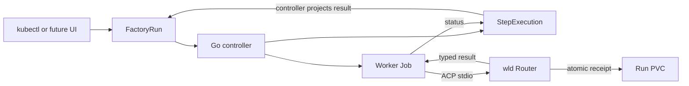

# RunWield Factory: Router recipes

This Go module runs an input-only Router loop on Kubernetes. It uses the normal `wld --mode acp` server and a
versioned ACP extension. It does not start the workflow selected by the Router.



The Kubernetes API is the consumer API. The controller owns `FactoryRun.status`; the worker can read and patch
only its named `StepExecution` and status. Specs are immutable. Use a new run for changed input. The controller
serializes active runs for the same Project ID in its namespace. A tenant namespace can admit multiple registered Projects.

## Run on the Mac

Requires an ARM64 Mac, Bun (the deployment script selects the version from the root `.bun-version`), Go **1.27.3**, Lima, and kubectl. The deployment uses a Linux VM with four CPUs,
8 GiB RAM, and a 40 GiB disk. Podman builds the image inside that VM; k3s uses its own containerd. There is no Docker
Desktop dependency. Verified with Lima 2.3.0 and k3s v1.37.2+k3s1.

From the repository root:

```sh
brew install lima kubectl
git submodule update --init third_party/plannotator skills
bash factory/deploy-mac.sh
export KUBECONFIG="$HOME/.lima/runwield-factory/copied-from-guest/kubeconfig.yaml"
./scripts/with-bun.sh factory/configure-auth.ts openai
project_id="$(./scripts/with-bun.sh factory/project.ts --print-id)"
sed "s/PROJECT_ID/$project_id/" factory/examples/router.yaml | kubectl apply -f -
kubectl -n runwield-personal wait factoryrun/router-demo --for=condition=Completed --timeout=180s
kubectl -n runwield-personal get factoryrun router-demo -o jsonpath='{.status.result}'
```

`configure-auth.ts` copies only the selected provider's saved credential from `~/.wld/auth.json` into a Kubernetes
Secret; it does not print credentials. A second positional argument selects a different auth file. Set the model
in the run to an available direct Pi provider/model. The image contains the checkout's compiled `wld`, not the
installed desktop release. Builds and deployment do not change the default kubeconfig context.

Deployment registers the checkout selected by `FACTORY_PROJECT_ROOT` (default: the repository containing the deploy script) through `@runwield/projects` and checks that its registration is active. It stores that ID in an immutable `factory-project-<id>` ConfigMap in the namespace.
To admit another checkout, run `FACTORY_PROJECT_ROOT=/path/to/checkout ./scripts/with-bun.sh factory/project.ts` with the same Kubernetes context. The controller rejects new submissions for unregistered IDs before creating work. If a binding disappears during an admitted run, reconciliation waits for its restoration and reuses the original execution and PVC.
The ACP handler verifies the provisioned ID and its launch directory before accessing receipts, running the model, or publishing to GitHub. A worker’s scratch directory can move between runs without changing Project identity.

The VM can be stopped with `limactl stop runwield-factory` and started with `limactl start runwield-factory`.
Stopping it interrupts the whole host environment and is outside the tested process/pod recovery guarantee.
Re-running `deploy-mac.sh` builds and imports the new image and restarts the controller. The `dev` tag is for local
iteration; use immutable image digests for a managed deployment.

## GitHub triage recipes

The personal setup installs one named wake schedule per namespace. Running setup for a second Project in the same namespace replaces that schedule. Manual runs and named batches can use any provisioned Project.

Two opinionated recipes call the same `wld` Router and post its triage as an issue comment:

- **Batch:** freeze the oldest ten eligible open issues labeled `test` in one `GitHubTriage` admission. Fewer than
  ten is valid, including zero. The batch runs sequentially for its Project ID.
- **Next:** an hourly Kubernetes CronJob creates one wake. It admits at most one oldest eligible issue, or records
  a no-op if the project has unfinished work or no eligible issue. It does not build a growing backlog.

Both exclude pull requests, issues labeled `status:in-progress`, and issues already claimed by either recipe. An
assignee alone does not mark work active. Other external work conventions can be expressed with `excludeLabels` in
the recipe. Completed claims remain excluded even if the issue stays open and retains `test`.

After deploying the controller, from the registered project's checkout:

```sh
export KUBECONFIG="$HOME/.lima/runwield-factory/copied-from-guest/kubeconfig.yaml"
./scripts/with-bun.sh factory/configure-github.ts RunWield/runwield
kubectl -n runwield-personal get githubtriages,factoryruns,cronjobs
kubectl -n runwield-personal get githubtriage github-test-first-ten -o yaml
```

Setup verifies the checkout’s active registration and the corresponding namespace binding, pins GitHub's numeric
repository ID, provisions the current `gh` user credential as `factory-github-auth`, and installs both recipes. It
waits for the controller to mount the credential before admission. The token needs issue read/write access to the
chosen repository. It is never included in recipe manifests, prompts, status, or console output. For this personal slice the
selected user token may carry broader permissions; repository-scoped credentials and production identity enforcement
remain separate work. GitHub App installation tokens and enterprise API origins are not supported yet.

The generated declarative recipes are saved to `.ci-cache/factory-github-recipes.json`. They can be reviewed and
applied with kubectl; the only API required for recipe clients is Kubernetes. `factory/github-recipes.ts` defines the
two deployable recipes. Configure `FACTORY_SCHEDULE` (default `0 * * * *`, UTC), `FACTORY_MODEL`, `FACTORY_IMAGE`,
`FACTORY_NAMESPACE`, `FACTORY_BATCH_NAME`, `FACTORY_PROJECT_ROOT`, or `FACTORY_RECIPES_OUTPUT` before setup. Reapplying
the same batch name resumes its existing selection; a new name starts a new batch. Existing intake specs are immutable.
Change the next-wake configuration through its ConfigMap; already admitted work retains its original settings.

To wake immediately or pause the standing recipe:

```sh
kubectl -n runwield-personal create job triage-manual-001 --from=cronjob/github-test-triage
kubectl -n runwield-personal patch cronjob github-test-triage --type=merge -p '{"spec":{"suspend":true}}'
```

The wake job carries no GitHub/model credentials and can only create/get `GitHubTriage` objects. Job retries use the
same deterministic admission name. The controller durably seals selected issue IDs before creating child runs and
pins each run by repository ID plus issue ID. Retained intake selections and FactoryRuns are the admission history;
there is no separate queue or generic transition engine. Deleting an intake does not delete its runs. Deleting both
intake history and a run deliberately discards that issue's deduplication history.

Each FactoryRun snapshots only `Title: …` and `Body: …` as Router input when that issue is admitted. Issue comments,
repository code, labels, and metadata are not model input. The destination is separately bound by stable repository
and issue IDs. `triage_report` triggers Core's deterministic publication transition. Core saves the triage, then the
comment intent, then the GitHub receipt. The comment contains routing intent, complexity, and summary, with an
operation marker. `FactoryRun.status.result.publication` exposes its ID and URL; a batch completes only after all
requested comments have receipts.

After an uncertain GitHub POST, retries reconcile the authenticated author's exact marker and body through paginated
comments. They do not rerun the model or blindly post again. If no matching comment can be found after an uncertain
write, the run stays recoverable and pending; this slice cannot automatically resolve that ambiguity. GitHub does not
provide this publisher with an idempotency key. Definite rejected writes can retry after the prerequisite is repaired.
API rate backoff is persisted across controller/worker restarts. No exactly-once external-delivery guarantee is claimed.

The local tests cover a ten-issue batch, pagination, excluded work and PRs, interrupted admission, duplicate wakes,
shared claims, no-op selection, durable rate backoff, and publication with lost acknowledgements. Live Mac k3s
qualification also completed a two-issue batch (#631,
#632) and two sequential wakes
(#633, #634).
A worker was force-deleted after admission during both the batch and the final wake. Replacement workers kept their
operation IDs, and all four issues had exactly one triage comment. A subsequent wake selected nothing while the issues
remained open and labeled. The first batch needed a stale model credential refreshed from the desktop; the final wake
recovered automatically with current credentials. These checks cover death before the routing result is saved;
lost acknowledgement during POST remains covered by network-boundary tests. The owner requested deletion of all four
test issues on 2026-11-18; the saved local evidence retains the observed comments and run identities.

## Contract

`FactoryRun.spec` has `projectId`, `loop: router`, `input.prompt`, and a required explicit `model`. Prompt input is
limited to 70,000 characters. The worker uses a private empty working directory; no repository is cloned. Its only model-visible
tool is `triage_report`, preventing file/shell access to mounted credentials. Shared memory is not connected yet.

During ACP initialization the worker requires:

```json
{ "agentCapabilities": { "_meta": { "dev.runwield/factory": { "version": 1, "loops": ["router"] } } } }
```

It calls `_dev.runwield/factory/execute` with:

```json
{
    "version": 1,
    "operationId": "<FactoryRun UID>:router",
    "projectId": "<stable Project ID>",
    "loop": "router",
    "cwd": "/data/workspace",
    "model": "openai/gpt-6.1-sol",
    "input": { "prompt": "Explain Pods versus Deployments; information only." }
}
```

The response repeats version and identity, with `phase: Completed` and a typed `result` containing
`routingIntent`, `complexity`, `summary`, and optional `classification`, `workKind`, and `sessionName`. The worker
validates identity and outcome before publishing status. ACP turn completion or arbitrary prose cannot complete a run.

Core owns [Router execution and receipts](../docs/prd/runwield-core-prd.md#factory-router-execution);
the [ACP PRD](../docs/prd/runwield-acp-protocol-prd.md#factory-router-operations) owns wire compatibility.

## Recovery and scope

Each run has a PVC for private HOME and working storage. `wld` locks the operation, saves admitted inputs before
reasoning, and atomically saves the typed receipt before replying. Identical retries replay a committed result.
Changed inputs for an admitted operation are rejected. If reasoning is interrupted before the receipt, it runs
again. This is safe for an input-only Router; it is **not** Pi Durable model checkpointing or a contract for replaying
implementation effects. The GitHub routing-comment publisher has its own durable intent and receipt, described below. Later loops must implement their own durable state and effect reconciliation.

Jobs replace failed pods and processes. The controller recreates an exhausted Job with the same operation ID and
volume, keeping errors recoverable. A model attempt has a ten-minute timeout. Fix credentials/configuration or
inspect logs when retries persist; retry budgets do not falsely mark routing complete. Completed runs and volumes
remain for inspection. Deleting a FactoryRun as an administrator garbage-collects its Job, execution, roles, and PVC.
The default local storage reclaim policy also removes its data; deletion is deliberate disposal, not recovery.

The worker preserves refreshed model credentials in its private HOME. Updating the source Secret replaces those
credentials on the next attempt; unchanged Secrets do not overwrite a refresh. Refreshed credentials are not copied
back to the desktop or shared Secret. Shared credential ownership remains a later prerequisite.

Only one trusted personal tenant is qualified. The controller is namespace-scoped and uses leader election. Client
roles start unbound. Worker roles cannot list Secrets, access another execution, or write FactoryRun status. Pods
run without root, with dropped capabilities and a read-only root filesystem. Network policy denies inbound traffic
and permits DNS plus HTTPS/API egress; it is not an external destination allowlist. The controller can create pods
that mount namespace Secrets and is therefore a trusted tenant operator.

Not yet implemented: tenant identity enforcement in `wld`, shared credential refresh/brokering, repository checkout
and confined discovery, cross-run Mnemoteca, workflow composition, human decisions, implementation/PR publication loops,
Pi Durable integration, artifact storage, cancellation, quotas/retention, or UI. Prompt and executable versions are
not pinned in receipts, so an interrupted retry after an upgrade can reason differently. Host/power/disk failure and
cross-node storage failover are outside scope.

## Validation and other clusters

```sh
(cd factory && go test ./...)
./scripts/with-bun.sh scripts/run-tests.ts src/acp/factory-router.test.ts src/acp/server.test.ts src/acp/protocol-smoke.test.ts
./scripts/with-bun.sh factory/smoke.ts
```

The live smoke script consumes model calls. It creates run records, kills the `wld` process, deletes a worker pod,
restarts the controller, verifies that replacement workers complete the original operation, and checks worker RBAC.
It retains those records as evidence. It requires administrator permissions for fault injection and impersonation.
`FACTORY_MODEL` overrides the model; `FACTORY_NAMESPACE` selects the namespace for smoke and credential provisioning.

`./scripts/with-bun.sh factory/github-smoke.ts` runs the GitHub qualification against the installed recipes. It creates four clearly
marked `test` issues and real comments, temporarily suspends the CronJob, kills an admitted batch worker, checks
replacement identity and one comment per issue, runs sequential wakes, and restores the prior schedule. It retains
the issues, Kubernetes objects, and `.ci-cache/factory-github-live.json` evidence. `FACTORY_EVIDENCE` selects another
receipt file; a completed evidence file refuses another run. The script refuses unrelated unclaimed `test` issues.
Provision current model credentials with `./scripts/with-bun.sh factory/configure-auth.ts openai` before qualification: the Kubernetes
Secret is a snapshot of the desktop credential, not a shared OAuth-refresh service. The harness waits for newly
created issues to appear in GitHub's list endpoint before admission; a create acknowledgement alone is insufficient.

For Linux k8s, GKE, or EKS, build the two binaries for the node architecture, build/push `Containerfile` to your
registry, install the CRDs, and adapt the tenant manifest's namespace, image, provider Secret, storage class, and
network policy. With the target namespace selected, run `FACTORY_NAMESPACE=<namespace> ./scripts/with-bun.sh factory/project.ts` from the registered checkout to provision its binding. A default dynamically provisioned RWO storage class is required. The manifests do not use hostPath,
Lima APIs, gVisor, or Agent Substrate. Only the Mac k3s deployment has been exercised so far.

Sources: [ACP extensions](https://agentclientprotocol.com/protocol/v1/extensibility),
[K3s installation](https://docs.k3s.io/quick-start), [Lima](https://lima-vm.io/docs/installation/),
[controller reconciliation](https://book.kubebuilder.io/cronjob-tutorial/controller-overview).
